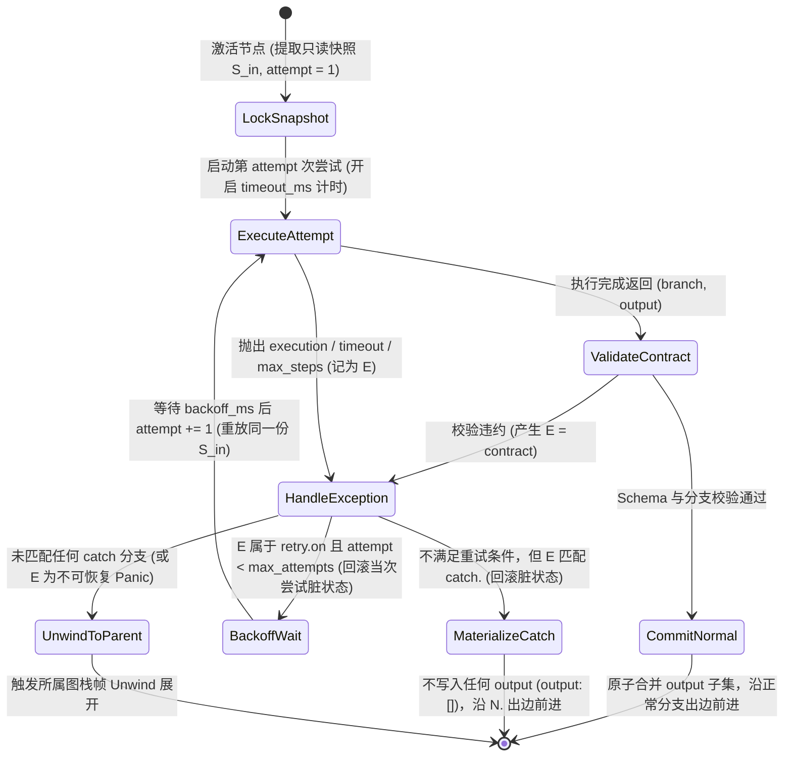

# 04. 三级异常体系、`retry` / `catch` / `fail` 状态机与栈展开

本规范定义运行时异常的分类、节点内原地重试与边界捕获状态机，以及未捕获异常的跨栈帧展开（Stack Unwinding）与协同取消协议。

---

## 一、 异常分类与捕获权限表

| 异常类别 | 标识符 / 异常名 | 产生源 | 是否允许被 `retry` / `catch` 拦截 |
| :--- | :--- | :--- | :--- |
| **可恢复运行时异常** | `execution` | `run` 执行器运行故障，或子图主动走向 `-> fail` | **允许** |
| **可恢复运行时异常** | `timeout` | 单次尝试耗时超出节点 `timeout_ms` | **允许** |
| **可恢复运行时异常** | `contract` | 节点返回的 `output` 违反 `TypeSpec` 或返回非法 `branch` | **允许** |
| **可恢复运行时异常** | `max_steps` | 内联 `graph` 或 `use` 子工作流超出其 `graph.max_steps` | **允许**（仅在包裹该子图的父节点边界） |
| **不可恢复引擎 Panic** | `StackOverflowError` | 调用栈深度 $d > \text{MAX\_CALL\_DEPTH}$ | **禁止拦截**（直接穿透终止） |
| **不可恢复引擎 Panic** | `MaxStepsExceededError` | 根工作流（Root Graph）自身超出 `max_steps` | **禁止拦截**（直接穿透终止） |
| **不可恢复引擎 Panic** | `CancelledError` | 外部宿主取消信号、并发兄弟分支 Fail-Fast 协同取消，或图栈帧 `max_steps` 超限时的在途并发任务取消 | **禁止拦截**（直接穿透终止） |

> **内建算子无运行时可恢复异常**：内建算子（`use: builtin:<op>`）属于引擎内部纯确定性同步求值原语，其输出类型契约与合法分支在编译期已完全静态锁定，且禁止挂载 `timeout_ms`、`retry` 与 `catch`。因此在运行期，内建算子**永不产生可恢复运行时异常**（`execution` / `timeout` / `contract` / `max_steps`）；其运行期求值语义详见 [`05-builtin-operational-semantics.md`](./05-builtin-operational-semantics.md)。

---

## 二、 节点级执行、重试与捕获状态机（Node Execution State Machine）

对于任意非内建节点 $N$（若挂载了 `for_each`，则针对单次元素迭代独立运行本状态机）：

### `catch` 分支匹配规则

* 节点的 `catch` 声明中，各分支的显式选择器集合两两互斥，且最多有一个分支声明通配符 `"*"`（代表差集 $\{ \texttt{execution}, \texttt{timeout}, \texttt{contract}, \texttt{max\_steps} \} \setminus \bigcup \text{ExplicitSelectors}$）。
* 当可恢复异常 $E$ 从重试控制器逃逸时，若存在分支 $c \in \text{dom}(N.\text{catch})$ 使得 $E \in \text{Selectors}(c)$，则异常被消费，控制令牌以空输出（$\Delta = \emptyset$）转入异常出边 $N.c$。

---

## 三、 `-> fail` 终态与未捕获异常栈展开（Stack Unwinding & Fail-Fast Cancellation）

### 1. 主动到达 `-> fail` 终态
当图 $G$ 内的控制令牌沿边 `src -> fail` 到达 `fail` 终态时，引擎立即停止图 $G$ 的后续调度，构造一个未捕获的可恢复异常 $E = \texttt{execution}$，并直接转入下文第 2 小节的栈展开协议统一处理。

### 2. 未捕获异常的协同取消与跨帧冒泡
当图栈帧 $F_G$ 产生未捕获异常 $E$——包括主动到达 `-> fail` 终态（$E = \texttt{execution}$）、图内节点（或并发分支 / `for_each` 迭代）抛出未被局部 `catch` 拦截的异常，或图 $G$ 自身触发 $\text{steps}(F_G) > G.\text{max\_steps}$ 步数超限（子图产生 $E = \texttt{max\_steps}$，根图产生不可恢复的 `MaxStepsExceededError`）——引擎按以下三步协议有序执行栈展开：

1. **在途并发任务 Fail-Fast 协同取消**：
   * 若出错点位于 Fork-Join 并发组 `[W_1, ..., W_k]` 或并发 `for_each` 内部，或图栈帧 $F_G$ 下仍存在尚未完成的在途并发分支、迭代及子栈帧，协调器立即向其广播不可捕获的 `CancelledError`（触发底层执行器 `abort_signal`）并等待其全部退出，同时丢弃已暂存的全部并发缓冲槽位。
2. **当前图栈帧销毁与回滚**：
   * 销毁当前图栈帧 $F_G$，丢弃其全部局部变量修改，不向父栈帧提交任何输出。
3. **跨栈帧向父边界传播**：
   * 若 $G$ 为子图，将异常 $E$（保留其原始选择器类型 `execution` / `timeout` / `contract` / `max_steps`，或透传不可恢复 Panic）传递至父栈帧中调用该子图的 `InlineGraphNode` 或 `CallNode` 边界，进入父节点的 `retry` / `catch` 状态机处理；
   * 若 $G$ 为根图（Root Graph），整个工作流立即以未捕获异常 $E$ 失败终止。
