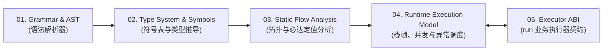

# Axcutor 语言与运行时形式化规范（Specification）

本目录（`spec/`）是 Axcutor 工作流 DSL 编译器/静态检查器（Static Validator）、运行时调度引擎（Runtime Scheduler）与业务执行器（Executors）的**权威实现规范（Single Source of Truth）**。

任何符合标准的 Axcutor 实现，必须在编译期静态检查阶段与运行期状态机调度阶段严格满足本规范定义的全部公理、类型决议算法、数据流方程与异常展开语义。

---

## 规范模块架构（对应引擎五大核心子系统）

### 1. [语法结构与抽象语法树规范（`01-grammar-and-ast/`）](/spec/01-grammar-and-ast/01-document-and-node-grammar)
* [01-document-and-node-grammar.md](/spec/01-grammar-and-ast/01-document-and-node-grammar)：文档根契约、三类节点（`run` / `use` / `graph`）形态鉴别与字段合法性判定
* [02-binding-and-projection-grammar.md](/spec/01-grammar-and-ast/02-binding-and-projection-grammar)：`with` 参数绑定解析规则、`{ value }` 常量字面量消歧与静态字段路径词法语法
* [03-edge-and-cfg-grammar.md](/spec/01-grammar-and-ast/03-edge-and-cfg-grammar)：6 种控制边表达式语法解析与 Fork-Join 三元边 AST 构造

### 2. [静态类型系统与符号表决议规范（`02-type-system-and-symbols/`）](/spec/02-type-system-and-symbols/01-typespec-well-formedness)
* [01-typespec-well-formedness.md](/spec/02-type-system-and-symbols/01-typespec-well-formedness)：`TypeSpec` 良构性公理（闭合性约束、`TypedDict` 与 `OrderedMap` 互斥铁律）
* [02-type-equivalence-and-compatibility.md](/spec/02-type-system-and-symbols/02-type-equivalence-and-compatibility)：静态类型结构化等价判定算法与字面量 Schema 实例兼容性校验算法
* [03-two-phase-symbol-resolution.md](/spec/02-type-system-and-symbols/03-two-phase-symbol-resolution)：图级静态符号表两阶段汇总算法、同帧同名同类型铁律与内联 `graph` 输出推导
* [04-static-field-projection-typing.md](/spec/02-type-system-and-symbols/04-static-field-projection-typing)：静态字段路径投影 $E = v_0.f_1\dots f_k$ 的编译期类型推导与非空穿透检查
* [05-builtin-generic-inference.md](/spec/02-type-system-and-symbols/05-builtin-generic-inference)：5 个 `builtin:*` 算子的编译期泛型类型推导规则与静态约束检验

### 3. [控制流拓扑与静态数据流分析规范（`03-static-flow-analysis/`）](/spec/03-static-flow-analysis/01-cfg-topology-and-sese-validation)
* [01-cfg-topology-and-sese-validation.md](/spec/03-static-flow-analysis/01-cfg-topology-and-sese-validation)：单令牌确定性出边穷尽检查、并发分支 SESE 限制与死代码/死环可达性定理
* [02-scoping-and-collision-rules.md](/spec/03-static-flow-analysis/02-scoping-and-collision-rules)：宿主输入与 `graph.variables` 初值互斥检查、局部帧注入名无冲突检查
* [03-branch-sensitive-definite-assignment.md](/spec/03-static-flow-analysis/03-branch-sensitive-definite-assignment)：全路径分支敏感必达定值分析（$Def_{in}$ / $Def_{out}$ 传递方程与不动点求解）
* [04-concurrent-disjoint-write-analysis.md](/spec/03-static-flow-analysis/04-concurrent-disjoint-write-analysis)：Fork-Join 并发组与 `for_each` 三通道写集合两两互斥（Disjoint Write）检查

### 4. [运行时状态机、内存模型与异常展开规范（`04-runtime-execution-model/`）](/spec/04-runtime-execution-model/01-frame-memory-model)
* [01-frame-memory-model.md](/spec/04-runtime-execution-model/01-frame-memory-model)：`Function Frame` / `Block Frame` / `Iteration Frame` 生命周期与最小权限只读快照注入
* [02-fork-join-and-for-each-scheduler.md](/spec/04-runtime-execution-model/02-fork-join-and-for-each-scheduler)：Fork 快照锁定、Join 屏障原子提交、`for_each` 并发度控制与三通道汇聚状态机
* [03-guardrails-and-step-accounting.md](/spec/04-runtime-execution-model/03-guardrails-and-step-accounting)：`max_steps` 精确计步公式、`max_call_depth` 调用树深度追踪与单次尝试（Per-Attempt）计时器
* [04-exception-handling-and-unwinding.md](/spec/04-runtime-execution-model/04-exception-handling-and-unwinding)：三级错误模型、`retry` 快照重放状态机、`catch` 分支物化、`fail` 回滚与 Fail-Fast 协同取消

### 5. [业务执行器（`run`）接口契约与扩展规范（`05-executor-abi/`）](/spec/05-executor-abi/01-run-executor-contract)
* [01-run-executor-contract.md](/spec/05-executor-abi/01-run-executor-contract)：`run` 执行器标准调用协议（输入快照载荷、输出与分支契约校验、异常映射与多执行器扩展准则）
