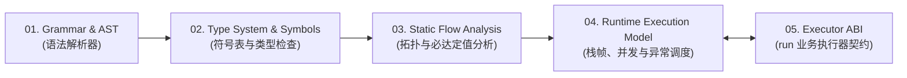

# Axcutor 语言与运行时形式化规范（Specification）

本目录（`spec/`）定义 Axcutor 工作流 DSL 编译器/静态检查器（Static Validator）、运行时调度引擎（Runtime Scheduler）与业务执行器（Executors）的实现规范（Single Source of Truth）。

符合标准的 Axcutor 实现应在编译期静态检查阶段与运行期状态机调度阶段满足本规范定义的全部文法约束、类型决议算法、数据流方程与异常展开语义。

---

## 编译器与运行时五阶段流水线架构

---

## 五大子系统职责与核心不变式

各子系统按编译期（阶段 01 ~ 03）与运行期（阶段 04 ~ 05）划分职责边界（详细算法与公理请通过左侧目录查阅）：

| 子系统模块 | 执行阶段 | 输入表示 | 核心校验/调度职责与形式化不变式 |
| :--- | :--- | :--- | :--- |
| **01. 语法结构与 AST** | 编译期（语法分析） | 原始 YAML / JSON 文本 | 验证 `RootNode` 与三类 `InnerNode`（`run` / `graph` / `use`）互斥鉴别字段；完成 `with.input` 四态字面量消歧、静态字段路径词法校验以及 6 种控制边的 EBNF 解析与 `BranchSpec` 消糖。 |
| **02. 静态类型与符号表** | 编译期（类型检查） | 规范化 AST | 校验 `TypeSpec` 闭合良构性（`TypedDict` 与 `OrderedMap` 互斥）；按**单遍显式符号收集算法（Single-Pass Explicit Symbol Resolution）**构建每张图的符号表 $\Sigma_G$ 与 `for_each` 单次迭代局部符号表 $\Sigma_{\text{iter}}(M)$，强制变量先声明后使用（Declaration-Before-Use）与同帧同名同类型不变式（$T_1 \equiv T_2$）；基于**静态子类型偏序（$T_1 <: T_2$）与不可变容器结构化协变**，完成静态字段路径投影（含非必填叶子字段可空提升）、跨工作流传参、16 个 `builtin:*` 算子与 `for_each` 一阶同构集合类型提升（$\text{Lift}(T_{\text{src}}, U) <: \Sigma_G(v_{\text{out}})$）的静态类型检查。 |
| **03. 拓扑与静态数据流** | 编译期（静态分析） | 带类型标注的 CFG | 验证单令牌出边穷尽且唯一、并发组 SESE 限制与全图双向可达性（无死代码与死环）；验证宿主输入与 `graph.variables` 声明互斥；求解前向必达定值最大不动点 $Def_{\text{in}}^*(X)$；校验并发写集合两两互斥（$OutVars(W_i) \cap OutVars(W_j) = \emptyset$）。 |
| **04. 运行时状态机模型** | 运行期（图调度引擎） | 已通过静态校验的 CFG | 管理 `FunctionFrame`、`BlockFrame` 与 `IterationFrame` 的物理隔离内存表 $\rho$；执行 Fork 快照锁定、Join 屏障原子提交与 `for_each` 保序槽位汇聚；维护 `max_steps`、`max_call_depth` 与单次尝试 `timeout_ms` 计时器；驱动 `retry` 重放、`catch` 分支物化、`-> fail` 回滚与并发 Fail-Fast 协同取消。 |
| **05. 执行器标准 ABI** | 运行期（I/O 边界） | 最小权限只读输入快照 | 向底层 `run` 执行器传递 `input_snapshot`、目标 `output_schema`、规范化 `branches_contract` 与 `abort_signal`; 在返回边界校验分支合法性与 `output` JSON Schema，并将故障或违约映射为标准 `execution` 或 `contract` 异常。 |
