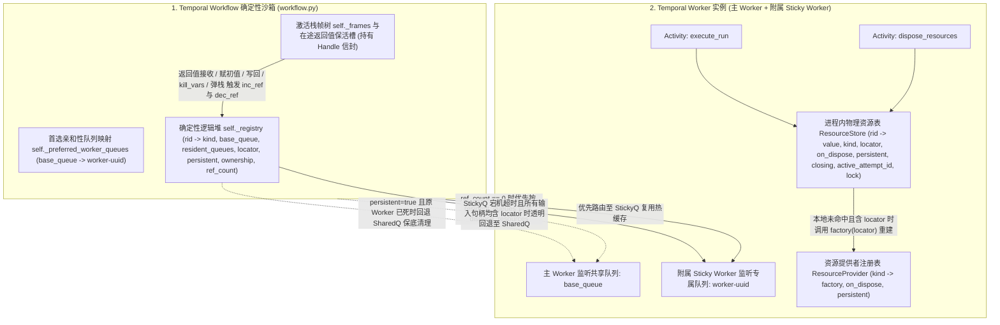
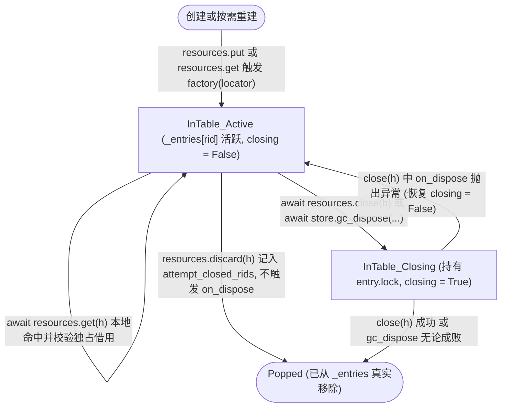

# RFC-0013: 不透明名义句柄类型（`handle`）、可恢复资源工厂（`locator`）、确定性引用计数逻辑堆与 Sticky Worker 物理资源存储规范

* **状态**：Proposed
* **所属分类**：类型系统扩展、静态并发流分析、运行时内存模型与跨 Activity 资源生命周期管理（Type System Extension, Static Concurrency Analysis, Runtime Heap & Resource Lifecycle）
* **前置关联提案**：
  * [`RFC-0009: 静态结构化子类型偏序（<:）与容器协变规范`](./0009-static-subtyping-and-covariance.md)
  * [`RFC-0011: Axcutor 编译器前后端与 Temporal 运行时参考实现架构`](./0011-compiler-and-temporal-runtime-architecture.md)
  * [`RFC-0012: 结构化 run 执行器分派机制、移除自然语言变量正则提取与 builtin 可信 Python 执行器规范`](./0012-run-executor-and-builtin-python.md)
  * [`RFC-0014: 基于预置 Python 模块引用的 module 执行器、__axcutor__.yaml 包同构布局与契约模板 SHA 校验规范`](./0014-module-python-executor.md)
  * [`RFC-0015: 统一工作流包（Package）寻址、显式根包挂载与私有可见性规范`](./0015-unified-package-and-import-system.md)
* **核心解决的问题**：
  1. **在不破坏纯值语义与闭合类型系统的前提下统一表达三类外部资源实体**：将 **纯内存瞬态资源**（如数据库事务 `postgres.tx`）、**可恢复进程缓存资源**（如数据库连接 `postgres.conn`、有状态会话 `agent.session`）与 **可恢复外部持久化临时资源**（如 S3 临时文件 `s3.temp_file`）统一建模为第 7 类基础类型构造器 **`type: handle`**（携带名义层级标识 `kind` 与可选独占修饰符 `exclusive?: boolean`），避免发明 `graph.resources` 或 `graph.sessions` 等冗余顶层语法块；
  2. **通过“单一 `on_dispose(value)` 析构钩子 + 可选 `factory(locator)` 恢复工厂 + `persistent` 标志”统一三类资源的故障恢复与清理语义**：
     * 对无 `locator` 的 **纯内存瞬态资源（数据库事务）**：强绑定创建它的 Sticky Worker 内存，Worker 崩溃时内存丢失即事务丢失，节点快速失败（Fail-fast）交由外层事务子图重试；
     * 对携带 `locator` 且 `persistent: false` 的 **可恢复进程缓存资源（数据库连接）**：原 Worker 存活时优先 Sticky 路由复用热连接；原 Worker 崩溃或跨 Worker 汇聚时，在任意存活 Worker 上通过 `factory(locator)` 透明重建连接继续业务；引用归零时仅在仍缓存该连接的存活 Worker 上执行 `on_dispose(value)`；
     * 对携带 `locator` 且 `persistent: true` 的 **可恢复外部持久化临时资源（S3 临时文件）**：既支持跨 Worker 通过 `factory(locator)` 恢复对象继续业务，又保证当原 Worker 崩溃后引用计数归零时，自动回退至共享主队列 `base_queue`，由任意存活 Worker 先调用 `factory(locator)` 恢复出对象 `value`、再调用同一个 `noexcept` 的 `on_dispose(value)` 删除外部临时文件，实现 100% 零泄漏；
  3. **编译期静态并发互斥分析 + 运行期 Attempt 级独占借用检测双层防护**：扩展静态流分析（Pass 3/4），禁止含有 `exclusive: true` 句柄的外层变量被 `concurrency > 1` 的 `for_each` 节点捕获，或被同一 Fork-Join 并发组的多个并行分支同时读取（同时允许并发 `for_each` 合法遍历由不同独立独占句柄组成的集合）；在子类型偏序中支持非独占向独占单调兼容（$\text{Exclusive}(T_1) \implies \text{Exclusive}(T_2)$）；并在 Worker `ResourceStore` 中维护运行期 Attempt 级独占借用锁，100% 兜底拦截通过容器重复元素（`[tx, tx]`）或 `builtin:assign` 变量别名绕过静态检查的并发访问；
  4. **建立“栈帧 `Handle` 信封 + 运行时全局 `Registry` 逻辑堆 + Worker 进程内 `ResourceStore` 物理表”的分层架构**：在 Temporal 确定性 Workflow 沙箱中维护零外部 DB 依赖的引用计数逻辑堆（`self._registry`），在 Worker 进程内维护持有真实 Python 对象、`ResourceProvider` 注册表与 `on_dispose` 析构钩子的无墓碑 `ResourceStore`；
  5. **实现双层防泄漏回收闭环（Attempt 级孤儿清理 + 栈帧引用计数归零 `dispose_resources`）、悬垂导出契约拦截与显式/被动析构解耦协议，并与 `builtin`（RFC-0012）及 `module`（RFC-0014/0015）执行器深度对齐**：严格维持被动回收 `gc_dispose` 作为编程语言级无异常（`noexcept`）析构函数的定位，同时通过 `ContextVar` 注入与契约模板生成让 `builtin` 和 `module` 执行器共享完全一致的 `resources` 与 `Handle` 编程体验。

---

## 一、 背景与设计动机

### 1.1 闭合纯值类型系统面对外部实体时的三类典型资源与特征矩阵

在现有规范中，`TypeSpec` 仅包含 6 种内联 JSON 值类型（`string`, `integer`, `number`, `boolean`, `array`, `object`）。然而在实际业务工作流中，节点之间往往需要传递无法或不适合直接内联为普通 JSON 数据的外部资源实体。按 **跨进程可恢复性（Recoverability）** 与 **持久化副作用范围（Persistence Scope）** 划分，外部资源可分为三类典型形态：

| 维度 | 1. 数据库事务 (`postgres.tx`) | 2. 数据库连接 / 会话 (`postgres.conn`) | 3. S3 上的临时文件 (`s3.temp_file`) | *(附) S3 持久文件 (`s3.file`)* |
| :--- | :--- | :--- | :--- | :--- |
| **本质特征** | **纯内存瞬态绑定（Volatile / Ephemeral）** | **可恢复 + 进程内缓存（Reconstructible + Process-Cached）** | **可恢复 + 外部持久化清理（Reconstructible + Persistent External）** | **可恢复 + 无清理副作用** |
| **可序列化定位符 `locator`** | **无**（`locator = null`；状态绑定在特定 Worker 内存与未提交的 TCP 事务上下文中） | **有**（如 DSN 配置名、连接参数、Session ID） | **有**（如 `{"bucket": "tmp", "key": "job-1/part.parquet"}`） | **有**（同左） |
| **恢复工厂 `factory(locator)`** | **无**（不可在其他 Worker 上恢复） | **有**（根据 `locator` 建立并返回新连接 `conn`） | **有**（根据 `locator` 构造轻量 `S3File` 访问对象） | **有**（同左） |
| **单一析构钩子 `on_dispose(value)`** | `await tx.rollback()`；`await conn.close()` | `await conn.close()` | `await s3_file.delete()`（若有本地流/缓存也在此一并关闭） | `None`（或仅关闭本地流） |
| **原 Worker 存活时的调度与销毁** | 强制路由回原 Worker 复用 `(conn, tx)`；销毁时在原 Worker 上调 `on_dispose(value)` | **优先 Sticky 路由回原 Worker** 复用内存热连接；销毁时在缓存了该连接的存活 Worker 上调 `on_dispose(conn)` | 优先路由回原 Worker；销毁时在原 Worker 上调 `on_dispose(s3_file)` 删除 S3 对象 | 任意或优先原 Worker |
| **原 Worker 崩溃 / 跨 Worker 汇聚时的业务连续性** | **不可恢复**：随 Worker 崩溃内存丢失即彻底丢失，节点必须快速失败（Fail-fast），交由外层包裹整个事务的子图重试 | **透明恢复继续业务**：后续节点回退至存活的新 Worker，在 `await resources.get(h)` 时通过 `factory(locator)` 自动重建连接并缓存，业务无感继续 | **透明恢复继续业务**：任意存活 Worker 在 `await resources.get(h)` 时通过 `factory(locator)` 恢复 `S3File` 访问对象，业务无感继续 | **透明恢复继续业务** |
| **原 Worker 崩溃时的被动析构（`gc_dispose`）** | 原 Worker 已死，OS 已断开 TCP 连接、DB 已自动回滚事务，**无需在其他 Worker 执行** | 原 Worker 已死，其内存连接已随进程消亡断开；若无其他存活 Worker 缓存该连接，**绝不** 为了关连接而在新 Worker 上专门 `factory` 新建连接再关掉（`persistent: false`） | 原 Worker 虽死，但 **S3 上的临时文件仍在**！自动回退至共享队列 `base_queue`，由任意存活 Worker **先调 `factory(locator)` 恢复出 `s3_file`，再调同一个 `on_dispose(s3_file)`** 完成清理（`persistent: true`） | 无需外部删除（`persistent: false`） |

### 1.2 为什么统一收敛为单一的 `type: handle` 与单一的 `on_dispose(value)` 析构函数？

1. **YAML 类型系统层面的高度同构（单一 `type: handle`）**：
   无论底层资源是数据库事务、数据库连接还是 S3 临时文件，在工作流控制流与静态分析视角下具有完全相同的本质：
   * **栈帧内表示同构**：在控制流栈帧 $\rho$ 中均表现为指向带外实体的轻量级不透明引用信封（Opaque Handle Envelope）；
   * **类型检查与并发安全同构**：静态类型兼容均基于 **名义类型标签（`kind`）的层级前缀匹配**，并发重入安全性均由 **`exclusive?: boolean`** 刻画；
   * **构造安全与生命周期同构**：均禁止在 YAML 中用非空字面量凭空伪造，且均遵循基于作用域可达性的确定性引用计数析构（RAII / Reference Counting）。
   至于某个句柄在运行期是否携带 `locator` 可跨 Worker 重建、是否设置 `persistent: true` 需要跨 Worker 保底清理，属于 **Python 资源提供者（`ResourceProvider`）与运行期信封属性**，无需污染 YAML 静态类型声明。

2. **运行期析构语义的高度内聚（单一 `on_dispose(value)` 无异常析构函数）**：
   不需要将析构拆分为“本地关闭（`local_close`）”与“外部清理（`external_dispose`）”两套钩子：
   * 既然可恢复资源本身就具备 `factory(locator) -> value`，那么当持有 `s3.temp_file` 的原 Worker 崩溃后，存活的新 Worker 只需 **先调用同一个 `factory(locator)` 恢复出 `value` 对象，再调用同一个 `on_dispose(value)` 钩子**，即可完成 S3 临时文件的删除；
   * 同时，所有由引用计数归零或孤儿回收被动触发的 `on_dispose(value)`，均严格保持编程语言中 **不可向控制流抛错（`noexcept`）的析构函数** 定位（等同于 Rust `Drop`、C++ `~T() noexcept`、Python `__del__`），绝不破坏 `builtin:*` 纯算子零异常不变量，也绝不在异常栈展开期间掩盖原始业务主异常。

---

## 二、 类型系统与静态并发检查规范（`axcutor-core`）

### 2.1 `TypeSpec` 良构性公理扩展

在基础非空类型集合 $\mathcal{B}$ 中新增 `"handle"`：

$$
\mathcal{B} = \{\texttt{"string"}, \texttt{"integer"}, \texttt{"number"}, \texttt{"boolean"}, \texttt{"array"}, \texttt{"object"}, \mathbf{\texttt{"handle"}}\}
$$

当基础类型 $b = \texttt{"handle"}$（含 `type: "handle"` 或显式可空 `type: ["handle", "null"]`）时，必须满足以下构造器约束：

1. **必填字段 `kind: KindIdentifier`**：
   * `kind` 必须为非空点分层级标识符，满足正则 `^[a-zA-Z_][a-zA-Z0-9_]*(\.[a-zA-Z_][a-zA-Z0-9_]*)*$`（例如 `"postgres.tx"`、`"postgres.conn"`、`"s3.temp_file"`、`"file.image.png"`）；
   * 在 `TypeSpec::parse` 与运行期 `ResourceContext.put(kind, ...)` 中，校验方式统一为 `!kind.is_empty() && kind.split('.').all(ast::identifier)`（使用纯标识符规则 `ast::identifier`，不适用排除 Python 关键字的 `ast::control_id`）。
2. **可选字段 `exclusive?: Boolean`（默认 `false`）**：
   * 当 `exclusive: true` 时，表示该句柄指向 **不可并发重入的独占状态资源**（如数据库事务 `postgres.tx`、单连接会话 `postgres.conn`、有状态 `agent.session`）；
   * 当 `exclusive: false` 或省略时，表示该句柄指向 **可安全并发共享读取的资源**（如 S3 临时文件 `s3.temp_file`、不可变文件 `file.image.png`、线程安全连接池）；
   * 在 AST 规范化阶段（`TypeSpec::to_value`），唯一规范形态为：**当且仅当 `exclusive == true` 时显式输出 `"exclusive": true`，当 `exclusive == false` 时一律省略 `"exclusive"` 字段**。
3. **可选字段 `description?: String`**；
4. **禁止字段**：禁止出现 `enum`、`items`、`properties`、`required`、`additionalProperties`。
5. **容器自由组合、算子支持边界与禁止字段投影**：
   * `handle` 类型允许作为 `array.items`、`TypedDict.properties.<f>` 或 `OrderedMap.additionalProperties` 的元素/字段类型，也允许被 `builtin:unwrap`、`builtin:assign`、`builtin:array_append`、`builtin:map_set` 等多态算子透明流转；
   * **允许等值比较（`builtin:compare` 的 `eq` / `ne`）**：`handle`（及含 `handle` 的容器）允许参与 `builtin:compare (op: eq | ne)`，用于判断可空句柄是否为 `null` 或判断两个子类型兼容的句柄变量是否指向同一底层资源 ID（`"$handle"`）；
   * **禁止字段投影与标量/有序算子**：`handle` 为原子不透明类型，禁止对其执行 `.field` 静态字段路径投影，禁止传入 `builtin:math`、`builtin:logic`、`builtin:switch` 以及 `builtin:compare` 的有序比较（`lt`/`lte`/`gt`/`gte`）。

```yaml
# 1. 独占瞬态资源句柄（数据库事务，禁止并发共享读取）
db_tx:
  type: handle
  kind: postgres.tx
  exclusive: true

# 2. 独占可恢复资源句柄（单连接数据库会话，禁止并发共享读取，但支持 Worker 宕机后按 locator 重建连接）
db_conn:
  type: handle
  kind: postgres.conn
  exclusive: true

# 3. 共享可恢复资源句柄（S3 临时文件，默认 exclusive: false，允许 Fork-Join 与并发 for_each 跨 Worker 共享）
temp_dataset:
  type: handle
  kind: s3.temp_file
```

### 2.2 名义等价与层级前缀子类型偏序（$T_1 <: T_2$）

在 `crates/axcutor-core/src/ast/typespec.rs` 中扩展 `TypeKind::Handle { kind: String, exclusive: bool }`：

1. **静态等价**（$T_1 \equiv T_2$）：
   当 $T_1, T_2$ 均为 `handle` 时：

   $$
   T_1 \equiv T_2 \iff \text{Nullable}(T_1) = \text{Nullable}(T_2) \;\land\; T_1.\text{kind} = T_2.\text{kind} \;\land\; T_1.\text{exclusive} = T_2.\text{exclusive}
   $$

2. **静态子类型偏序**（$T_1 <: T_2$）：
   当 $T_1, T_2$ 均为 `handle` 且满足可空性单调提升公理（$\text{Nullable}(T_1) \implies \text{Nullable}(T_2)$）时，$T_1 <: T_2$ 当且仅当同时满足以下两条公理：
   * **独占性单调提升（Exclusivity Monotonicity，非独占兼容于独占）**：

     $$
     T_1.\text{exclusive} \implies T_2.\text{exclusive}
     $$

     （即：非独占句柄 `exclusive: false` 可安全作为独占句柄 `exclusive: true` 的子类型传入受限串行上下文使用；但独占句柄 `exclusive: true` **严禁** 赋给非独占目标类型 `exclusive: false`，防止独占句柄被拓宽后逃逸进入并发分支。同时由 $(\text{Exclusive}(T_1) \implies \text{Exclusive}(T_2)) \land (\text{Exclusive}(T_2) \implies \text{Exclusive}(T_1)) \iff \text{Exclusive}(T_1) = \text{Exclusive}(T_2)$，偏序集反对称性 $T_1 \equiv T_2 \iff T_1 <: T_2 \land T_2 <: T_1$ 严格保持。）
   * **`kind` 满足点分组件前缀包含（Segment Prefix）**：

     $$
     T_1.\text{kind} = T_2.\text{kind} \;\lor\; T_1.\text{kind}\text{.starts\_with}(\text{concat}(T_2.\text{kind}, \texttt{"."}))
     $$

   * 例如：`s3.temp_file.parquet (exclusive: false) <: s3.temp_file (exclusive: false) <: s3 (exclusive: true)`；注意 `"s3_extra"` 不是 `"s3"` 的子类型。

### 2.3 独占资源句柄（`exclusive: true`）的静态结构化并发互斥分析

为防止同一独占资源（如单个数据库事务 `tx`、单连接 `conn` 或单个 `agent.session`）被多个并发协程同时操作导致底层协议错乱，编译器在静态分析阶段定义递归谓词 $\text{HasExclusive}(T)$：

$$
\text{HasExclusive}(T) = \begin{cases}
T.\text{exclusive} & \text{if } T \text{ is } \texttt{Handle} \\
\text{HasExclusive}(T.\text{items}) & \text{if } T \text{ is } \texttt{Array} \\
\text{HasExclusive}(T.\text{additionalProperties}) & \text{if } T \text{ is } \texttt{OrderedMap} \\
\exists f \in \text{dom}(T.\text{properties}),\; \text{HasExclusive}(T.\text{properties}[f]) & \text{if } T \text{ is } \texttt{TypedDict} \\
\texttt{false} & \text{otherwise}
\end{cases}
$$

编译器对 Axcutor 的两类结构化并发原语强制执行以下静态借用检查（注：静态检查针对词法外层变量共享；对于通过容器重复元素 `[tx, tx]` 或 `builtin:assign` 变量别名产生的同句柄并发重入，由第 3.4.1 节的运行期 Attempt 级独占借用锁兜底拦截）：

1. **禁止并发 `for_each`（`concurrency > 1`）捕获外层独占资源（但允许并发遍历元素本身为独占句柄的集合）**：
   * 当节点 $N$ 挂载了 `for_each` 且 **`for_each.concurrency > 1`** 时（注：`concurrency == 1` 为串行顺序迭代，允许安全使用外层独占资源）：
   * **允许 `item` 本身为独占句柄**：允许 `for_each.source` 的元素类型为 `exclusive: true` 的句柄（例如并发遍历由多个不同独立 `postgres.conn` 或 `agent.session` 组成的数组，每个迭代协程通过 `item` 独占操作各自的资源；若数组中含重复的同一句柄，由运行期独占借用锁拦截）；
   * **严禁节点 `body` 捕获任何含独占句柄的外层变量**：直接检查 **节点 `body` 自身声明的所有外层读取引用**（严禁仅因为某变量 $v$ 充当了 `for_each.source` 的根变量 $\text{RootVar}(N.\text{for\_each.source})$ 就豁免节点 `body` 对 $v$ 自身或其实体字段的直接读取；例如当 `source: ctx.items` 时，若节点 `body` 的 `input` 同时直接捕获了含独占句柄的 `ctx`，必须拦截）：
     * 对 `NodeBody::Run` 与 `NodeBody::Graph`：对任意 $v \in N.\text{body.input} \setminus \{\text{item}, \text{key}, \text{index}\}$，若 $\text{HasExclusive}(\Sigma_G(v)) = \texttt{true}$，编译期报诊断错误；
     * 对 `NodeBody::Workflow` 与 `NodeBody::Builtin`：对 `N.body.bindings.input` 中任意引用路径 $p$（其根变量 $\text{RootVar}(p) \notin \{\text{item}, \text{key}, \text{index}\}$），若其投影后的目标类型满足 $\text{HasExclusive}(\text{TypeOf}(\Sigma_G, p)) = \texttt{true}$，编译期报诊断错误。
2. **禁止 Fork-Join 并发组的多条分支同时读取同一独占资源变量**：
   * 在 Pass 4 校验 Fork-Join 并发边 `src -[W_1, W_2, ..., W_k]-> join_target` 时，除检查写集合两两正交 $OutVars(W_i) \cap OutVars(W_j) = \emptyset$ 外，额外检查各分支读取的含独占句柄变量交集 $Use_{\text{excl}}(W_i) \cap Use_{\text{excl}}(W_j)$：
   * 对分支 $W_i$，若 $W_i$ 为 `Run` / `Graph`（或挂载了 `for_each`），其读取的根变量 $v$ 在 $\text{HasExclusive}(\Sigma_G(v)) = \texttt{true}$ 时记入 $Use_{\text{excl}}(W_i)$；若 $W_i$ 为 `Workflow` / `Builtin`，其输入路径 $p$ 在投影后类型满足 $\text{HasExclusive}(\text{TypeOf}(\Sigma_G, p)) = \texttt{true}$ 时将 $\text{RootVar}(p)$ 记入 $Use_{\text{excl}}(W_i)$（注：若仅通过 `FieldPath` 投影读取了 `TypedDict` 中的非独占标量字段如 `order_ctx.order_id`，由于 `eval_arg` 在进入子工作流/内置算子前已提取出纯标量值，不视为借用独占句柄）；
   * 对任意 $1 \le i < j \le k$，必须满足：

     $$
     Use_{\text{excl}}(W_i) \cap Use_{\text{excl}}(W_j) = \emptyset
     $$

   * 若存在 $v \in Use_{\text{excl}}(W_i) \cap Use_{\text{excl}}(W_j)$（即两个并行分支同时借用了同一个含独占句柄的变量 $v$），编译期直接拒绝（独占句柄在同一个 Fork-Join 并发组中至多只能被其中一个分支独占使用）。

### 2.4 编译期字面量不可伪造性与运行期信封校验分离

`handle` 类型区分 **编译期源码字面量校验（`TypeSpec::accepts_literal`）** 与 **运行期传输信封校验（`TypeSpec::accepts_runtime`）**：

1. **编译期源码字面量校验（`accepts_literal`）**：
   * 在编译期所有常量字面量校验点——包括：
     1. `check.rs` 中 `graph.variables.<v>.default` 的默认字面量校验；
     2. `check.rs` 中 `argument()` 对 `use.with.input.<p>` 及内置算子常量参数 `ArgValue::Const` 的校验；
     3. `builtins.rs` 中 `equality()` 对常量比较操作数的校验；
     4. `builtins.rs` 中 `object_merge()` 当 `base` 为常量对象 `{ value: {...} }` 时的校验——
     统一调用 `accepts_literal`：
     * 若 `TypeSpec` 为 `handle`（或容器内部递归包含非空 `handle`），**唯一合法的句柄字面量为 `null`**（且仅当 $\text{Nullable}(T) = \texttt{true}$ 时允许）；
     * 任何非 `null` 的 JSON 对象或字符串在编译期一律拒绝，防止在 YAML 源码中硬编码伪造句柄。
2. **运行期 ABI 信封校验（`accepts_runtime`）**：
   * 在运行期边界（`kernel/mod.rs` 中的 `validate_input` 与 `validate_run_contract`）统一调用 `accepts_runtime`，其中 `handle` 值的标准 JSON 传输信封格式为闭合 JSON 对象：
     ```json
     // 形态 A：纯内存瞬态句柄（如 postgres.tx，无 locator）
     {
       "$handle": "res_018f...",
       "kind": "postgres.tx",
       "worker_queue": "axcutor-worker-a1b2c3"
     }

     // 形态 B：可恢复句柄（如 postgres.conn 或 s3.temp_file，含非 null 的 locator 与可选 persistent）
     {
       "$handle": "res_018f...",
       "kind": "s3.temp_file",
       "worker_queue": "axcutor-worker-a1b2c3",
       "locator": {
         "bucket": "axcutor-tmp",
         "key": "wf-123/part-0.parquet"
       },
       "persistent": true
     }
     ```
   * **信封字段规范与校验规则**：
     * **必填键**：`"$handle"`（非空字符串，全局唯一资源 ID）、`"kind"`（非空字符串，满足目标 `TypeSpec.kind` 的点分前缀子类型关系）、`"worker_queue"`（非空字符串，创建或最近驻留该资源的 Sticky Worker 队列名）；
     * **可选键**：
       * `"locator"`：任意合法 JSON 值（省略或为 `null` 时表示该句柄为不可跨进程恢复的纯内存瞬态资源；非 `null` 时表示可通过 `factory(locator)` 重建的可恢复资源，且 `locator` 内部不得嵌套包含 `"$handle"` 信封）；
       * `"persistent"`：布尔值（默认 `false`；仅当 `"locator"` 非 `null` 时允许为 `true`，表示即使所有缓存该资源的 Worker 均已崩溃，仍须在存活 Worker 上通过 `factory(locator)` 重建并执行 `on_dispose`）；
     * **闭合约束**：除 `{"$handle", "kind", "worker_queue", "locator", "persistent"}` 外严禁出现任何其他键。
   * **与用户 `TypedDict` 的零冲突性定理**：由于 DSL 规范要求 `TypedDict` 的所有属性名必须为合法 `Identifier`（首字符为 `[a-zA-Z_]`，禁止包含美元符号），任何合法的用户 `TypedDict` 实例均不可能包含 `"$handle"` 键。因此，任意 JSON 树中的句柄信封可通过 `"$handle" in obj` 在 $O(1)$ 时间内无歧义地识别；同时在 `builtin:compare (op: eq | ne)` 中，两个句柄信封的相等性定义为比较其 `"$handle"` 字符串是否相等（忽略迁移后可能变化的 `"worker_queue"`）。

---

## 三、 运行时架构：统一资源提供者（`ResourceProvider`）、逻辑堆（`Registry`）与 Sticky Worker 物理存储（`ResourceStore`）

在 Temporal 架构下，Workflow 协程运行在确定性沙箱中（支持随时重放重建状态），而真实的数据库连接、事务、S3 文件句柄和 Agent 会话对象驻留在 Worker 进程的 Activity 执行环境中。为此，Axcutor 采用 **逻辑生命周期与物理对象存储分离、Sticky 亲和性优先与 `locator` 跨 Worker 透明恢复相结合** 的架构：



### 3.1 统一资源提供者（`ResourceProvider`）与三种资源注册模式

为使单一的 `on_dispose(value)` 析构模型同时覆盖 **数据库事务**、**数据库连接** 与 **S3 临时文件**，在 `python/axcutor_runtime/src/axcutor_runtime/resources.py` 中定义 `ResourceProvider`：

```python
@dataclass(frozen=True)
class ResourceProvider(Generic[L, V]):
    """可跨 Worker 寻址的可恢复资源提供者定义。"""

    kind: str
    factory: Callable[[L], V | Awaitable[V]]
    on_dispose: Callable[[V], Any | Awaitable[Any]] | None = None
    persistent: bool = False
```

* **`kind: str`**：该 Provider 绑定的资源类型名（满足 `KindIdentifier`，如 `"postgres.conn"`、`"s3.temp_file"`）；
* **`factory(locator) -> V | Awaitable[V]`**：接收 JSON 反序列化后的只读 `locator`（深拷贝隔离），在当前 Worker 上构造或恢复底层物理 Python 对象 `value`；
* **`on_dispose(value) -> Any | Awaitable[Any]`**：**唯一的析构钩子**，接收 `value` 对象本身（无论该 `value` 是最初在当前 Worker 上创建的，还是由 `factory(locator)` 在当前 Worker 上重建出来的）；
* **`persistent: bool = False`**：
  * 当 `persistent == False`（默认，如数据库连接 `postgres.conn`）：表示资源的生命周期附着于 **进程内的连接/状态实例**。原 Worker 崩溃后，后续业务节点可在新 Worker 上通过 `factory(locator)` 重建连接继续运行；但当引用计数归零进入被动回收时，仅需在当前实际缓存了该连接实例的存活 Worker 上执行 `on_dispose(value)`——若持有它的 Worker 已经崩溃，连接已随进程消亡断开，**绝不在新 Worker 上为了执行 `on_dispose` 而调用 `factory(locator)` 白白新建一条连接再立即关闭**；
  * 当 `persistent == True`（如 S3 临时文件 `s3.temp_file`）：表示资源的生命周期附着于 **外部持久化存储实体**，原 Worker 进程崩溃并不会使 S3 上的临时文件消失。当引用计数归零进入被动回收时，若所有曾缓存该对象的 Sticky Worker 均已崩溃失联，Workflow 必须将回收请求回退投递至共享主队列 `base_queue`，由任意存活 Worker **先调用 `factory(locator)` 恢复出 `value`，再调用 `on_dispose(value)`** 完成外部临时文件清理。

#### 3.1.1 Provider 的跨 Worker 寻址与注册机制（结合 RFC-0014 与 RFC-0015）

由于当 Worker 1 崩溃或并发分发至 Worker 2 时，Worker 2 无法访问 Worker 1 内存中的匿名 `lambda` 闭包，可恢复资源的 `ResourceProvider` 通过以下两种方式在集群各 Worker 间保持一致寻址：

1. **宿主 Worker 级显式注册表（`create_worker` / `RunActivities`）**：
   * 在组装 Worker 时通过 `create_worker(client, task_queue, resource_providers=[...])` 显式传入 `ResourceProvider` 序列（按 `provider.kind` 唯一索引，重复注册同名 `kind` 在启动期直接报错）；适用于全局基础设施级资源（如 `"postgres.conn"`、`"s3.temp_file"`）。
2. **基于 RFC-0015 统一工作流包的模块内声明与按需加载**：
   * 在 [`RFC-0015`](./0015-unified-package-and-import-system.md) 确立的显式根包挂载体系下，若某个可恢复资源归属于特定工作流包（如 `billing.s3_temp`），允许将该包的 `ResourceProvider` 定义在对应的 Python 包模块内并在宿主挂载时自动汇聚注册，确保多 Worker 进程拥有完全一致的 `kind -> ResourceProvider` 映射表。

#### 3.1.2 `resources.put(...)` 的统一创建接口

注入到执行环境的 `ResourceContext.put` 同时支持 **纯内存瞬态资源** 与 **基于 `locator` 的可恢复资源**：

```python
class ResourceContext:
    async def put(
        self,
        kind: str,
        value: Any = _OMITTED,
        *,
        locator: Any = None,
        on_dispose: Callable[[Any], Any | Awaitable[Any]] | None = None,
        persistent: bool | None = None,
    ) -> Handle[Any]:
        ...
```

1. **模式 A：纯内存瞬态资源（`locator is None`，如数据库事务 `postgres.tx`）**：
   * 必须显式传入 `value`（不可省略），禁止设置 `persistent=True`；
   * 直接在当前 Worker 的 `ResourceStore._entries[rid]` 中存入 `(value, on_dispose)`，返回 `"locator": None, "persistent": False` 的 `Handle`；
   * 示例：
     ```python
     conn = await asyncpg.connect(dsn)
     tx = conn.transaction()
     await tx.start()

     async def _rollback_and_close(pair: tuple[Any, Any]) -> None:
         c, t = pair
         try:
             await t.rollback()
         finally:
             await c.close()

     tx_handle = await resources.put("postgres.tx", (conn, tx), on_dispose=_rollback_and_close)
     ```
2. **模式 B：可恢复资源（`locator is not None`，如数据库连接 `postgres.conn` 或 S3 临时文件 `s3.temp_file`）**：
   * 根据 `kind` 从当前 Worker 的 `ResourceStore` 注册表中查找已注册的 `ResourceProvider`（若未注册对应的 `ResourceProvider`，立即抛出 `LookupError(f"no ResourceProvider registered for kind {kind!r}")`）；
   * 若调用方省略了 `value`（如 `await resources.put("postgres.conn", locator={"dsn": "main"})`）：立即在当前 Worker 上调用 `value = await provider.factory(deepcopy(locator))` 构造初始物理实例；
   * 若调用方已显式传入构造好的 `value`（如节点刚生成并上传完 S3 临时文件后调用 `await resources.put("s3.temp_file", value=s3_obj, locator={"bucket": "b", "key": "k"})`）：直接复用传入的 `value` 存入当前 Worker 的 `ResourceStore._entries[rid]`，免去在原 Worker 上重复执行一次 `factory(locator)`；
   * 析构钩子与持久化标志默认继承自 `provider.on_dispose` 与 `provider.persistent`（不允许为可恢复资源传入与 `provider` 脱节的匿名 `on_dispose` 闭包，保证跨 Worker 重建后的析构行为与原 Worker 100% 一致）。

---

### 3.2 Worker 进程亲和性、Sticky 路由与跨 Worker 故障恢复协议

每个 Worker 在启动时（`create_worker`）与 Workflow 调度时遵循以下双队列亲和性与分级故障转移协议：

1. **Worker 专属队列标识（`worker_queue`）与双 `Worker` 协同装配**：
   * 每个持有 `ResourceStore` 的 Worker 进程分配一个唯一专属队列名 `worker_queue = f"{task_queue}-worker-{uuid4().hex}"`（其中前缀 `{task_queue}-worker-` 显式编码了该 Worker 所属的主共享队列名 `base_queue = task_queue`）；
   * 由于 `temporalio.worker.Worker` 单个实例仅绑定单个 `task_queue`，`create_worker` 内部封装 **主队列 `Worker`**（监听共享 `task_queue`，注册 `AxcutorInterpreterWorkflow` 与 `execute_run`、`dispose_resources`）与 **附属 Sticky `Worker`**（监听 `worker_queue`，共享同一个 `ResourceStore` 与 `RunActivities` 实例，注册 `execute_run` 与 `dispose_resources`），并在 `run()` / `__aenter__` / `__aexit__` 生命周期中协同启动与优雅关闭二者。
2. **Workflow 级首选 Sticky 队列（`self._preferred_worker_queues`）与 `execute_run` 分级路由规则**：
   * `AxcutorInterpreterWorkflow` 维护按主队列 `base_queue` 索引的首选 Sticky 队列映射 `self._preferred_worker_queues: dict[str, str]`（在启动 Child Workflow 时一并通过输入上下文继承）；
   * 在 `AxcutorInterpreterWorkflow._run_activity` 调度节点（设该节点 executor 对应的主共享队列为 `base_queue = options.task_queues.get(executor, default_task_queue)`）时，扫描当前节点 `input_snapshot` 中包含的所有 Handle 信封，并按 `locator is None` 将输入句柄划分为 **瞬态绑定句柄集** $H_{\text{pin}}$ 与 **可恢复句柄集** $H_{\text{rec}}$：
     * **情形 1：包含瞬态绑定句柄**（$H_{\text{pin}} \neq \emptyset$，如含有 `postgres.tx`）：
       * 提取 $H_{\text{pin}}$ 中所有句柄所属的 `worker_queue` 集合 $Q_{\text{pin}}$；
       * 若 $|Q_{\text{pin}}| > 1$（存在两个驻留于不同 Worker 内存且均不可恢复的瞬态句柄）：立即抛出可恢复的 **`execution`** 异常（跨 Worker 瞬态内存句柄冲突）；
       * 若 $Q_{\text{pin}} = \{w_{\text{pin}}\}$：**强制将 `execute_run` 路由至** $w_{\text{pin}}$（带短 `schedule_to_start_timeout`）。注意：即便此时 $H_{\text{rec}}$ 中还包含由其他 Worker 创建的可恢复句柄（如另一个并行分支生成的 `s3.temp_file` 或 `postgres.conn`），也 **绝不报错**——节点在 $w_{\text{pin}}$ 上运行时，会在 `await resources.get(h)` 时通过 `factory(locator)` 就地重建那些可恢复句柄！
       * 若发往 $w_{\text{pin}}$ 的 `execute_run` 触发 `schedule_to_start_timeout`：说明持有该内存事务的 Worker 已崩溃、内存状态已永久丢失，Workflow 清除失效的 `preferred_worker_queue` 绑定，并将超时映射为可恢复的 **`execution`** 异常，使外层包裹整个事务生命周期的子图可通过 `retry` 在存活的新 Worker 上重新开启事务。
     * **情形 2：仅包含可恢复句柄**（$H_{\text{pin}} = \emptyset \land H_{\text{rec}} \neq \emptyset$，如仅含 `postgres.conn` 和/或 `s3.temp_file`）：
       * **热缓存亲和性优先（Sticky-First）**：若当前 `self._preferred_worker_queues.get(base_queue)` 或 $H_{\text{rec}}$ 中句柄的已知驻留队列 `resident_queues` 存在存活候选队列 $w_{\text{sticky}}$，优先将 `execute_run` 路由至 $w_{\text{sticky}}$（带短 `schedule_to_start_timeout`），从而在原 Worker 存活时直接 $O(1)$ 命中内存中的数据库连接或文件对象，避免重复建连；
       * **Worker 崩溃透明故障转移（Transparent Failover & Rehydration）**：若发往 $w_{\text{sticky}}$ 的 `execute_run` 因该 Worker 崩溃下线而触发 **`schedule_to_start_timeout`**，由于当前节点所需的全部输入句柄均携带 `locator` 可在任意 Worker 上恢复，Workflow **绝不抛出异常中断业务**，而是：
         1. 自动将已死亡的 $w_{\text{sticky}}$ 从 `self._preferred_worker_queues` 及所有逻辑堆条目的 `resident_queues` 中剔除；
         2. **立即透明重投递 `execute_run` 至共享主队列 `base_queue`**；
         3. 存活的新 Worker $w_{\text{new}}$ 认领任务后，在业务代码调用 `await resources.get(h)` 时通过 `provider.factory(h.locator)` 透明恢复资源并缓存至 $w_{\text{new}}$ 的 `ResourceStore`；
         4. Activity 正常返回时携带 $w_{\text{new}}$ 的 `worker_queue` 与本次重建的 `rehydrated_rids`，Workflow 自动将 `self._preferred_worker_queues[base_queue]` 更新为 $w_{\text{new}}$ 并将 $w_{\text{new}}$ 记入对应句柄的 `resident_queues`，实现后续节点的无缝亲和性迁移！
     * **情形 3：无输入句柄**（$H_{\text{pin}} = \emptyset \land H_{\text{rec}} = \emptyset$）：
       * 若 `base_queue in self._preferred_worker_queues`：优先路由至 `self._preferred_worker_queues[base_queue]`；若触发 `schedule_to_start_timeout`，自动清除该失效绑定并立即透明回退投递至共享队列 `base_queue`；
       * 若尚未绑定首选队列：直接投递至共享队列 `base_queue`。

---

### 3.3 Workflow 侧：确定性引用计数逻辑堆（`self._registry`）与双路容错回收

在 `python/axcutor_runtime/src/axcutor_runtime/workflow.py` 的 `AxcutorInterpreterWorkflow` 中，维护逻辑堆表 `self._registry: dict[str, LogicalResourceEntry]`：

```python
@dataclass
class LogicalResourceEntry:
    resource_id: str
    kind: str
    base_queue: str
    resident_queues: list[str]         # 按活跃先后排序的、当前持有该 rid 内存缓存的 Sticky Worker 队列列表
    locator: Any = None                # 可序列化恢复定位符（None 表示不可跨进程恢复的纯内存瞬态资源）
    persistent: bool = False           # True 表示外部持久化临时资源，所有 resident_queues 崩溃后仍须回退 base_queue 清理
    ownership: Literal["borrowed", "owned"] = "owned"
    disposed: bool = False             # 若已在节点内通过 close/discard 显式终结则为 True
    ref_count: int = 0
```

逻辑堆完全由 Workflow 协程内的确定性事件驱动，在 Temporal 重放（Replay）期间按完全相同的顺序重建，**无需任何外部数据库**：

1. **句柄扫描器 `_iter_handles(value: Any) -> Iterator[JsonObject]`**：
   * 递归遍历任意 JSON 值（穿透 `list` 与普通 `dict`，但不进入句柄信封自身的 `"locator"` 字段内部）；凡遇到包含 `"$handle"` 键的字典，即产出该句柄信封。
   * 注意：若同一个 `Frame.env` 中的两个不同变量（或数组中的两个槽位）指向同一个 `resource_id`，按出现次数精确累计引用计数。
2. **所有权分类（`ownership`）、跨 Worker 缓存追踪与跨 Workflow Run（含 Child Workflow）边界**：
   * **`borrowed`（外部借入）**：在 `AxcutorInterpreterWorkflow.run()` 入口处（无论根工作流还是 `start_child_workflow` 启动的 Child Workflow），出现在初始 `input` 中的所有句柄，预先在当前 Workflow Run 的 `self._registry` 中注册为 `ownership="borrowed"`。当前 Workflow Run 在任何情况下 **绝不销毁** 其 `borrowed` 资源。
   * **`owned`（内部受管）**：当前 Workflow Run 运行期间由 `run` 节点或 Child Workflow 调用新产出（首次出现在 Activity / Child Workflow 返回值中且不在当前 `self._registry` 内）的句柄，注册为 `ownership="owned"`，初始 `resident_queues = [handle["worker_queue"]]`。
   * **跨 Worker 重建与显式关闭状态同步**：
     * 每当 `execute_run` Activity 在 Worker $w$ 上完成并返回元数据 `rehydrated_rids`（即本次在该 Worker 上通过 `factory(locator)` 重建并缓存了这些 `rid`）时，Workflow 将 $w$ 加入对应 `LogicalResourceEntry.resident_queues`；
     * 每当 `execute_run` Activity 返回元数据 `closed_rids`（即业务代码在本次 Attempt 中对这些 `rid` 成功执行了 `await resources.close(h)` 或 `resources.discard(h)`）时，Workflow 将对应条目的 `disposed = True` 置位，并从 `resident_queues` 中移除当前 Worker $w$（若某 `persistent == False` 的资源此前还在其他 Worker $w' \neq w$ 上缓存过本地连接副本，立即向 $w'$ 异步触发本地清理）。
   * **当前 Workflow Run 顶层正常导出豁免（`parent_id is None`）**：当 `AxcutorInterpreterWorkflow.run()` 的入口栈帧（`frame.parent_id is None`，涵盖根工作流 `call_depth == 1` 以及作为独立 Temporal Child Workflow 运行的子工作流 `call_depth > 1`）正常到达顶层 `end` / `end.<branch>` 返回最终 `result["output"]` 时，凡出现在最终 `result["output"]` 中的 `owned` 句柄，其所有权移交给上层调用方（在当前 Run 中标记为 `ownership="borrowed"` 豁免销毁）：
     * 若当前为 Child Workflow，父 Workflow 在 `await child` 收到返回结果时，将其中尚未在父 `self._registry` 中存在的句柄接管注册为父 Workflow 的 `ownership="owned"`（若已在父 `self._registry` 中存在，则合并 Child 运行期间新增的 `resident_queues`）；
     * 若当前为根工作流，所有权移交给外部宿主调用方。
3. **无真空期的在途返回值保活与栈帧引用计数协议（RC Protocol）**：
   * **Activity / Child Workflow 返回值落地即纳入逻辑堆（消除在途真空期）**：
     * 一旦 `_run_activity` 中的 `await workflow.execute_activity`（或 `_exec_call` 中的 `await child`）返回响应 `response`，在执行任何后续处理前，**立即** 对 `response.get("output")` 中的所有句柄在 `self._registry` 中注册并执行 `inc_ref`（作为在途返回值临时保活引用）；
     * 该临时保活引用由调用栈帧通过 `try ... finally` 托管：只有当返回值被正式绑定写入外层 `frame.env`（完成目标变量 `inc_ref`）或作为 `RootBody::Run` 顶层结果返回后，才在 `finally` 中释放该在途临时 `inc_ref`；
     * 因此，即便在 `_run_activity` 随后的 `_contract` 校验中失败、在 `for_each` / `fork_join`（`_owned_group`）中因兄弟分支失败或 `cancel_and_drain` 而丢弃了已完成的分支返回值、或者在 `NodeBody::Workflow` 的 `bindings["output"]` 中仅映射了子图/子工作流返回字段的子集（忽略了其余含句柄的字段），`finally` 中对原始返回值的配对 `dec_ref` 都会精确将未被接收句柄的 `ref_count` 减至 `0` 并立即回收，**绝无任何在途泄漏窗口**。
   * **栈帧创建（`_frame`）**：新栈帧 `frame.env` 拷贝建立时，对 `frame.env` 内的所有句柄执行 `inc_ref(handle)`（`ref_count += 1`）。
   * **边级抹除（`kill_vars`）**：在 `_exec_graph` 中执行 `frame.env.pop(name, None)` 时，对被移除旧值中的所有句柄执行 `dec_ref`，并立即 `await self._flush_disposals()`。
   * **节点输出写回（`frame.env.update`）**：当节点返回 `result["output"]` 合并入 `frame.env`（或 `for_each` / `fork_join` 屏障汇聚写回）时，**遵循“先 `inc_ref` 新值、再 `dec_ref` 被覆盖旧值、最后释放临时保活槽并 `await self._flush_disposals()`”的顺序**（防止同名变量自我赋值 `tx = tx` 时引用计数瞬间归零误触发销毁，同时确保循环内覆写的旧句柄在当步立即释放而不必等到退环）。
   * **栈帧退出与弹出（`_exec_graph` / `_exec_root` 的 `finally`）**：
     * 若栈帧正常返回 `return_output` 给父调用方：先对 `return_output` 中的句柄执行一次临时 `inc_ref`（移交调用方保活槽），然后对当前 `frame.env` 中的全部变量执行 `dec_ref` 销毁当前帧，待父栈帧接收映射完字段后再在父调用方的 `finally` 中释放该保活槽；
     * 若栈帧因 `-> fail`、未捕获异常或 `CancelledError` 异常展开（Unwind）：直接对当前 `frame.env` 中的全部句柄执行 `dec_ref`，并调用 `await self._flush_disposals()`。
4. **引用归零时的确定性异步清理（`_flush_disposals` 端到端 `noexcept` 与 `persistent` 共享队列保底协议）**：
   * 每当 `dec_ref` 导致某个 `ownership == "owned"` 的条目 `ref_count == 0` 时，将其从 `self._registry` 移除；若 `not entry.disposed`，将其加入待清理队列；
   * 在 `_flush_disposals` 中，使用 `asyncio.shield`（确保即使当前协程正处于 `CancelledError` 取消展开路径中，清理 Activity 仍能完整发往 Worker 完成回滚与外部临时文件删除）按条目属性执行分级清理，且 **全程包裹在 `try ... except exceptions.FailureError:` 块中，确保端到端 100% `noexcept`**：
     * **对 `persistent == False` 的资源（数据库事务 `postgres.tx`、数据库连接 `postgres.conn`）**：
       * 向 `entry.resident_queues` 中的每个 Sticky 队列并发调用 `dispose_resources(rids=[rid])`（带短 `schedule_to_start_timeout`）；
       * 存活的 Worker 在本地 `ResourceStore._entries` 中找到 `rid`，调用 `await on_dispose(value)` 关闭连接/回滚事务并移除条目；
       * 若某个 Sticky 队列因 Worker 已崩溃触发 `schedule_to_start_timeout`：说明该 Worker 进程内的内存事务或连接已被操作系统自动断开回收，直接吞没该超时错误，**绝不向共享队列发起重建**。
     * **对 `persistent == True` 的外部持久化临时资源（如 S3 临时文件 `s3.temp_file`）**：
       * S3 上的外部文件全局只有一份，其 `on_dispose(value)`（删除 S3 文件）只需在集群中成功调用一次，同时让所有曾缓存过该包装对象的存活 Worker 从 `_entries` 中摘除引用：
       * 若 `entry.resident_queues` 非空：向首选驻留队列 $w_0 = \text{entry.resident\_queues}[-1]$ 发送携带 `run_dispose: True` 的 `dispose_resources`（对其余驻留队列 $w_i \neq w_0$ 仅发送 `evict_only: True` 摘除内存条目）；
       * **Worker 崩溃时的共享队列保底回退（Fallback to Shared `base_queue`）**：若发往 $w_0$ 的 `dispose_resources` 触发了 `schedule_to_start_timeout`（或 `entry.resident_queues` 中所有 Sticky Worker 均已失联），Workflow **绝不放弃清理**，而是立即向 **主共享队列 `entry.base_queue`** 发起一次携带 `{"resource_id": rid, "kind": entry.kind, "locator": entry.locator, "rehydrate_for_dispose": True}` 的 `dispose_resources` Activity 调用！
       * 集群中 **任意存活的 Worker** 从共享队列 `base_queue` 认领该任务后，先调用 `value = await provider.factory(deepcopy(locator))` 恢复出 `S3File` 对象，随即调用同一个 `noexcept` 的 `await provider.on_dispose(value)` 删除 S3 临时文件！

---

### 3.4 Activity 与 Worker 侧：物理资源表（`ResourceStore`）、按需透明重建与显式/被动析构语义

在 `python/axcutor_runtime/src/axcutor_runtime/resources.py` 中实现进程内 `ResourceStore` 与通过 `ContextVar` 暴露的 `ResourceContext`：

```python
class ResourceContext:
    """注入到 builtin 与 module Python 执行器中的 `resources` 上下文对象。"""

    async def put(
        self,
        kind: str,
        value: Any = _OMITTED,
        *,
        locator: Any = None,
        on_dispose: Callable[[Any], Any | Awaitable[Any]] | None = None,
        persistent: bool | None = None,
    ) -> Handle[Any]:
        """注册一个瞬态或可恢复物理资源对象，返回可写入 Output 的强类型 Handle。"""
        ...

    async def get(self, handle: Handle[Any] | JsonObject) -> Any:
        """根据 Handle 解引用获取底层物理 Python 对象（唯一解引用入口）。
        若当前 Worker 本地未命中且 handle 含非空 locator，自动通过 ResourceProvider.factory(locator) 重建并缓存；
        若不存在且不可恢复、已被显式关闭/丢弃、正在关闭中或被另一并发独占借用，则抛 RuntimeError。
        """
        ...

    def discard(self, handle: Handle[Any] | JsonObject) -> None:
        """将该 Handle 从活跃物理表中直接移除（不触发 on_dispose，幂等且无返回值）；若正在关闭中则抛 RuntimeError。"""
        ...

    async def close(self, handle: Handle[Any] | JsonObject) -> None:
        """显式执行该 Handle 的 on_dispose 钩子（若本地未命中且 persistent=True 则先重建再执行）；
        仅当钩子成功完成时将其从活跃物理表中移除并标记已关闭（幂等）。
        """
        ...
```

#### 3.4.1 物理资源条目（`ResourceEntry`）的无墓碑状态机、按需重建与运行期独占借用保护

一旦某个资源通过 `discard`、`close` 或 `gc_dispose` 完成销毁，它就会 **直接从 `ResourceStore._entries` 字典中真实移除（`self._entries.pop(rid, None)`）**，不在 `ResourceStore` 中永久残留任何 `closed` 或 `removed` 墓碑对象（Tombstone），使底层 Python 对象得以立即被垃圾回收（单次 Activity Attempt 内部仅维护轻量级集合 `attempt_closed_rids: set[str]` 用于拦截同一 Attempt 内的悬垂导出与关后重读）。

驻留在 `_entries` 字典中的活跃条目 `ResourceEntry` 维护以下状态字段：

* **`closing: bool = False`** 与 **`lock: asyncio.Lock`**：保护异步 `factory(locator)` 初始化与 `await on_dispose(value)` 析构挂起期间的临界区；
* **`active_attempt_id: str | None = None`**：用于运行期独占借用检测（Runtime Exclusive Borrow Check），100% 兜底拦截通过容器重复元素（如 `tx_list = [tx, tx]` 配合 `for_each (concurrency: 2)`）或 `builtin:assign` 变量别名（如 `tx2 = tx` 配合 Fork-Join）绕过静态词法检查的并发重入访问。

```python
@dataclass
class ResourceEntry:
    resource_id: str
    kind: str
    value: Any
    locator: Any = None
    on_dispose: Callable[[Any], Any | Awaitable[Any]] | None = None
    persistent: bool = False
    closing: bool = False
    active_attempt_id: str | None = None
    lock: asyncio.Lock = field(default_factory=asyncio.Lock)
```



各操作在该状态机下的精确行为：

1. **`await get(handle) -> Any`（缓存命中、按需透明重建与运行期独占借用检测）**：
   * 若 `rid in attempt_closed_rids`（当前 Attempt 内已对该句柄调用过 `close` 或 `discard`）：立即抛出 `RuntimeError(f"resource handle has already been closed or discarded: {rid}")`（严禁对已关闭的可恢复句柄再次通过 `locator` 死灰复燃）；
   * **情况 A（当前 Worker 本地 `_entries` 命中 `entry`）**：
     * 若 `entry.closing == True`（正处于异步 `on_dispose` 挂起期间）：抛出 `RuntimeError(f"resource handle is currently closing: {rid}")`，防止并发协程读写半关闭状态的物理对象；
   * **情况 B（当前 Worker 本地 `_entries` 未命中 `rid`）**：
     * 若 `handle.locator is None`：说明该句柄是创建于其他 Worker 或已销毁的纯内存瞬态资源，抛出 `RuntimeError(f"unknown or already closed resource handle: {rid}")`；
     * 若 `handle.locator is not None`：获取该 `rid` 的进程内初始化锁 `async with self._get_init_lock(rid):`，二次检查 `self._entries.get(rid)`；若仍未命中，查找 `handle.kind` 对应的 `ResourceProvider`，调用 `value = await provider.factory(deepcopy(handle.locator))` 构造物理对象，写入 `self._entries[rid] = ResourceEntry(...)`，并将 `rid` 记入当前 Attempt 的 `rehydrated_rids` 集合（随 Activity 返回值上报给 Workflow 记录进 `resident_queues`）；
   * **运行期独占借用校验**：当当前 `execute_run` Attempt 的 `input_schema` 中声明该句柄（或其所属容器元素）为 `exclusive: true` 时（或当 `entry.active_attempt_id` 已被另一并发 Attempt 占用时）：
     * 若 `entry.active_attempt_id is not None and entry.active_attempt_id != current_attempt_id`，立即抛出 `RuntimeError(f"concurrent access to exclusive resource handle: {rid}")`（转化为可恢复的 `execution` 异常）；
     * 若该句柄处于独占上下文，将其 `entry.active_attempt_id = current_attempt_id` 绑定至当前 Attempt，并在当前 `execute_run` Attempt 的 `finally` 块结束时自动释放（重置为 `None`）；
   * 返回 `entry.value`。
2. **`discard(handle) -> None`**：
   * 若 `entry := self._entries.get(rid)` 存在且 `entry.closing == True`：抛出 `RuntimeError(f"cannot discard resource handle while it is closing: {rid}")`；
   * 执行 `self._entries.pop(rid, None)` 真实移除条目，并将 `rid` 记入当前 Attempt 的 `attempt_closed_rids`（若该句柄来自节点输入，随成功响应上报给 Workflow 标记 `disposed = True`），**幂等返回 `None`**。
3. **`await close(handle) -> None` 与 `await gc_dispose(items) -> None` 的重入同步**：
   * 对显式 `await close(handle)`：
     * 若 `rid in attempt_closed_rids`：幂等返回；
     * 若 `rid` 不在当前 Worker 的 `self._entries` 中：
       * 若 `handle.locator is not None and handle.persistent`（例如在未调用过 `get` 的新 Worker 节点上直接调用 `await resources.close(input.s3_file)`）：先通过 `provider.factory(deepcopy(handle.locator))` 构造出 `entry`；
       * 否则直接将 `rid` 记入 `attempt_closed_rids` 并幂等返回；
     * 获取 `async with entry.lock:`，置 `entry.closing = True` 并执行 `await on_dispose(entry.value)`：
       * 若 `on_dispose` 成功完成：执行 `self._entries.pop(rid, None)` 并记入 `attempt_closed_rids`；
       * 若 `on_dispose` 抛出异常：恢复 `entry.closing = False` 并保留在 `self._entries` 中，将异常向上抛出（支持节点级 `retry` 重试 `close`）。
   * 对被动 `await gc_dispose(items)`：
     * 针对每个待回收项 `item`（若 `item.get("rehydrate_for_dispose")` 为真且本地 `_entries` 未命中，则在 `try` 块内先通过 `provider.factory(deepcopy(item["locator"]))` 恢复出临时对象），在 `try ... except Exception: logger.exception(...) finally: self._entries.pop(rid, None)` 中执行 `on_dispose`，严格保证 **100% `noexcept`** 与无条件内存摘除。

#### 3.4.2 为什么提供无返回值的 `discard(handle) -> None` 而非 `pop(handle) -> Any`？

若提供同时兼具“取出对象”与“注销句柄”的 `pop(handle) -> Any`，用户在编写终结节点（如提交数据库事务的 `commit_tx` 节点）时，会自然写出“先 `conn, tx = resources.pop(input.tx)` 注销句柄、再执行 `await tx.commit()`”的危险序列。一旦 `await tx.commit()` 因网络抖动或锁冲突抛出异常：

1. **节点级重试（`retry`）失效**：由于句柄在第一次 Attempt 的前半段已被 `pop` 从 `ResourceStore` 中永久抹除，第二次重试 Attempt 调用 `resources.pop(input.tx)`（或 `get`）会直接报 `RuntimeError: unknown or already closed resource handle`；
2. **异常展开自动回滚失效**：若重试耗尽进入栈展开（Unwind），由于 `on_dispose` 已被提前注销，运行时自动触发的 `gc_dispose` 也无法回滚并关闭该连接，直接导致物理连接泄漏。

为此，`ResourceContext` 严格分离 **解引用（`await get`）** 与 **注销（`discard`）** 职责：

* **`await resources.get(handle) -> Any` 是获取底层物理对象的唯一入口**；
* **`resources.discard(handle) -> None` 不返回任何值**，强制引导用户在完成自定义终结动作（如 `await tx.commit()` 和 `await conn.close()`）**成功之后**，才调用 `resources.discard(input.tx)` 将条目从 `_entries` 中移除：

```python
# 标准事务提交范式：先 await get -> 再执行可能失败的 I/O -> 成功后最后 discard
conn, tx = await resources.get(input.tx)
await tx.commit()
await conn.close()
resources.discard(input.tx)
```

若 `await tx.commit()` 抛出异常，`input.tx` 仍完好保留在 `ResourceStore._entries` 中：无论该节点触发节点级 `retry` 重新尝试提交，还是失败后进入栈展开由运行时自动触发 `on_dispose` 执行 `rollback()`，均保持 100% 状态一致。

#### 3.4.3 显式关闭（`resources.close`）与被动垃圾回收（`store.gc_dispose`）的异常与生命周期协议

即使引入了可恢复数据库连接与 S3 临时文件，运行时依然严格维持“**显式 `close` 可抛错可重试、被动 `gc_dispose` 视为编程语言级 `noexcept` 析构函数**”的核心法则：

| 维度 | 显式关闭：`await resources.close(handle)` | 被动 GC 回收：`await store.gc_dispose(items)` |
| :--- | :--- | :--- |
| **定位与语义** | 普通命令式业务操作（如显式关闭连接、显式删除临时文件并校验结果） | **编程语言级 `noexcept` 析构函数（如 Rust `Drop` / C++ `~T() noexcept`）** |
| **触发时机** | 用户在 `run` 节点的业务代码中主动调用 | 1. **Attempt 级孤儿回收**：`execute_run` 的 `finally` 中回收未通过 `output` 导出的句柄；2. **栈帧级 RC 归零回收**：变量覆写、`kill_vars`、在途异常丢弃、子图正常退出或异常栈展开使 `ref_count == 0` 时，通过 `dispose_resources` Activity 触发。 |
| **`on_dispose` 成功时** | 执行 `self._entries.pop(rid, None)` 从字典中真实移除，并标记 `rid` 已显式关闭。 | 执行 `self._entries.pop(rid, None)` 从字典中真实移除。 |
| **`on_dispose` 抛异常时** | **恢复 `entry.closing = False` 并保留条目在 `ResourceStore._entries` 中**，同时将异常原样向上抛出给当前 `run` 节点。 | **在 `finally` 中无条件执行 `self._entries.pop(rid, None)` 从字典中真实移除**；Worker 捕获异常并记录结构化 `ERROR` 日志（`logger.exception`），**绝不向外抛出异常（`noexcept`）**。 |
| **Worker 崩溃时的回退行为** | 随所在 `run` 节点的重调度策略处理。 | 若 `persistent == False`：原 Worker 已死则连接已断，直接忽略；若 `persistent == True`：自动回退至共享队列 `base_queue`，由存活 Worker 通过 `factory(locator)` 恢复实例后调用同一个 `noexcept` 的 `on_dispose(value)`。 |

**为什么即使包含 S3 临时文件清理，被动回收 `store.gc_dispose` 依然必须严格定位为 `noexcept` 析构函数？**

1. **绝不击穿静态异常分析与无辜纯算子**：在 Axcutor 中，栈帧级 `ref_count == 0` 常由下游节点的变量覆写或边上的 `kill_vars`（含挂载在零可恢复异常的 `builtin:unwrap`、`builtin:assign` 边上的 `kill_vars`）以及子图到达 `-> end` 弹栈触发。在编译期静态分析（Pass 4）中，这些位置均为 **零可恢复异常点**——若被动析构向外抛错，会在无 `catch` 分支的位置直接击穿静态异常完备性不变量；
2. **绝不掩盖主异常（Double-Fault 防护）**：当节点因 `timeout`、`contract` 违约、业务 `execution` 报错或 `CancelledError` 取消而触发 Attempt 级孤儿回收或栈帧展开（Unwind）时，若清理 S3 临时文件或回滚连接顺带抛出的次生网络异常向外逃逸，将覆盖并篡改原始主异常类别，破坏外层 `catch` 分支路由与错误诊断；
3. **职责边界清晰**：若某次外部文件删除的成败本身属于核心业务契约（失败必须重试或走特定业务补偿分支），用户应在配置了 `retry` / `catch` 的业务节点中显式调用 `await resources.close(h)`；一旦交由作用域结束的 `gc_dispose` 兜底，它就是纯粹的资源析构器（Finalizer / Drop）。

#### 3.4.4 导出句柄存活契约校验与单次 Activity Attempt 级孤儿防漏机制（Attempt-Scoped Orphan Protection）

在 `RunActivities.execute_run` 中，存在两个必须在 Activity 边界闭环的关键问题：
1. **禁止导出已关闭/已丢弃的悬垂句柄（Dangling Handle Export Check）**：如果某个 `run` 节点在内部已经对句柄 `h` 调用了 `await resources.close(h)` 或 `resources.discard(h)`，随后却仍将该失效的 `h` 放入 `Output` 返回给下游，必须当场作为 **`contract` 异常（`ContractError`）** 拦截，严禁悬垂句柄流入工作流逻辑堆；
2. **孤儿句柄防漏**：如果某个 `run` 节点在代码前半段调用了 `await resources.put(...)` 开启了事务或创建了 S3 临时文件，但在返回前抛出了异常、超时、被取消，或者返回的 `Output` 未通过 `validate_run_contract` 校验（又或者该句柄未被选中的分支导出），此时该句柄尚未进入 Workflow 的逻辑堆 `self._registry`，必须在当前 Attempt 结束时立即就地调用 `on_dispose` 回收。

为此，`RunActivities.execute_run` 执行以下闭环流程：

1. 在每次 `execute_run` 启动时，初始化当前 Attempt 的上下文追踪集：`allocated_rids: set[str] = set()`、`rehydrated_rids: set[str] = set()` 与 `attempt_closed_rids: set[str] = set()`；
2. 每次调用 `resources.put(...)` 时，将新生成的 `rid` 记入 `allocated_rids`；
3. 当执行器返回结果并通过 `axcutor_core.validate_run_contract` 静态模式校验后：
   * 扫描 `response_json["output"]` 提取所有导出的句柄 ID 集合 `exported_rids`；
   * **存活契约校验**：逐一检查 `exported_rids` 中的每个 `rid`：
     * 若 `rid in attempt_closed_rids`（无论该句柄是否为含 `locator` 的可恢复句柄，只要已在本次 Attempt 中被显式 `close` 或 `discard`），立即抛出 `ContractError(f"cannot export closed or discarded resource handle: {rid}")`（归类为可恢复的 **`contract`** 异常）；
     * 若 `rid in allocated_rids`（或为纯内存瞬态句柄 `locator is None`），必须仍存活于 `store._entries` 中（且 `not entry.closing`），否则同样抛出 `ContractError`；
4. 在 `execute_run` 的 `finally` 块中，首先执行 `await cancel_and_drain(tasks)`、释放当前 Attempt 持有的独占借用锁，并 **在判定孤儿集合前同步执行取消状态检查（`if activity.is_cancelled(): signal._abort("cancelled")`）**：
   * 若本次 Attempt 正常通过了 `validate_run_contract` 与导出句柄存活契约校验，且 `not signal.aborted`（未超时、未取消）：立即通过 `await asyncio.shield(store.gc_dispose(allocated_rids - exported_rids))` 回收未导出的内部临时句柄（含未导出 S3 临时文件的就地删除）；
   * 若本次 Attempt 因报错、超时、取消（`signal.aborted`）或 `contract` 校验失败（含导出已关闭句柄）而中止：立即通过 `await asyncio.shield(store.gc_dispose(allocated_rids))` 回收本次 Attempt 分配的 **全部** 句柄；
   * 这一机制同时确保了当节点启用 Temporal 原生 Activity 重试（`native_retry`）或工作流级 `retry` 时，前几次失败 Attempt 创建的连接/事务/S3 临时文件会在当次 Attempt 结束时立即回滚或删除，绝不泄漏到下一次重试。
5. **Activity 成功返回前的进程级硬崩溃（Crash / `kill -9` / 掉电）边界说明**：
   * 当 `execute_run` 内部刚调用完 `resources.put(...)` 但尚未向 Temporal Server 返回 `Output` 时，若 Worker 进程发生直接硬崩溃（进程级 `finally` 无法执行，且句柄尚未移交至 Workflow 逻辑堆 `self._registry`）：
     * 对 **数据库事务（`postgres.tx`）与数据库连接（`postgres.conn`）**：进程消亡瞬间由操作系统内核自动断开 TCP Socket，数据库服务端检测到连接断开后自动回滚未提交事务并释放连接，天然 100% 无泄漏；
     * 对 **外部持久化临时资源（如 `s3.temp_file`）**：对于尚未离开 Activity 边界的外部存储写入副作用，工程上遵循两条标准准则：一是采用 **基于业务/节点上下文的确定性 `locator` Key（幂等覆盖写）**，使崩溃后的重试 Attempt 直接覆写同一目标路径并纳入逻辑堆受管；二是在对象存储临时前缀（如 `s3://bucket/tmp/`）上配置 **Bucket Lifecycle TTL 过期清理规则**，兜底进程硬崩溃且工作流彻底放弃重试时的极小概率未移交文件。

---

## 四、 `builtin`（RFC-0012）与 `module`（RFC-0014 / RFC-0015）执行器的强类型 `Handle` 与 `resources` 统一规范

结合 [`RFC-0012`](./0012-run-executor-and-builtin-python.md)、[`RFC-0014`](./0014-module-python-executor.md) 与 [`RFC-0015`](./0015-unified-package-and-import-system.md)，Axcutor 为内联 `builtin` 脚本与模块化 `module` 包提供 **100% 同构** 的 `Handle` 类型契约与 `resources` 访问方式：

### 4.1 基于 `ContextVar` 的全局 `axcutor_runtime.resources` 代理与公开导出

在 [`RFC-0014`](./0014-module-python-executor.md) 中，`executor: "module"` 节点的业务实现模块（如 `order_flow/charge_card.py`）是标准 Python 模块文件，其入口函数签名固定为 `async def execute(input: Input) -> ReturnType:`，不经过 `builtin` 执行器的 `exec()` 命名空间注入。

为此，`axcutor_runtime` 在顶层公开导出 `Handle`、`ResourceProvider` 与基于 `contextvars.ContextVar` 的上下文代理对象 `resources`：

```python
from axcutor_runtime import Handle, ResourceProvider, resources
```

* 在 `RunActivities.execute_run` 启动每次 Attempt 时，通过 `_current_resource_context.set(attempt_resource_ctx)` 将当前 Attempt 专属的 `ResourceContext` 绑定到当前异步任务上下文中，并在 `finally` 中 `reset`；
* **在 `module` 执行器中**：业务模块直接通过 `from axcutor_runtime import resources` 调用 `await resources.get(...)`、`await resources.put(...)`、`await resources.close(...)` 与 `resources.discard(...)`；
* **在 `builtin` 执行器中**：`_PRELUDE` 默认将 `resources` 与 `Handle` 注入模块顶层作用域，用户既可直接访问 `resources`，也可显式编写 `from axcutor_runtime import resources`。

### 4.2 契约模板（Contract Stub）中的强类型 `Handle` 代码生成与 SHA-256 指纹

在 `builtin.synthesize_module`（RFC-0012）与 `synthesize_contract_module`（RFC-0014 生成 `<node>_contract.py` / `_contract.py`）中，共享同一套 `Handle` 模型定义与类型映射规则：

1. **内置 `Handle` 泛型模型与校验器**：
   ```python
   _K = _ax_typing.TypeVar("_K", bound=str)

   class Handle(_FrozenModel, _ax_typing.Generic[_K]):
       model_config = _ax_pydantic.ConfigDict(
           extra="forbid", strict=True, frozen=True, populate_by_name=True
       )
       handle_id: StrictStr = _ax_pydantic.Field(alias="$handle")
       kind: _K
       worker_queue: StrictStr
       locator: _ax_typing.Any = None
       persistent: StrictBool = False
   ```
   * `_validate_handle(expected_kind: str)` 的 `BeforeValidator` 校验传入的 `Handle` 实例或信封字典满足 `actual_kind == expected_kind or actual_kind.startswith(expected_kind + ".")`，并统一转换为当前契约模块的 `Handle` 实例。
2. **输入/输出类型映射与 `_export` 还原**：
   * 当 `input_schema`、`output_schema` 或 `branches_contract` 中的字段为 `{"type": "handle", "kind": "<kind>", ...}` 时，生成强类型注解 `Handle[str]`（附带 `expected_kind` 的 `BeforeValidator`）；
   * 在 `_export(value, unset)` 中，当遇到 `Handle` 实例时，自动将其还原为标准信封字典（当 `locator is not None` 时输出 `"locator"` 及 `"persistent": True`），以供 `axcutor_core.validate_run_contract` 校验；
   * 在 RFC-0014 的 `compute_contract_sha256` 中，归一化后的 `{"type": "handle", "kind": "...", "exclusive": true}` 直接参与节点契约的 SHA-256 指纹计算（`__axcutor_contract_sha256__`），任何对 `kind` 或 `exclusive` 的修改均会在运行期触发契约漂移检测（Schema Drift Check）。

### 4.3 三类资源在 `module` 执行器下的完整代码示例

```python
# 宿主启动时注册可恢复资源 Provider（数据库连接与 S3 临时文件）
from axcutor_runtime import ResourceProvider, create_worker

pg_conn_provider = ResourceProvider(
    kind="postgres.conn",
    factory=lambda loc: asyncpg.connect(dsn=loc["dsn"]),
    on_dispose=lambda conn: conn.close(),
    persistent=False,  # 进程内连接：Worker 崩溃后可在新 Worker 重建继续业务；销毁时无需在已死 Worker 外重建
)

s3_temp_provider = ResourceProvider(
    kind="s3.temp_file",
    factory=lambda loc: S3TempFile(bucket=loc["bucket"], key=loc["key"]),
    on_dispose=lambda f: f.delete_object(),
    persistent=True,   # 外部持久化临时资源：即使原 Worker 崩溃，引用归零时仍回退共享队列重建并执行 delete_object
)
```

```python
# 业务模块示例（workflows/etl_pipeline/stage_data.py）
from axcutor_runtime import resources
from .stage_data_contract import Input, Output, ReturnType


async def execute(input: Input) -> ReturnType:
    # 1. 解引用可恢复数据库连接（若原 Worker 宕机迁移至此，自动通过 pg_conn_provider.factory 重建）
    conn = await resources.get(input.db_conn)
    rows = await conn.fetch("SELECT * FROM orders WHERE batch_id = $1", input.batch_id)

    # 2. 写入 S3 临时文件并注册为可恢复且需保底清理的句柄 (persistent=True)
    locator = {"bucket": "etl-scratch", "key": f"batches/{input.batch_id}.parquet"}
    s3_file = await upload_parquet_to_s3(locator, rows)
    temp_handle = await resources.put("s3.temp_file", s3_file, locator=locator)

    return Output(staged_file=temp_handle, row_count=len(rows))
```

---

## 五、 变更影响模块清单

| 模块路径 | 变更内容摘要 |
| :--- | :--- |
| `crates/axcutor-core/src/ast/typespec.rs` | 新增 `TypeKind::Handle { kind: String, exclusive: bool }`；实现 `type: "handle"` 解析（使用 `ast::identifier` 校验 `kind` 分段）、`to_value` 规范化（仅 `exclusive == true` 时输出字段）、点分前缀与 `exclusive` 单调子类型判定 `is_subtype_of`、`has_exclusive` 递归判定、编译期字面量校验 `accepts_literal` 与运行期信封校验 `accepts_runtime`（支持可选 `locator` 与 `persistent` 字段）。 |
| `crates/axcutor-core/src/compiler/check.rs` | 将编译期常量字面量校验切换为 `accepts_literal`（拒绝非 `null` 的 `handle` 字面量）；禁止对 `handle` 做字段路径投影；禁止 `for_each (concurrency > 1)` 的节点 `body` 读取外层 `exclusive` 句柄（允许 `item` 本身为独占句柄）。 |
| `crates/axcutor-core/src/compiler/builtins.rs` | 将 `equality` 与 `object_merge` 中的编译期常量校验切换为 `accepts_literal`（保留 `builtin:compare` 的 `eq`/`ne` 对 `handle` 的支持，按 `"$handle"` 比较相等性，禁止 `lt`/`lte`/`gt`/`gte`）。 |
| `crates/axcutor-core/src/compiler/flow.rs` | 在 Fork-Join 并发组校验中，禁止多个并行分支同时借用含有 `exclusive: true` 句柄的同一变量（支持 `use` 节点字段路径投影后的精确类型判定）。 |
| `python/axcutor_runtime/src/axcutor_runtime/resources.py` | **新增**：实现 `ResourceProvider`（统一封装 `factory(locator)`、单一 `on_dispose(value)` 与 `persistent` 标志）、`ResourceEntry`、`ResourceStore`（支持本地缓存命中、未命中时按 `locator` 异步重建、显式 `close`/`discard` 与 `noexcept` 被动批量回收 `gc_dispose`）、`ResourceContext`（异步 `put`/`get`/`close` 与同步 `discard`）及基于 `ContextVar` 的全局 `resources` 代理。 |
| `python/axcutor_runtime/src/axcutor_runtime/builtin.py` | `_PRELUDE`、`synthesize_module` 与契约模板生成（RFC-0014 `synthesize_contract_module`）统一支持含 `locator`/`persistent` 的 `Handle`、`_ax_ResourceContext` 静态声明、跨命名空间 `Handle` 转换与 `_export` 序列化；在 `execute_builtin` 与 `execute_module` 中共享 `ContextVar` 绑定的 `resources`。 |
| `python/axcutor_runtime/src/axcutor_runtime/activities.py` | `RunActivities` 集成 `ResourceStore`、`resource_providers` 与 `worker_queue`；在 `execute_run` 出口校验导出句柄未在当前 Attempt 被关闭/丢弃（否则报 `ContractError`），并在响应中附带 `rehydrated_rids` 与 `closed_rids`；在 `finally` 中前置取消状态检查并通过 `store.gc_dispose` 回收孤儿句柄；新增支持 `rehydrate_for_dispose` 的 `dispose_resources` Activity。 |
| `python/axcutor_runtime/src/axcutor_runtime/workflow.py` | `AxcutorInterpreterWorkflow` 新增 `self._registry` 引用计数逻辑堆（追踪 `resident_queues`、`locator`、`persistent` 与 `disposed`）、在途返回值保活槽、栈帧进出/覆写/抹除时的 RC 更新、`parent_id is None` 顶层导出豁免、分级 Sticky 路由（瞬态句柄强绑定快速失败 + 可恢复句柄宕机透明回退 `base_queue` 重建继续业务）以及端到端 `noexcept` 的 `_flush_disposals`（含 `persistent=True` 资源在原 Worker 宕机时回退 `base_queue` 重建并执行 `on_dispose`）。 |
| `python/axcutor_runtime/src/axcutor_runtime/worker.py` | `create_worker` 支持传入 `resource_providers`，并封装主共享队列 `Worker` 与附属 Sticky `worker_queue` `Worker` 的双队列协同运行生命周期。 |
