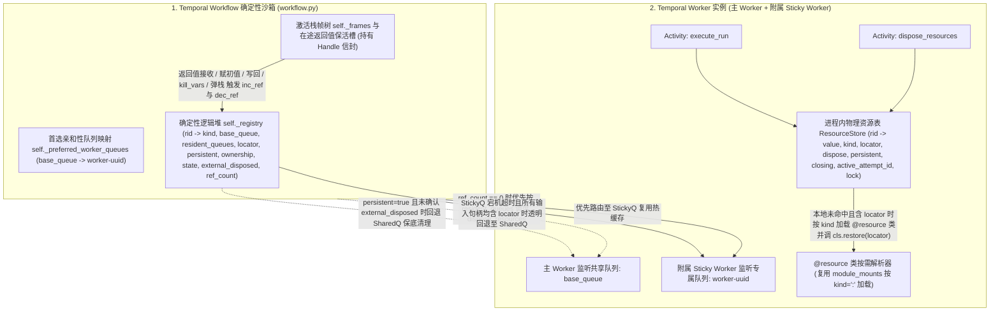
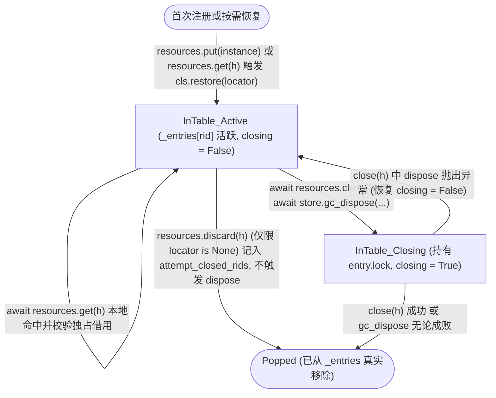

# RFC-0013: 不透明句柄类型（`handle: module:name`）、`@resource` Python 资源类协议（`locator` / `restore` / `dispose`）、确定性引用计数逻辑堆与 Sticky Worker 物理资源存储规范

* **状态**：Proposed
* **所属分类**：类型系统扩展、静态并发流分析、运行时内存模型与跨 Activity 资源生命周期管理（Type System Extension, Static Concurrency Analysis, Runtime Heap & Resource Lifecycle）
* **前置关联提案**：
  * [`RFC-0009: 静态结构化子类型偏序（<:）与容器协变规范`](./0009-static-subtyping-and-covariance.md)
  * [`RFC-0011: Axcutor 编译器前后端与 Temporal 运行时参考实现架构`](./0011-compiler-and-temporal-runtime-architecture.md)
  * [`RFC-0012: 结构化 run 执行器分派机制、移除自然语言变量正则提取与 builtin 可信 Python 执行器规范`](./0012-run-executor-and-builtin-python.md)
  * [`RFC-0014: 基于预置 Python 模块引用的 module 执行器、__axcutor__.yaml 包同构布局与契约模板 SHA 校验规范`](./0014-module-python-executor.md)
  * [`RFC-0015: 统一工作流包（Package）寻址、显式根包挂载与私有可见性规范`](./0015-unified-package-and-import-system.md)
* **核心解决的问题**：
  1. **在不破坏纯值语义与闭合类型系统的前提下统一表达三类外部资源实体**：将 **纯内存瞬态资源**（如数据库事务 `infra.postgres:Tx`）、**可恢复进程缓存资源**（如数据库连接 `infra.postgres:Conn`、有状态会话 `infra.agent:Session`）与 **可恢复外部持久化临时资源**（如 S3 临时文件 `infra.s3:TempFile`）统一建模为第 7 类基础类型构造器 **`type: handle`**（携带指向 Python `@resource` 类的 `kind: <ModulePath>:<ClassName>` 与可选独占修饰符 `exclusive?: boolean`），避免发明 `graph.resources` 或 `graph.sessions` 等平行于 `graph.variables` 的冗余图内变量表；
  2. **通过 `kind: <ModulePath>:<ClassName>` 自寻址与 `@resource` Python 类三要素协议（`locator(self)` + `restore(cls, locator)` + `dispose(self)`）将三类资源 100% 统一内聚于 Python 侧**：
     * 取消 `create_worker` 资源注册表与 YAML 顶层配置块：所有资源（含瞬态资源与可恢复资源）统一在挂载的 Python 模块中通过 `@resource(persistent=...)` 装饰资源类；业务代码只需构造出 `@resource` 类实例并调用 **`await resources.put(instance, exclusive=...)`**，运行时即自动从实例所属类推导 `kind = "<ModulePath>:<ClassName>"`、自动调用 `instance.locator()` 提取可序列化定位符并绑定 `instance.dispose()`；
     * `handle` 的 `kind` 中 `.` 仅表示 [`RFC-0015`](./0015-unified-package-and-import-system.md) 的逻辑模块包路径层级，`:` 后为 `@resource` 类名，不再定义基于点分前缀的 `kind` 子类型关系（仅要求 `T_1.kind == T_2.kind` 精确匹配）；不同工作流只需在 YAML 中声明相同的 `kind: <ModulePath>:<ClassName>` 并在 Python 中 `import` 该类即可自然共享；
     * 对不定义 `locator` / `restore`（或 `locator()` 返回 `None`）的 **纯内存瞬态资源（数据库事务 `infra.postgres:Tx`）**：强绑定创建它的 Sticky Worker 内存，支持通过 `resources.discard(h)` 在手工提交事务后跳过回滚析构；Worker 崩溃时内存丢失即事务丢失，节点快速失败（Fail-fast）交由外层事务子图重试；
     * 对定义 `locator` + `restore` 且 `persistent: false` 的 **可恢复进程缓存资源（数据库连接 `infra.postgres:Conn`）**：原 Worker 存活时优先 Sticky 路由复用热连接；原 Worker 崩溃或跨 Worker 汇聚时，在任意存活 Worker 上按 `kind` 加载 `@resource` 类并通过 `cls.restore(locator)` 透明恢复连接继续业务；引用归零时仅在仍缓存该连接的存活 Worker 上执行 `value.dispose()`；
     * 对定义 `locator` + `restore` 且 `persistent: true` 的 **可恢复外部持久化临时资源（S3 临时文件 `infra.s3:TempFile`）**：支持跨 Worker 恢复、幂等 `value.dispose()` 删除外部对象与共享队列保底清理；实例只保存定位信息与按需操作客户端，不跨 Activity 长持本地流，Worker 停机仅摘除内存引用；清理失败记录诊断，未完成移交或清理的外部对象由存储 TTL 兜底；
  3. **编译期静态并发互斥分析 + Workflow 按资源 ID 借用检查 + Worker 本地 Attempt 防护**：保留独占性单调子类型规则与静态词法检查；输入端口的 `exclusive: true` 只申请调用期独占借用，不改写资源固有属性；运行期在调度前按实际 `rid` 检查别名、重复元素和跨 Worker 的并发借用，并在 Worker 的 `get`、`close`、`discard` 中统一检查本地借用状态；
  4. **建立“栈帧 `Handle` 信封 + 运行时全局 `Registry` 逻辑堆 + Worker 进程内 `ResourceStore` 物理表”的分层架构**：在 Temporal 确定性 Workflow 沙箱中维护零外部 DB 依赖的引用计数逻辑堆（`self._registry`），在 Worker 进程内维护持有真实 `@resource` 实例、按 `kind` 按需加载 `@resource` 类的无墓碑 `ResourceStore`；
  5. **实现双层防泄漏回收（Attempt 级孤儿清理 + 栈帧引用计数归零 `dispose_resources`）、悬垂导出契约拦截与显式/被动析构解耦，并与 `builtin`（RFC-0012）及 `module`（RFC-0014/0015）执行器对齐**：正常路径通过返回值或异常 details 交回资源状态，超时恢复使用心跳快照，不设置启动前 Signal 登记屏障；根工作流顶层输入输出禁止 `handle`，所有权仅在执行内部流转。被动回收保持 `noexcept`，两类 Python 执行器复用同一个运行期 `Handle` 类与 `resources` 接口。

---

## 一、 背景与设计动机

### 1.1 闭合纯值类型系统面对外部实体时的三类典型资源与 `@resource` 特征矩阵

在现有规范中，`TypeSpec` 仅包含 6 种内联 JSON 值类型（`string`, `integer`, `number`, `boolean`, `array`, `object`）。然而在实际业务工作流中，节点之间往往需要传递无法或不适合直接内联为普通 JSON 数据的外部资源实体。按 **跨进程可恢复性（Recoverability）** 与 **持久化副作用范围（Persistence Scope）** 划分，外部资源可分为三类典型形态，且全部统一由 `@resource` 类三要素（`locator`、`restore`、`dispose`）表达：

| 维度 | 1. 数据库事务 (`infra.postgres:Tx`) | 2. 数据库连接 / 会话 (`infra.postgres:Conn`) | 3. S3 上的临时文件 (`infra.s3:TempFile`) | *(附) S3 持久文件 (`infra.s3:File`)* |
| :--- | :--- | :--- | :--- | :--- |
| **本质特征** | **纯内存瞬态绑定（Volatile / Ephemeral）** | **可恢复 + 进程内缓存（Reconstructible + Process-Cached）** | **可恢复 + 外部持久化清理（Reconstructible + Persistent External）** | **可恢复 + 无外部删除副作用** |
| **定位符提取 `self.locator()`** | **未定义**（或返回 `None`；状态绑定在特定 Worker 内存与未提交的 TCP 事务上下文中） | **返回 JSON 值**（如 `{"dsn": self.dsn}` 或 Session ID） | **返回 JSON 值**（如 `{"bucket": self.bucket, "key": self.key}`） | **返回 JSON 值**（同左） |
| **跨 Worker 恢复 `cls.restore(locator)`** | **未定义**（不可在其他 Worker 上恢复） | **定义 `@classmethod`**（根据 `locator` 建立并返回新 `Conn` 实例） | **定义 `@classmethod`**（仅用定位符构造 `TempFile`，不要求对象仍存在） | **定义 `@classmethod`**（同左） |
| **单一析构方法 `self.dispose()`** | `await self.tx.rollback()`；`await self.conn.close()` | `await self.conn.close()` | `await self.delete_object()`，容忍对象已不存在 | 无或仅关闭本地流 |
| **原 Worker 存活时的调度与销毁** | 强制路由回原 Worker 复用 `Tx` 实例；异常销毁时在原 Worker 上调 `value.dispose()`，正常提交后通过 `discard` 注销 | **优先 Sticky 路由回原 Worker** 复用内存热连接；销毁时在缓存了该连接的存活 Worker 上调 `value.dispose()` | 优先路由回原 Worker；引用归零或显式关闭时幂等删除 S3 对象；Worker 停机只摘除引用 | 任意或优先原 Worker |
| **原 Worker 崩溃 / 跨 Worker 汇聚时的业务连续性** | **不可恢复**：随 Worker 崩溃内存丢失即彻底丢失，节点必须快速失败（Fail-fast），交由外层包裹整个事务的子图重试 | **透明恢复继续业务**：后续节点回退至存活的新 Worker，在 `await resources.get(h)` 时按 `kind` 加载 `Conn` 类并通过 `Conn.restore(locator)` 自动恢复连接并缓存，业务无感继续 | **透明恢复继续业务**：任意存活 Worker 在 `await resources.get(h)` 时按 `kind` 加载 `TempFile` 类并通过 `TempFile.restore(locator)` 恢复访问对象，业务无感继续 | **透明恢复继续业务** |
| **原 Worker 崩溃时的被动析构（`gc_dispose`）** | 原 Worker 已死，OS 已断开 TCP 连接、DB 已自动回滚事务，**无需在其他 Worker 执行** | 原 Worker 已死，其内存连接已随进程消亡断开；若无其他存活 Worker 缓存该连接，**绝不** 为了关连接而在新 Worker 上专门 `restore` 新建连接再关掉（`persistent: false`） | 原 Worker 虽死，但 **S3 上的临时文件仍在**！自动回退至共享队列 `base_queue`，由任意存活 Worker **按 `kind` 加载 `TempFile` 类，先调 `TempFile.restore(locator)` 恢复实例，再调 `value.dispose()`** 完成清理（`persistent: true`） | 无需外部删除（`persistent: false`） |

### 1.2 为什么统一收敛为单一的 `type: handle`、`kind: <ModulePath>:<ClassName>` 与 `@resource` 三要素协议？

1. **YAML 类型系统层面的高度同构（单一 `type: handle`）与 Python 模块包模型（RFC-0015）无缝对齐**：
   * **栈帧内表示同构**：无论底层资源是数据库事务、数据库连接还是 S3 临时文件，在控制流栈帧 $\rho$ 中均表现为指向带外实体的轻量级不透明引用信封（Opaque Handle Envelope）；
   * **`kind: <ModulePath>:<ClassName>` 直接统一类型标识与 Python `@resource` 类寻址**：`.` 严格代表 [`RFC-0015`](./0015-unified-package-and-import-system.md) 中的 Python 逻辑模块路径（如 `infra.s3`），`:` 后代表模块内由 `@resource` 装饰的资源类名（如 `TempFile`）。这样既消除了“YAML 资源配置块与 Python 业务代码割裂”的问题，又让任意多个平行工作流（无需存在 `use: workflow:...` 调用关系）只需在 YAML 中声明相同的 `kind: infra.s3:TempFile`、在 Python 中 `from infra.s3 import TempFile` 即可天然共享同一套资源定义；
   * **取消 `kind` 前缀子类型**：既然 `.` 表示包/模块层级而非类型继承层级，两个 `handle` 类型兼容当且仅当它们的 `kind` 字符串完全相等（$T_1.\text{kind} = T_2.\text{kind}$），子类型关系仅体现在可空性（`Nullable`）与独占性修饰符（`exclusive`）的单调提升上。

2. **首次创建、跨 Worker 恢复（`restore`）与析构（`dispose`）职责正交且完全内聚于 `@resource` 类**：
   * **消除 `factory` 与 `create` 的语义歧义**：
     * 资源类的普通构造/业务创建方法（如 `__init__`、`open`、`upload`、`begin`）保持纯正的 Python 语义，负责在业务节点中首次产生 `@resource` 实例；
     * **`locator(self)`** 负责从实例提取可跨 Worker 序列化的定位符；
     * **`restore(cls, locator)`** 专职负责当句柄漂移到新 Worker（或共享队列保底清理）时，根据 `locator` 恢复出 Python 实例；
     * **`dispose(self)`** 专职负责在引用计数归零或显式 `close` 时释放本地流与清理外部对象；
     * **`await resources.put(instance, exclusive=...)`** 只需接收构造好的 `@resource` 实例本身，由框架自动读取其类对应的 `kind` 与 `instance.locator()` 完成注册，无需调用方手写字符串 `kind` 或重复拼装 `locator` 字典。
   * **单一 `dispose(self)` 无异常析构方法**：
     * 资源在仍被引用期间（`ref_count > 0`）不做自动提前缓存淘汰；当引用计数归零（或显式调用 `close`）且在途借用结束后，登记驻留责任的存活 Worker 副本执行同一个幂等的 `value.dispose()`。正常停机另按第 3.2 节区分进程资源与外部持久化实体，不因 Worker 重启删除后者；
     * 当所有驻留副本均因 Worker 崩溃失联而未能确认完成外部清理时，存活的新 Worker 只需 **按 `kind: <ModulePath>:<ClassName>` 导入该 `@resource` 类，先调用 `cls.restore(locator)` 恢复出 `value` 实例，再调用 `value.dispose()`**，即可完成 S3 临时文件的保底删除；
     * 同时，所有由引用计数归零或孤儿回收被动触发的 `dispose`，均严格保持编程语言中 **不可向控制流抛错（`noexcept`）的析构函数** 定位（等同于 Rust `Drop`、C++ `~T() noexcept`、Python `__del__`），绝不破坏 `builtin:*` 纯算子零异常不变量，也绝不在异常栈展开期间掩盖原始业务主异常。

---

## 二、 类型系统、`kind: <ModulePath>:<ClassName>` 寻址文法与静态并发检查规范（`axcutor-core`）

### 2.1 `TypeSpec` 良构性公理扩展

本 RFC 扩展 RFC-0012「决策 2」第 2 项的 Schema 表述：包含 `type: handle` 的归一化 `TypeSpec` 是 Axcutor 扩展 JSON Schema，不再直接作为无扩展的标准 Draft 2020-12 JSON Schema 消费；不含该扩展的纯值类型保持原有约束。

在基础非空类型集合 $\mathcal{B}$ 中新增 `"handle"`：

$$
\mathcal{B} = \{\texttt{"string"}, \texttt{"integer"}, \texttt{"number"}, \texttt{"boolean"}, \texttt{"array"}, \texttt{"object"}, \mathbf{\texttt{"handle"}}\}
$$

当基础类型 $b = \texttt{"handle"}$（含 `type: "handle"` 或显式可空 `type: ["handle", "null"]`）时，必须满足以下构造器约束：

1. **必填字段 `kind: ResourceKindSpec`（`<ModulePath>:<ClassName>` 格式）**：
   * `kind` 必须为由单个冒号 `:` 分隔的 **`<ModulePath>:<ClassName>`** 字符串：
     ```txt
     ResourceKindSpec ::= PackagePath ":" PublicClassName ;
     PublicClassName ::= PackageSegment ;  // 另要求不以 "_" 开头
     ```
     * 冒号左侧 `<ModulePath>` 必须满足 [`RFC-0015`](./0015-unified-package-and-import-system.md) 的 `ast::package_path` 规则（非空点分路径，首段不以 `_` 开头，每段为合法 ASCII 标识符且排除 Python 35 个硬关键字与 `"__axcutor__"`，末段不为 `"yaml" | "yml" | "json"`，例如 `"infra.postgres"`、`"infra.s3.temp"`、`"billing._internal"`）；
     * 冒号右侧 `<ClassName>` 必须满足 `ast::package_segment` 且不以 `_` 开头（合法公开 ASCII 标识符且排除 Python 硬关键字，例如 `"Tx"`、`"Conn"`、`"TempFile"`）；
     * 在 `TypeSpec::parse` 与运行期信封校验中，统一按 `kind.split_once(':').is_some_and(|(m, n)| ast::package_path(m) && ast::package_segment(n) && !n.starts_with('_'))` 校验。
   * **复用 [`RFC-0015`](./0015-unified-package-and-import-system.md) 的 `_` 私有可见性检查**：
     * 私有可见性仅由 `<ModulePath>` 中以 `_` 开头的私有段控制，直接复用 `ast::workflow_visible(caller_workflow_id, module_path)`（匿名工作流 `"__main__"` 或父包子树外的其他工作流包引用私有 `kind` 时，编译期报 `visibility.private_resource` 错误）。例如 `billing._internal:Conn` 合法并受私有模块规则保护，`billing.resources:_Conn` 则直接不满足 `kind` 文法。
2. **可选字段 `exclusive?: Boolean`（默认 `false`）**：
   * 资源的固有独占性由 `resources.put(instance, exclusive=...)` 确定；数据库事务、单连接会话等不可并发重入的实例必须以 `exclusive=True` 注册。共享安全的资源可使用默认 `False`；
   * **输入端口**的 `exclusive: true` 表示在当前节点调用存活期间申请独占借用，排斥同一 `rid` 的并发共享或独占借用；它不改写信封、Store 或 Registry 中的固有属性。`exclusive: false` 或省略表示共享借用，只接受允许共享的句柄；
   * **变量和输出槽位**的 `exclusive: true` 表示该句柄后续访问必须独占；共享句柄写入该槽位时生成带 `"exclusive": true` 的导出信封。该约束属于导出的句柄，不追溯改写其他别名或资源固有属性；
   * 在 AST 规范化阶段（`TypeSpec::to_value`），唯一规范形态为：**当且仅当 `exclusive == true` 时显式输出 `"exclusive": true`，当 `exclusive == false` 时一律省略 `"exclusive"` 字段**。
3. **可选字段 `description?: String`**；
4. **禁止字段**：禁止出现 `enum`、`items`、`properties`、`required`、`additionalProperties`。
5. **容器自由组合、算子支持边界与禁止字段投影**：
   * `handle` 类型允许作为 `array.items`、`TypedDict.properties.<f>` 或 `OrderedMap.additionalProperties` 的元素/字段类型，也允许被 `builtin:unwrap`、`builtin:assign`、`builtin:array_append`、`builtin:map_set` 等多态算子透明流转；
   * **允许等值比较（`builtin:compare` 的 `eq` / `ne`）**：`handle`（及含 `handle` 的容器）允许参与 `builtin:compare (op: eq | ne)`，用于判断可空句柄是否为 `null` 或判断两个相同 `kind` 的句柄变量是否指向同一底层资源 ID（`"$handle"`）；
   * **禁止字段投影与标量/有序算子**：`handle` 为原子不透明类型，禁止对其执行 `.field` 静态字段路径投影，禁止传入 `builtin:math`、`builtin:logic`、`builtin:switch` 以及 `builtin:compare` 的有序比较（`lt`/`lte`/`gt`/`gte`）。
6. **根工作流入口边界**：`handle` 仅允许在执行内部的图变量、节点输入输出、内联子图及 `use: workflow:<target>` 的子工作流输入输出间流转。作为根入口（`call_depth == 1`）启动的工作流，其 `root.input` 与 `root.output` 递归禁止包含 `handle`，包括可空句柄及嵌套容器；同时覆盖 `RootBody::Run` 与 `RootBody::Graph`。
   * `compile_workflow` / `compile_bundle` 保持通用定义编译，不因所选 `entry` 含句柄接口而拒绝生成 bundle；`generate_contracts` 继续复用它们，无需编译模式或豁免参数。另提供纯函数 `axcutor_core.validate_root_interface(input_schema, output_schema)`，递归拒绝根接口中的句柄；`ExecutionService.submit` 在联系 Temporal 前调用，Workflow 在实际根入口再次调用。入口校验结合 Temporal 的父执行信息识别根运行，外部请求不能仅伪造 `_call_depth` 绕过约束。
   * 根工作流与 HTTP、CLI、Python 宿主之间维持原有纯 JSON 业务结果，资源所有权不向宿主导出，不新增宿主侧资源管理协议。

```yaml
# 1. 独占瞬态资源句柄（绑定 infra/postgres.py 中的 @resource class Tx，禁止并发共享读取）
db_tx:
  type: handle
  kind: infra.postgres:Tx
  exclusive: true

# 2. 独占可恢复资源句柄（绑定 infra/postgres.py 中的 @resource class Conn）
db_conn:
  type: handle
  kind: infra.postgres:Conn
  exclusive: true

# 3. 共享可恢复资源句柄（绑定 infra/s3.py 中的 @resource(persistent=True) class TempFile）
temp_dataset:
  type: handle
  kind: infra.s3:TempFile
```

### 2.2 名义等价与子类型偏序（$T_1 <: T_2$）：精确匹配 `kind`

在 `crates/axcutor-core/src/ast/typespec.rs` 中扩展 `TypeKind::Handle { kind: String, exclusive: bool }`。由于 `kind` 中的 `.` 表示模块包路径而非子类型继承层级，**不对 `kind` 做任何前缀子类型比较**：

1. **静态等价**（$T_1 \equiv T_2$）：
   当 $T_1, T_2$ 均为 `handle` 时：

   $$
   T_1 \equiv T_2 \iff \text{Nullable}(T_1) = \text{Nullable}(T_2) \;\land\; T_1.\text{kind} = T_2.\text{kind} \;\land\; T_1.\text{exclusive} = T_2.\text{exclusive}
   $$

2. **静态子类型偏序**（$T_1 <: T_2$）：
   当 $T_1, T_2$ 均为 `handle` 且满足可空性单调提升公理（$\text{Nullable}(T_1) \implies \text{Nullable}(T_2)$）时，$T_1 <: T_2$ 当且仅当同时满足以下两条公理：
   * **`kind` 精确相等**：

     $$
     T_1.\text{kind} = T_2.\text{kind}
     $$

   * **独占性单调提升（Exclusivity Monotonicity，非独占兼容于独占）**：

     $$
     T_1.\text{exclusive} \implies T_2.\text{exclusive}
     $$

     （即：同一 `kind` 的非独占句柄 `exclusive: false` 可传入 `exclusive: true` 的输入端口取得临时独占借用，调用结束后仍可通过原别名共享读取；写入独占输出槽位时仅加强新导出信封的约束。独占句柄 `exclusive: true` **严禁** 赋给非独占目标类型 `exclusive: false`。同时由 $(\text{Exclusive}(T_1) \implies \text{Exclusive}(T_2)) \land (\text{Exclusive}(T_2) \implies \text{Exclusive}(T_1)) \iff \text{Exclusive}(T_1) = \text{Exclusive}(T_2)$，偏序集反对称性 $T_1 \equiv T_2 \iff T_1 <: T_2 \land T_2 <: T_1$ 严格保持。）

### 2.3 独占资源句柄（`exclusive: true`）的静态结构化并发互斥分析

为防止同一独占资源（如单个数据库事务 `tx`、单连接 `conn` 或单个 `agent.session`）被多个并发协程同时操作导致底层协议错乱，编译器在静态分析阶段定义递归谓词 $\text{HasExclusive}(T)$：

$$
\text{HasExclusive}(T) = \begin{cases}
T.\text{exclusive} & \text{if } T \text{ is } \texttt{Handle} \\
\text{HasExclusive}(T.\text{items}) & \text{if } T \text{ is } \texttt{Array} \\
\text{HasExclusive}(T.\text{additionalProperties}) & \text{if } T \text{ is } \texttt{OrderedMap} \\
\exists f \in \text{dom}(T.\text{properties}),\; \text{HasExclusive}(T.\text{properties}[f]) & \text{if } T \text{ is } \texttt{TypedDict} \\
\texttt{false} & \text{otherwise}
\end{cases}
$$

编译器对 Axcutor 的两类结构化并发原语强制执行以下静态借用检查（注：静态检查针对词法外层变量共享；容器重复元素和变量别名由第 3.3 节的 Workflow 资源 ID 借用检查及第 3.4.1 节的 Worker 本地防护共同处理）。下文 `Injected(N)` 为该节点实际配置的迭代注入变量名集合，包括 `for_each.item` 及非空的 `key`、`index`，不硬编码为字面名称 `item`、`key`、`index`：

1. **禁止并发 `for_each`（`concurrency > 1`）捕获外层独占资源（但允许并发遍历元素本身为独占句柄的集合）**：
   * 当节点 $N$ 挂载了 `for_each` 且 **`for_each.concurrency > 1`** 时（注：`concurrency == 1` 为串行顺序迭代，允许安全使用外层独占资源）：
   * **允许 `item` 本身为独占句柄**：允许 `for_each.source` 的元素类型为 `exclusive: true` 的句柄（例如并发遍历由多个不同独立 `infra.postgres:Conn` 或 `infra.agent:Session` 组成的数组，每个迭代协程通过 `item` 独占操作各自的资源；若数组中含重复的同一句柄，由运行期独占借用锁拦截）；
   * **严禁节点 `body` 捕获任何含独占句柄的外层变量**：直接检查 **节点 `body` 自身声明的所有外层读取引用**（严禁仅因为某变量 $v$ 充当了 `for_each.source` 的根变量 $\text{RootVar}(N.\text{for\_each.source})$ 就豁免节点 `body` 对 $v$ 自身或其实体字段的直接读取；例如当 `source: ctx.items` 时，若节点 `body` 的 `input` 同时直接捕获了含独占句柄的 `ctx`，必须拦截）：
     * 对 `NodeBody::Run` 与 `NodeBody::Graph`：对任意 $v \in N.\text{body.input} \setminus \text{Injected}(N)$，若 $\text{HasExclusive}(\Sigma_G(v)) = \texttt{true}$，编译期报诊断错误；
     * 对 `NodeBody::Builtin`：对 `N.body.bindings.input` 中任意引用路径 $p$（其根变量 $\text{RootVar}(p) \notin \text{Injected}(N)$），若其投影后的目标类型满足 $\text{HasExclusive}(\text{TypeOf}(\Sigma_G, p)) = \texttt{true}$，编译期报诊断错误；
     * 对 `NodeBody::Workflow`：对 `N.body.bindings.input` 中任意形参绑定 $(\text{param}, p)$（其引用路径 $p$ 的根变量 $\text{RootVar}(p) \notin \text{Injected}(N)$），若实参投影后的源类型满足 $\text{HasExclusive}(\text{TypeOf}(\Sigma_G, p)) = \texttt{true}$，或目标子工作流形参类型满足 $\text{HasExclusive}(\text{target.input}[\text{param}]) = \texttt{true}$（即非独占句柄通过子类型提升请求了独占借用），编译期均报诊断错误。
   * 诊断码为 `type.exclusive_capture`，地址指向相应 `input` 或 `with.input` 引用；嵌套图继续受已有的显式输入与作用域隔离规则约束。
2. **禁止 Fork-Join 并发组的多条分支对同一资源变量发生独占与独占、或独占与共享借用冲突**：
   * 在 Pass 4 校验 Fork-Join 并发边 `src -[W_1, W_2, ..., W_k]-> join_target` 时，定义递归谓词 $\text{HasHandle}(T)$（当 $T$ 为 `Handle` 或递归包含 `Handle` 元素/字段时为 `true`），除检查写集合两两正交 $OutVars(W_i) \cap OutVars(W_j) = \emptyset$ 外，额外统计每个分支 $W_i$ 读取的含句柄根变量集合 $Use_{\text{handle}}(W_i)$ 与请求独占借用的根变量集合 $Use_{\text{excl}}(W_i)$（排除 `Injected(W_i)`）：
   * 对分支 $W_i$ 的 `body`，按上述 `Run` / `Graph` 的完整输入类型、`Builtin` 的实参投影类型、或 `Workflow` 的实参投影类型与目标形参类型（$\text{TypeOf}(\Sigma_G, p)$ 与 $\text{target.input}[\text{param}]$），凡满足 $\text{HasHandle}$ 的外层引用根变量记入 $Use_{\text{handle}}(W_i)$，凡满足 $\text{HasExclusive}$ 的外层引用根变量记入 $Use_{\text{excl}}(W_i)$；
   * 若挂载 `for_each`，另行检查 `for_each.source` 的**投影类型**，当该类型满足 $\text{HasHandle}$ 时将其根变量记入 $Use_{\text{handle}}(W_i)$，满足 $\text{HasExclusive}$ 时记入 $Use_{\text{excl}}(W_i)$。该规则独立于 body 种类，覆盖仅通过迭代元素访问句柄的分支，也避免把 `ctx.items` 中的纯标量误判为借用了 `ctx.tx`；
   * 对任意 $1 \le i < j \le k$，必须满足（任一分支请求独占借用时，另一并发分支不得对同一根变量发生任何独占或共享句柄读取）：

     $$
     (Use_{\text{excl}}(W_i) \cap Use_{\text{handle}}(W_j)) \cup (Use_{\text{handle}}(W_i) \cap Use_{\text{excl}}(W_j)) = \emptyset
     $$

   * 若存在交集，在对应并发边上报 `topology.concurrent_exclusive`。静态分析仍按根变量保守拒绝同一结构体中不同句柄字段的并发冲突；实际资源别名由运行期检查。

3. **画布变量补全与捕获规则一致**：
   * `compiler::get_available_vars_at_node` 增加查询作用域 `VariableQueryScope::{Body, ForEachSource}`；Python / WASM / JSON 入口使用 `scope: "body" | "for_each_source"`，默认 `"body"`。`NodeAnalysis` 由节点修饰符派生 `for_each_concurrent` 标记，不复制一套并发分析器。
   * `Body` 查询中，对并发迭代的外层候选，在每次字段投影后按候选类型过滤 `candidate.has_exclusive()`，或 `expected` 请求独占借用的情形；只隐藏不合法候选，继续递归检查其字段，不能连同安全的标量子字段一起剪枝。现有确定赋值与子类型筛选继续适用。
   * `Body` 过滤不作用于 `node.injected` 中实际配置的迭代注入变量；`item` 可为独占句柄。`ForEachSource` 仅枚举图作用域中已定值的变量，不加入本次迭代注入变量，也不套用 body 捕获限制。串行迭代保持原有候选。

### 2.4 编译期字面量不可伪造性与运行期信封校验分离

`handle` 类型区分 **编译期源码字面量校验（`TypeSpec::accepts_literal`）** 与 **运行期传输信封校验（`TypeSpec::accepts_runtime`）**：

1. **编译期源码字面量校验（`accepts_literal`）**：
   * 在编译期所有常量字面量校验点——包括：
     1. `check.rs` 中 `graph.variables.<v>.default` 的默认字面量校验；
     2. `check.rs` 中 `argument()` 对 `use.with.input.<p>` 及内置算子常量参数 `ArgValue::Const` 的校验；
     3. `builtins.rs` 中 `equality()` 对常量比较操作数的校验；
     4. `builtins.rs` 中 `object_merge()` 当 `base` 为常量对象 `{ value: {...} }` 时的校验；
     5. `builtin:unwrap` 的常量 `source: null` 按目标类型的可空形式校验，`default` 仍按非空目标类型调用 `accepts_literal`；合法的 `unwrap(null, default=已有句柄变量)` 不会创建新身份，不应禁止——
     统一调用 `accepts_literal`：
     * 沿数组元素、映射值和结构体字段递归校验；仅当到达 `handle` 类型位置时，要求字面量为 `null` 且该类型可空，拒绝该位置的一切非 `null` 值；
     * 因而 `array<handle>` 的 `[]`、`map<handle>` 的 `{}` 以及可空句柄字段为 `null` 的合法容器仍可作为字面量，不会因元素类型含有 `handle` 被整体拒绝。
2. **运行期 ABI 信封校验（`accepts_runtime`）**：
   * 在运行期边界（`kernel/mod.rs` 中的 `validate_input` 与 `validate_run_contract`）统一调用 `accepts_runtime`，其中 `handle` 值的标准 JSON 传输信封格式为闭合 JSON 对象：
     ```json
     // 形态 A：纯内存瞬态句柄（如 infra.postgres:Tx，无 locator）
     {
       "$handle": "res_018f...",
       "kind": "infra.postgres:Tx",
       "worker_queue": "axcutor-worker-0123456789abcdef0123456789abcdef",
       "exclusive": true
     }

     // 形态 B：可恢复句柄（如 infra.postgres:Conn 或 infra.s3:TempFile，含非 null 的 locator 与可选 persistent）
     {
       "$handle": "res_018f...",
       "kind": "infra.s3:TempFile",
       "worker_queue": "axcutor-worker-0123456789abcdef0123456789abcdef",
       "locator": {
         "bucket": "axcutor-tmp",
         "key": "wf-123/part-0.parquet"
       },
       "persistent": true
     }
     ```
   * **信封字段规范与校验规则**：
     * **必填键**：`"$handle"`（非空字符串，全局唯一资源 ID）、`"kind"`（满足 `<ModulePath>:<ClassName>` 文法且与目标 `TypeSpec.kind` 精确相等的字符串）、`"worker_queue"`（必须符合 `<base_queue>-worker-<32位小写hex>` 专属队列寻址格式且 `<base_queue>` 非空，见第 3.2 节）；
     * **可选键**：
       * `"exclusive"`：布尔值（默认 `false`），表示资源固有限制或该导出句柄已加强的独占约束。输入端口不会修改此字段；输出序列化可以将共享句柄加强为 `true`，不能把已有独占句柄降为 `false`。运行期校验遵守 `actual.exclusive implies expected.exclusive`，降级导出产生 `contract` 异常；
       * `"locator"`：满足第 3.1.1 节数值保真约束的规范 JSON 值（省略或为 `null` 时表示不可跨进程恢复的纯内存瞬态资源；非 `null` 时可通过 `cls.restore(locator)` 恢复，内部不得嵌套包含 `"$handle"` 信封）；
       * `"persistent"`：布尔值（默认 `false`；仅当 `"locator"` 非 `null` 时允许为 `true`，表示即使所有缓存该资源的 Worker 均已崩溃，仍须在存活 Worker 上通过 `cls.restore(locator)` 恢复并执行 `value.dispose()`）；
     * **闭合约束**：除 `{"$handle", "kind", "worker_queue", "exclusive", "locator", "persistent"}` 外严禁出现任何其他键。
   * **按类型识别与比较**：`OrderedMap` 允许任意字符串键，例如 `map<string>` 中的 `{"$handle": "customer-value"}` 是普通业务数据。扫描器必须同时接收值与其 `TypeSpec`，仅在 `handle` 类型位置识别信封；不得仅根据 `"$handle" in obj` 或完整对象形状推断类型。`builtin:compare (op: eq | ne)` 在句柄类型位置只比较资源 ID，在容器中按对应元素/字段类型递归比较，其他位置保留现有 JSON 值相等性。此运行期比较实现在 `kernel/mod.rs`（编译期 `literal_eq` 保持字面量语义），具体递归比较函数 `values_equal(a, b, ty_a: Option<&TypeSpec>, ty_b: Option<&TypeSpec>)` 规则如下（兼顾一侧为 `ArgValue::Const` 字面量如 `null`、`[]`、`{}` 时 `arg_type` 为 `None` 或两侧 `TypedDict` 存在子类型差异的情形）：
     1. 若 `a.is_null() || b.is_null()`，直接返回 `a.is_null() && b.is_null()`；
     2. 若 `ty_a` 或 `ty_b` 中任一基础类型为 `"handle"`，比较 `a.get("$handle") == b.get("$handle")`（且两侧均为非空字符串）；
     3. 若两侧为 JSON Array（且任一类型基础类型为 `"array"`），要求长度相等，并递归传入元素类型 `(ty_a.and_then(|t| t.items.as_deref()), ty_b.and_then(|t| t.items.as_deref()))` 逐项比较；
     4. 若两侧为 JSON Object：当任一类型为 `OrderedMap` 时，要求键集合相等且每个键 `k` 递归传入 `additionalProperties` 类型比较；当任一类型为 `TypedDict` 时，先要求两侧 JSON Object 的键集合完全相等，再对每个键 `k` 递归传入 `(ty_a.and_then(|t| t.properties.as_ref()?.get(k)), ty_b.and_then(|t| t.properties.as_ref()?.get(k)))` 比较；其余标量位置回退 `literal_eq(a, b)`。
   * 比较操作数的类型复用现有 `compiler::arg_type(arg, symbols)`（已由 kernel 使用），保留可选字段投影后的可空性；常量没有独立 `TypeSpec` 时传 `None`，两侧均为常量时回退 `literal_eq`。
   * **按输出槽位加强信封**：内核提供递归的 `coerce_output(value, spec)`，在已有类型校验通过后复制值；仅在非空 `handle` 叶子且目标要求独占时置 `exclusive=True`，容器按对应元素或字段类型递归。`validate_run_contract`、`eval_builtin` 的输出写入和 Workflow 的变量写回 / 子工作流输出映射统一采用该规则；不原地改写源值，也不修改 Registry。`validate_input` 只校验兼容性，不调用输出加强函数，不能因 `expected.exclusive=True` 改写实际输入句柄。

---

## 三、 运行时架构：`@resource` Python 资源类协议（`locator` / `restore` / `dispose`）、逻辑堆（`Registry`）与 Sticky Worker 物理存储（`ResourceStore`）

在 Temporal 架构下，Workflow 协程运行在确定性沙箱中（支持随时重放重建状态），而真实的数据库连接、事务、S3 文件句柄和 Agent 会话对象驻留在 Worker 进程的 Activity 执行环境中。为此，Axcutor 采用 **逻辑生命周期与物理对象存储分离、Sticky 亲和性优先与 `kind: <ModulePath>:<ClassName>` 按需加载 `@resource` 类透明恢复相结合** 的架构：



### 3.1 `@resource` Python 类三要素协议（`locator` / `restore` / `dispose`）与 `kind: <ModulePath>:<ClassName>` 自寻址机制

不设宿主 `create_worker` 资源注册表，也不支持模块顶层裸函数写法或 `__resource__` 特殊变量；所有外部资源（无论瞬态资源还是可恢复资源）统一在挂载的 Python 模块中通过 **`@resource` 类装饰器**定义，并通过 `kind: "<ModulePath>:<ClassName>"` 自寻址：

```python
from typing import Any, Awaitable, Callable, TypeVar, overload

T = TypeVar("T")


@overload
def resource(cls: type[T], *, persistent: bool = False) -> type[T]: ...


@overload
def resource(
    cls: None = None, *, persistent: bool = False
) -> Callable[[type[T]], type[T]]: ...


def resource(
    cls: type[T] | None = None,
    *,
    persistent: bool = False,
) -> type[T] | Callable[[type[T]], type[T]]:
    """将一个 Python 类声明为可按 `<ModulePath>:<ClassName>` 寻址的资源类。"""
    ...
```

1. **`@resource` 资源类的三要素方法契约**：
   * 装饰器校验目标 `cls` 必须为模块顶层 Python `class`，类名不以 `_` 开头（禁止装饰函数、实例或嵌套局部类），且检查以下三个可选/必填成员方法（不满足约束时在类定义期直接抛 `TypeError`）：
     * **要素 1：定位符提取方法 `locator(self) -> Any | Awaitable[Any]`**（可选，定义时必须与 `restore` 成对出现）：
       * 定义在类上的实例方法 `def locator(self) -> JsonValue:`（允许同步或异步）；
       * 当调用 `await resources.put(instance)` 注册实例时，由运行时自动调用 `instance.locator()` 提取可跨 Worker 传输的 JSON 定位符（若类未定义 `locator` 方法，或 `instance.locator()` 返回 `None`，则该实例被注册为无 `locator` 的纯内存瞬态资源）。
     * **要素 2：跨 Worker 恢复类方法 `restore(cls, locator) -> T | Awaitable[T]`**（与 `locator` 成对出现；若 `persistent=True` 则 `locator` 与 `restore` 均必填）：
       * 定义为 `@classmethod async def restore(cls, locator: ...) -> Self:`（允许 `@classmethod` 或 `@staticmethod`，支持同步或异步）；
       * 当句柄漂移到未缓存该 `rid` 的 Worker（或共享队列保底清理）时，接收经第 3.1.1 节同一函数规范化并深拷贝隔离的 `locator`；定位符在注册时即确定规范数值表示，不在恢复时首次做有损转换。在当前 Worker 上恢复并返回实例后，必须校验 `type(value) is cls`；其他类或子类的实例均抛 `TypeError`。此规则适用于 `get`、显式关闭与被动清理的全部恢复路径。
       * 对 `persistent=True` 的外部实体，`restore` 应为不依赖实体必然存在的惰性、轻量构造，只保存定位符并在实际读写时访问外部对象；不得为了恢复清理能力而重新创建外部实体。保底清理中的“已不存在”按第 3.4.1 节处理。
       * 非空 locator 承诺恢复业务所需的同一逻辑实体或等价访问能力，不承诺恢复未编码的连接本地状态。仅有 DSN 的连接不能保留临时表、会话设置或未提交事务；依赖这些状态的资源必须使用瞬态句柄。参与 Worker 对同一 `kind` 必须部署兼容的 locator / restore / dispose 协议，破坏性变更使用新 kind 或固定部署版本，不增加通用检查点及兼容转换层。
     * **要素 3：析构实例方法 `dispose(self) -> Any | Awaitable[Any]`**（当 `persistent=False` 时可选，当 `persistent=True` 时**必填**）：
       * 定义在类上的实例方法 `async def dispose(self) -> None:`（支持同步或异步）；
       * **唯一的析构钩子**：无论该实例 `self` 是最初在当前 Worker 上通过 `resources.put(instance)` 注册的，还是由 `cls.restore(locator)` 在当前 Worker 上恢复出来的，销毁时统一调用 `await self.dispose()`；
       * 方法必须能容忍清理重试及其他副本已删除外部实体；进程资源在 `finally` 中释放本实例持有的连接或流，持久化资源的逐次操作自行关闭临时本地流。运行时不提供 exactly-once 副作用保证。`locator`、`restore` 与 `dispose` 均允许同步返回值或 awaitable，下文的 `await ...` 为简写，实际实现只对 `inspect.isawaitable(result)` 的结果执行 `await`。
   * **`persistent: bool = False`**：
     * 当 `persistent == False`（默认，如数据库事务 `infra.postgres:Tx` 或连接 `infra.postgres:Conn`）：表示资源的生命周期附着于 **进程内的连接/状态实例**。若该资源含非空 `locator`，原 Worker 崩溃后后续业务节点可在新 Worker 上通过 `cls.restore(locator)` 恢复连接继续运行；但当引用计数归零进入被动回收时，仅需在当前实际缓存了该实例的存活 Worker 上执行 `value.dispose()`——若持有它的 Worker 已经崩溃，连接已随进程消亡断开，**绝不在新 Worker 上为了执行 `dispose` 而调用 `cls.restore(locator)` 白白新建一条连接再立即关闭**；
     * 当 `persistent == True`（如 S3 临时文件 `infra.s3:TempFile`）：要求类必须同时定义 `locator`、`restore` 与 `dispose`（且运行时 `instance.locator()` 不得返回 `None`）。表示资源的生命周期附着于 **外部持久化存储实体**，原 Worker 进程崩溃并不会使 S3 上的临时文件消失。当引用计数归零进入被动回收时，若所有曾缓存该对象的 Sticky Worker 均未能确认完成清理（`external_disposed == False`），Workflow 必须将回收请求回退投递至共享主队列 `base_queue`，由任意存活 Worker **按 `kind` 加载该 `@resource` 类，先调用 `cls.restore(locator)` 恢复出 `value`，再调用 `value.dispose()`** 完成外部临时文件清理。
     * `persistent=True` 实例只保存定位符、元数据或按需操作客户端，不得在 Activity 之间长持必须显式关闭的进程级 OS 句柄；读写内部随用随关本地流。复用的 SDK 客户端由 Worker / 宿主创建和关闭，资源仅借用；资源自行创建的客户端须在单次操作内关闭。因而正常停机无需新增 `close_local` 钩子，外部实体删除只由所有者的引用归零、显式关闭或未移交孤儿清理触发。
   * 装饰器在类对象自身的字典中写入内部只读元数据属性 `__axcutor_resource_meta__ = ResourceMeta(owner=cls, persistent=persistent, has_restore=..., has_dispose=...)`。未显式添加 `@resource` 装饰器的子类即使继承自资源类也无效，所有校验均读取 `vars(cls).get("__axcutor_resource_meta__")` 并验证 `meta.owner is cls`。

2. **按 `kind: <ModulePath>:<ClassName>` 复用 `module_mounts` 的确定性双向解析协议（结合 RFC-0014 与 RFC-0015）**：
   * Worker 之间不传递内存中的 Python 函数或类对象；`RunActivities` 与 `ResourceStore` 共享 `create_worker(..., module_mounts=...)` 配置的根包挂载表 `module_mounts: Mapping[str, str] | None`（若挂载表配置了两个不同逻辑根包指向同一物理模块或存在父子前缀重叠，在初始化时直接拒绝以保证逆映射唯一）。
   * **正向解析（由 `kind: "<ModulePath>:<ClassName>"` 加载 `@resource` 类 `cls`）**：
     当 Worker 在 `resources.get`、`resources.close` 或 `dispose_resources` 中需要按 `kind`（如 `"infra.s3:TempFile"`）加载资源类时：
     1. 按 `module_path, sep, class_name = kind.partition(":")` 拆分，校验 `package_path(module_path)`、`package_segment(class_name)` 与 `not class_name.startswith("_")`；
     2. 提取根包段 `root, dot, suffix = module_path.partition(".")`：
        * 若 Worker 配置了显式 `module_mounts`，则校验 `root in module_mounts`（未挂载则抛 `LookupError(f"no Python package mounted for {root!r}")`），映射后的物理模块路径为 `target_module = (module_mounts[root] if module_mounts is not None else root) + dot + suffix`；
     3. 调用与 [`module.py`](../python/axcutor_runtime/src/axcutor_runtime/module.py) 共用的无二义性模块加载器 `_load_python_module(target_module, require_package=None)`（对所有层级均拒绝同名目录包 `foo/__init__.py` 与文件模块 `foo.py` 并存的二义性，中间段强制为 package，末段在 `require_package=None` 时同时支持普通 `.py` 文件模块或包目录 `__init__.py`，而在 `module.py` 中传入 `require_package=current_package`）；
     4. 从模块中读取 `cls = getattr(mod, class_name, None)`，校验 `isinstance(cls, type)`、`vars(cls).get("__axcutor_resource_meta__")` 存在且属于 `cls` 自身、`cls.__qualname__ == class_name` 且 `cls.__module__ == mod.__name__`（即反向推导出的规范 `kind` 必须精确等于请求的 `kind`，拒绝跨模块 re-export 别名），返回该资源类。
   * **反向推导（在 `resources.put(instance)` 中由 `cls = type(instance)` 推导规范逻辑 `kind`）**：
     1. 校验 `vars(cls).get("__axcutor_resource_meta__")` 存在且属于 `cls` 自身，同时 `cls.__qualname__ == cls.__name__`；
     2. 读取 `physical_module = cls.__module__`：若配置了 `module_mounts`，将 `physical_module` 的挂载目标前缀逆映射回逻辑根包名 `root` 得到 `logical_module`（若不属于任何已挂载根包则抛 `LookupError`）；未配置 `module_mounts` 时 `logical_module = physical_module`；
     3. 合成 `kind = f"{logical_module}:{cls.__name__}"`，并校验正向解析 `resolve_resource_class(kind) is cls`（确保该类可通过 `kind` 在任意其他 Worker 上无歧义加载）。
   * **运行期类身份与类元数据一致性不变量**：在每个 Worker 进程内，活跃物理资源必须满足 `type(entry.value) is resolve_resource_class(entry.kind)`，且信封/条目的 `persistent` 与是否存在非空 `locator` 必须与 `cls.__axcutor_resource_meta__` 声明一致（即 `handle.persistent == meta.persistent`，且当 `handle.locator is not None` 时 `meta.has_restore` 为真，当 `meta.persistent` 为真时 `handle.locator is not None`）。注册、缓存命中后交付业务、恢复后缓存或执行析构均须核对这一精确类身份与元数据一致性；类名相同、结构兼容或 `isinstance` 成立均不能替代 `is` 检查。

3. **执行 `locator`、`restore` 与 `dispose` 时的上下文隔离**：
   * 在 `resources.put(instance)` 中先调用 `instance.locator()`，校验并深拷贝其 JSON 表示，再转移资源所有权。`cls.restore` 在失败或取消时负责释放尚未交给 Store 的半构造对象。调用方提供的 `instance` 在 `put` 成功注册前由调用方负责，成功注册后由当前 Attempt 负责。
   * 执行 `instance.locator`、`cls.restore` 或 `instance.dispose` 时临时禁用 `resources` 上下文（将 `_current_resource_context` 置为不可调用状态），并在退出时恢复。方法可以直接使用普通 Python 对象和第三方 SDK，但不得嵌套调用 `resources.put/get/close/discard`，避免在资源初始化锁内递归借用，或在析构阶段创建无法移交的新句柄。

#### 3.1.1 `resources.put(instance, *, exclusive=False)` 的单实例内聚注册接口

得益于 `@resource` 类自身封装了 `locator(self)`、`restore(cls, locator)` 与 `dispose(self)`，`ResourceContext.put` 收敛为直接接收 **`@resource` 类的实例 `value`** 的极简接口，彻底无需调用方手写 `kind` 字符串或手动传递 `locator` / `dispose` 参数：

```python
class ResourceContext:
    async def put(
        self,
        value: T,
        *,
        exclusive: bool = False,
    ) -> Handle[T]:
        """将一个 @resource 类的实例注册进当前 Worker 的 ResourceStore 并返回强类型 Handle。"""
        ...
```

1. **统一注册流程**：
   * 校验 `cls = type(value)` 必须是由 `@resource` 直接装饰的顶层资源类（否则抛 `TypeError`），并按第 3.1 节反向推导并校验其规范 `kind = "<ModulePath>:<ClassName>"`；
   * **禁止同一 Python 实例重复注册为多个活跃句柄**：校验当前 `ResourceStore._entries` 中不存在任何活跃条目满足 `entry.value is value`（维护 `id(value) -> rid` 反向索引并在条目入表/移除时同步更新）；若该实例已绑定某个活跃 `rid`（例如对同一实例重复调用 `put(x)`，或对 `get(h)` 取得的受管实例再次调用 `put`），立即抛出 `RuntimeError("resource instance is already registered in ResourceStore")`，防止两个独立 `rid` 共享同一底层对象导致提前析构或独占锁失效；
   * **物理所有权边界**：每个 `@resource` 实例必须独立拥有其底层物理资源。禁止把已受管句柄解引用出的内部连接、事务或流再次包装注册成另一个资源；例如 `PostgresTx` 必须自行持有专属连接，不能借用受管 `PostgresConn.conn`。运行时不维护跨 `rid` 依赖图；
   * **自动提取定位符 `locator`**：
     * 若 `cls` 定义了 `locator` 方法：调用 `raw_locator = await value.locator()`；
     * 若 `cls` 未定义 `locator` 方法：令 `raw_locator = None`；
     * 立即用统一的 JSON 校验与规范化函数得到 `locator`，通过后才分配并入表。用户 `locator()` 返回值、Store / Context 的私有身份快照、返回 `Handle.locator` 及传给 `restore` 的参数分别深拷贝隔离；它们数值等价但不共享可变容器。`Handle` 冻结仅限制字段重新赋值，不能防止内部字典被修改，身份核验必须对照业务不可改写的私有快照；
   * **异步提取后的原子提交**：完成全部身份、locator 与资源协议校验后，在不含 `await` 的同一临界段内，再检查实例反向索引，分配 `rid`，提交条目、索引和 `allocated_rids`。同一实例的并发 `put` 只能有一次成功；不能跨用户 `locator()` 调用持有 Store 全局锁。恢复入表也维护同一实例唯一性约束；
   * **自动区分瞬态资源与可恢复资源**：
     * **当 `raw_locator is None`（纯内存瞬态资源，如 `infra.postgres:Tx`）**：
       * 若 `cls.__axcutor_resource_meta__.persistent == True`，立即抛出 `ValueError("persistent @resource instance must return a non-null locator")`；
       * 在当前 Worker 的 `ResourceStore._entries[rid]` 中存入 `value` 及其绑定的 `value.dispose if meta.has_dispose else None`，返回 `"kind": kind, "locator": None, "persistent": False` 的 `Handle`；
     * **当 `raw_locator is not None`（可恢复资源，如 `infra.postgres:Conn` 或 `infra.s3:TempFile`）**：
       * 校验 `cls` 必须同时定义了 `restore` 类方法，且规范 `locator` 为不含嵌套 `"$handle"` 的 JSON 值；
       * 在当前 Worker 的 `ResourceStore._entries[rid]` 中存入 `value`、`locator`、`value.dispose if meta.has_dispose else None` 与 `persistent = cls.__axcutor_resource_meta__.persistent`，返回携带 `locator` 与 `persistent` 的 `Handle`。

2. **`locator` 的 JSON 数值保真约束**：
   * 仅接受 `null`、布尔、字符串、字符串键对象、数组及规范数值，递归拒绝 `NaN`、正负无穷及非 JSON 对象。整数限于 `[-(2**53-1), 2**53-1]`，更大整数或高精度标识符必须使用字符串；
   * 原生 `float` 必须有限；传输层或用户提供的 `Decimal` 仅当转换为有限 `float` 后，其最短十进制往返表示仍与原数值相等时才接受，否则拒绝溢出、下溢或精度丢失。规范值使用原生 `int` / `float`，同一规则用于信封校验和恢复前解码；
   * Rust 对整数令牌使用相同安全整数范围；带小数点或指数的令牌转为有限 `f64`，再以 `serde_json::Number::from_f64` 的最短十进制值与原令牌做精确十进制数值比较。Python 对应使用 `Decimal(repr(float_value))` 比较，忽略尾随零及指数写法差异，拒绝实际舍入；不能在 Rust 边界放过 Python 会拒绝的定位符；
   * 规范化必须幂等，满足 `normalize(decode(encode(locator))) == locator`。不能在 `put` 保存高精度原值、到另一个 Worker 的 `restore` 才静默舍入。
   * 身份比较采用递归 JSON 值相等性：布尔与数字属于不同类型，`true` 不等于 `1`；数字按上述规范化后的精确十进制数值比较，对象比较键集合及对应值。不能直接以 Python 容器 `==` 作为身份判据。

3. **固有独占性与借用模式分离**：`put(..., exclusive=...)` 将资源固有属性存入 Store、信封与 Registry，此属性终身不因输入端口改变。每次调用按固有属性、实际句柄约束和输入 schema 计算临时借用模式，调用结束即释放；共享句柄经过独占输入节点后，原别名仍允许共享读取。输出槽位要求独占时，仅复制并加强该导出信封；保留已有独占信封的约束，不将其降级，也不向其他别名传播此加强。元数据中的固有属性来自最初注册记录，不从加强后的输出信封反推。

`get(h)` 返回的物理实例借用期严格限于当前 Attempt，禁止存入模块全局变量或游离任务跨 Attempt 使用。Attempt 内对同一实例的协程并发由业务代码负责，不对同一事务并发执行多个操作；框架不为此增加协程级资源锁。

---

### 3.2 Worker 进程亲和性、Sticky 路由与跨 Worker 故障恢复协议

每个 Worker 在启动时（`create_worker`）与 Workflow 调度时遵循以下双队列亲和性与分级故障转移协议：

1. **Worker 专属队列标识（`worker_queue`）与双 `Worker` 协同装配**：
   * 每个持有 `ResourceStore` 的 Worker 进程分配一个唯一专属队列名 `worker_queue = f"{task_queue}-worker-{uuid4().hex}"`（其中前缀 `{task_queue}-worker-` 显式编码了该 Worker 所属的主共享队列名 `base_queue = task_queue`）；
   * 从专属队列名末尾的固定 `-worker-<32 hex>` 后缀提取 `base_queue`，不能在队列名中任意切分 `-worker-`。子工作流传入的句柄同样遵守此格式；队列名只用于寻址，不是存活证明。
   * 由于 `temporalio.worker.Worker` 单个实例仅绑定单个 `task_queue`，`create_worker` 内部封装 **主队列 `Worker`**（监听共享 `task_queue`，注册 `AxcutorInterpreterWorkflow` 与 `execute_run`、`dispose_resources`）与 **附属 Sticky `Worker`**（监听 `worker_queue`，共享同一个 `ResourceStore`、`module_mounts` 与 `RunActivities` 实例，注册 `execute_run` 与 `dispose_resources`），并在 `run()` / `__aenter__` / `__aexit__` 生命周期中协同启动与优雅关闭二者。
   * `create_worker` 返回明确的复合 Worker 对象，公开 `run()`、`shutdown()` 和异步上下文管理接口；任一成员启动失败时关闭已启动成员，正常关闭时先停止接收业务、排空 Activity，再关闭共享 Store。附属 Worker 不注册 Workflow；配置按 Workflow / Activity 职责分配，不以继承或全量代理伪装成单个 SDK Worker。
   * **`ResourceStore.close()` 的停机语义**：排空后，仅对 `persistent=False` 的条目调用 `value.dispose()` 并摘除；对 `persistent=True` 的条目只清空内存引用及索引，不调用会删除外部实体的 `dispose()`。Workflow 后续可在新 Worker 上恢复，最终由引用计数归零的 `dispose_resources` 删除外部对象；不新增第四个资源钩子。
   * `_parse_options` 增加正整数选项 `sticky_schedule_to_start_timeout_ms`（默认 `5000`）与 `resource_disposal_timeout_ms`（默认 `30000`）。前者限制一次 Sticky 排队等待，后者限制一次被动清理的总等待；这些选项随 Workflow 输入记录并传给 Child，不读取进程环境改变重放行为。
2. **Workflow 级首选 Sticky 队列（`self._preferred_worker_queues`）与 `execute_run` 分级路由规则**：
   * `AxcutorInterpreterWorkflow` 维护按主队列 `base_queue` 索引的首选 Sticky 队列映射 `self._preferred_worker_queues: dict[str, str]`（在启动 Child Workflow 时一并通过输入上下文继承）；
   * 在 `AxcutorInterpreterWorkflow._run_activity` 调度节点（设该节点 executor 对应的主共享队列为 `base_queue = options.task_queues.get(executor, default_task_queue)`）时，扫描当前节点 `input_snapshot` 中包含的所有 Handle 信封，并按 `locator is None` 将输入句柄划分为 **瞬态绑定句柄集** $H_{\text{pin}}$ 与 **可恢复句柄集** $H_{\text{rec}}$：
     * **情形 1：包含瞬态绑定句柄**（$H_{\text{pin}} \neq \emptyset$，如含有 `infra.postgres:Tx`）：
       * 提取 $H_{\text{pin}}$ 中所有句柄所属的 `worker_queue` 集合 $Q_{\text{pin}}$；
       * 若 $|Q_{\text{pin}}| > 1$（存在两个驻留于不同 Worker 内存且均不可恢复的瞬态句柄）：立即抛出可恢复的 **`execution`** 异常（跨 Worker 瞬态内存句柄冲突）；
       * 若 $Q_{\text{pin}} = \{w_{\text{pin}}\}$ 且该队列属于目标 `base_queue`：将 `execute_run` 路由至 $w_{\text{pin}}$（带上述排队期限）。其他可恢复输入可在此通过对应的 `@resource` 类 `cls.restore(locator)` 恢复；若瞬态句柄所在 Worker 不属于目标 executor 的队列池，则报可恢复的 **`execution`** 路由冲突，不覆盖 executor 路由。
       * 若发往 $w_{\text{pin}}$ 的 `execute_run` 触发 `schedule_to_start_timeout`：只说明本次任务未及时被领取，也可能是 Worker 忙碌。清除本次首选绑定并报可恢复的 **`execution`** 异常，但保留该 Worker 的驻留记录与清理责任；不得推断内存已消失。外层事务子图可按业务幂等约束重新开始。
     * **情形 2：仅包含可恢复句柄**（$H_{\text{pin}} = \emptyset \land H_{\text{rec}} \neq \emptyset$，如仅含 `infra.postgres:Conn` 和/或 `infra.s3:TempFile`）：
       * **热缓存亲和性优先（Sticky-First）**：候选仅限目标 `base_queue` 的 Worker。先取该池的首选队列；若无首选，则按类型扫描输入句柄的确定性顺序，取第一个句柄的最新兼容驻留队列；均无候选时直接投递目标共享队列。不依赖在线探测、集合遍历顺序或进程本地状态选队列。
       * **未启动任务的透明回退（Transparent Failover & Rehydration）**：若发往 $w_{\text{sticky}}$ 的任务触发 **`schedule_to_start_timeout`**，因该次任务尚未启动且全部输入可恢复，Workflow 执行以下回退：
         1. 清除该次路由的首选绑定，但保留所有 `resident_queues` 与清理责任；
         2. **立即透明重投递 `execute_run` 至共享主队列 `base_queue`**；
         3. 存活的新 Worker $w_{\text{new}}$ 认领任务后，在业务代码调用 `await resources.get(h)` 时按 `h.kind` 加载 `@resource` 类并通过 `cls.restore(h.locator)` 透明恢复资源并缓存至 $w_{\text{new}}$ 的 `ResourceStore`；
         4. 消费 Activity 生命周期元数据后，将 $w_{\text{new}}$ 记入驻留队列并更新首选绑定。已开始执行后的超时不能按此规则透明重投，须进入第 3.3 节的重试与借用收敛规则。
     * **情形 3：无输入句柄**（$H_{\text{pin}} = \emptyset \land H_{\text{rec}} = \emptyset$）：
       * 输入及任一输出分支的 schema 均不含 `handle` 时，直接投递共享队列 `base_queue`；纯值节点不沿用资源亲和性，避免普通并发计算被固定到单个 Worker。
       * 其余可能创建句柄的节点，若该池已有首选队列则优先路由至该队列，便于多个瞬态资源同域创建；排队超时后清除首选并回退共享队列。无首选时直接投递共享队列；此偏好不保证并发创建的全部瞬态资源同域。

---

### 3.3 Workflow 侧：确定性引用计数逻辑堆（`self._registry`）与双路容错回收

在 `python/axcutor_runtime/src/axcutor_runtime/workflow.py` 的 `AxcutorInterpreterWorkflow` 中，维护逻辑堆表 `self._registry: dict[str, LogicalResourceEntry]`：

```python
@dataclass
class LogicalResourceEntry:
    resource_id: str
    kind: str
    base_queue: str
    resident_queues: list[str]         # 已登记该 rid 驻留责任、尚未确认清理的 Sticky 队列；排队超时不删除
    exclusive: bool = False            # put 时确定的固有属性；不随端口借用或导出信封加强而改变
    locator: Any = None                # 可序列化恢复定位符（None 表示不可跨进程恢复的纯内存瞬态资源）
    persistent: bool = False           # True 表示外部实体仍需共享队列保底清理
    ownership: Literal["borrowed", "owned"] = "owned"
    state: Literal["active", "terminal", "outcome_unknown"] = "active"
    # terminal 表示已确认逻辑终结；outcome_unknown 隔离结果未确认的终结权限调用
    external_disposed: bool = False    # persistent 资源已有一次完整析构成功确认；不代表所有本地副本已释放
    ref_count: int = 0
```

逻辑堆完全由 Workflow 协程内的确定性事件驱动，在 Temporal 重放（Replay）期间按完全相同的顺序重建，**无需任何外部数据库**：

1. **句柄扫描器 `_iter_handles(value: Any, typespec: TypeSpec) -> Iterator[JsonObject]`**：
   * 按 `TypeSpec` 递归进入数组元素、映射值与结构体已声明字段，仅在非空 `handle` 类型位置产出信封，不扫描信封的 `locator`。扫描环境或输出映射时，逐一配对每个字段与其 schema；未通过契约校验的对象不能用键名猜测资源类型。
   * 注意：若同一个 `Frame.env` 中的两个不同变量（或数组中的两个槽位）指向同一个 `resource_id`，按出现次数精确累计引用计数。
2. **所有权分类（`ownership`）、跨 Worker 缓存追踪与跨 Workflow Run（含 Child Workflow）边界**：
   * **`borrowed`（从父调用借入）**：仅独立 Temporal Child Workflow 的 Run 初始输入句柄注册为 `ownership="borrowed"`，不因当前 Run 的引用归零而被动销毁外部实体；同一 Run 内的子图及进程内子工作流沿用现有 Registry 所有权。业务显式 `close` / `discard` 仍是终结操作，必须向父所有者同步。新增副本驻留信息随结果或异常交回，由所有者在全局 RC 归零后统一回收；不因某次 Attempt 失败而提前析构仍被父作用域引用的资源。根入口不接受外部句柄。
   * **`owned`（内部受管）**：当前 Workflow Run 运行期间由 `run` 节点或 Child Workflow 调用新产出（首次出现在 Activity / Child Workflow 返回值中且不在当前 `self._registry` 内）的句柄，注册为 `ownership="owned"`，初始 `resident_queues = [handle["worker_queue"]]`。
   * **跨 Worker 恢复与显式关闭/注销状态同步**：
     * Activity 的成功响应和可协作完成的失败响应都携带第 3.4.4 节的资源元数据；Workflow 在处理业务结果、`retry` / `catch` 或丢弃返回值之前先应用元数据。`rehydrated_rids` 记录本次恢复事件；`resident_rids` 记录本次结束时仍存活的相关缓存条目。对当前队列 `w` 确认仍驻留的 ID，以去重保序方式加入 `resident_queues`，不覆盖其他队列；仅凭 ID 未出现在快照中，不能撤销此前的清理责任。成功关闭、丢弃或清理确认再移除对应队列，旧快照不能重新登记已确认释放的副本。
     * 对成功 `close` 的 `closed_rids` 与成功 `discard` 的 `discarded_rids`，将逻辑条目标记 `state="terminal"` 并从 `resident_queues` 中移除已完成本地摘除的队列：
       * **`discard` 仅限无 `locator` 的纯内存瞬态资源**：由于 `locator is None` 的瞬态资源全局仅存在于创建它的单一 Sticky Worker 上，在原 Worker 完成 `discard` 本地摘除后，`resident_queues` 即刻归空，绝不存在任何跨 Worker 残留副本，也无需任何 `evict_only` 跨节点协议；
       * **`close` 后其余驻留副本的统一析构**：对含 `locator` 的可恢复资源，在某 Worker 上成功 `close` 后，其余 `resident_queues` 中的驻留副本仍统一调用同一个幂等 `value.dispose()` 释放各自的物理对象与本地流；外部实体已被删除时也必须通过 `finally` 完成本地释放。
     * `terminal` 只表示逻辑资源终结，不表示所有物理缓存已释放。显式终结一经同步，其余在途借用排空后，立即把残留副本送入待清理队列，无需等待旧别名的 `ref_count` 归零。保留逻辑终结状态直到所有活跃引用和在途借用消失。后续调用从资源上下文派生 `terminal_rids`，由 Activity 拦截实际访问：`get` 报 `execution`、再次导出报 `contract`，重复 `close` / `discard` 幂等返回，绝不能凭旧别名中的 `locator` 复活。
     * **终结结果不明时隔离旧 ID**：已启动且获准独占借用的调用有权执行 `close` / `discard`；若它在最终状态送达前失联，旧心跳中没有关闭记录不能证明资源仍活跃。尚未确认终结的相关 ID 置为 `outcome_unknown`，拒绝 `get`、再次业务终结及导出，禁止自动 `restore`；仍保留驻留与清理责任。只有确切对应调用的最终状态证明未终结且已经排空，才能恢复 `active`；确认关闭则进入不可逆的 `terminal`。否则外层使用新资源重试。此隔离不是物理删除确认，也不依赖 Worker 永久墓碑。
     * 对 `persistent=True` 的资源，成功 `close` 或 `dispose_resources` 返回 `disposed` 时，将 `external_disposed=True` 单调置位；`missing`、排队超时和析构失败都不能推断外部删除成功。该确认随生命周期更新和清理状态保留，避免剩余副本未响应时再次为已确认删除的实体调用 `cls.restore(locator)`。
     * 同一 `rid` 的 `kind`、`locator`、`persistent`、固有 `exclusive` 与原始 `base_queue` 不得被重导出改写，`worker_queue` 仅为驻留提示。句柄信封可按输出类型加强独占约束，但不据此升级 Registry。检查身份一致性后再合并驻留，拒绝冲突元数据。
   * **仅独立 Child Run 向父 Run 移交所有权**：`use_child=True` 时，Child 入口栈帧满足 `frame.parent_id is None && call_depth > 1`，正常完成时将最终输出中的 `owned` 句柄移交父 Run 并豁免本 Run 析构，覆盖 `RootBody::Graph` 与 `RootBody::Run`。`use_child=False` 的进程内 `_exec_root` 具有非空 `parent_id`，共享 Registry，只移交返回值保活槽，不改变所有权。
     * Child 的成功返回携带完整资源移交描述；普通失败通过异常 details 交回借入资源累计更新，取消或响应无法送达时按第 3.4.4 节保留单次兜底。父 Workflow 在处理业务结果、输出投影或释放借用前应用元数据；即使 Child 只返回标量、输出被丢弃或 Child 失败，也不丢失已收到的驻留和终结状态。正常路径不逐层发送 Signal。
     * 父 Run 全量接管 `transferred` 中的所有新资源，校验其与 Child 完整输出相符后注册为 `owned`，并在同一同步步骤保活完整输出；随后才执行 `with.output` 投影。未映射的句柄随完整返回保活槽释放而回收，不能在 Child 已豁免析构后只登记父调用选中的字段。
     * 根工作流 `call_depth == 1` 没有句柄输出移交豁免，正常返回、失败及取消均在退出前释放内部所有权并执行有界清理；不能确认的外部删除保留诊断并由 TTL 兜底。资源逻辑生命周期闭合于根执行内部，不向宿主转移清理责任。
3. **无真空期的在途返回值保活与栈帧引用计数协议（RC Protocol）**：
   * **所有节点返回值统一进入保活槽（含纯 `Builtin`）**：
     * 每次 `_state_machine` / `_activate` 成功返回的 `result["output"]` 都恰有一个返回保活槽，包括同步 `Builtin`、空迭代及 `none` / `catch` 分支；空输出槽不产生引用。生产方建立临时 `inc_ref`，调用方接管并最终释放；已有槽直接移交，不能重复计数，也不能对未建立的槽执行 `dec_ref`。
     * 一旦 Activity 或 Child Workflow 返回内部响应，先解包 `result` 并应用资源身份和生命周期元数据，在任何可能挂起、业务校验或输出投影之前，对 `result["output"]` 按输出 schema 扫描的所有句柄执行注册与临时 `inc_ref`（接管与保活在同一同步步骤完成）。同理，进程内 `_exec_root` / `_exec_graph`（涵盖 `RootBody::Graph`、`RootBody::Run`、内联 `NodeBody::Graph` 与未派生 Child Workflow 的进程内 `NodeBody::Workflow`）在退出销毁自身 `frame.env` 前，先对即将返回的 `return_output` 执行临时保活 `inc_ref` 并移交调用方保活槽；
     * 对 `NodeBody::Workflow`（无论进程内调用还是 Child Workflow），调用方 `_attempt` 在收到子工作流完整 `return_output` 保活槽后，按 `bindings["output"]` 提取被映射字段建立新的返回保活槽，并在 `finally` 中释放原始子工作流 `return_output` 的保活槽（使未被 `bindings["output"]` 映射的子工作流输出句柄立即减引用并回收）；
     * 对 `for_each` 与 `fork_join`（`_owned_group`），由外层屏障作用域在 `try ... finally` 中托管 `group_keep_alive`，各分支把返回槽的责任移入其中。若分支实际创建了迭代诊断帧或子图帧，必须先保活再销毁该帧；普通 Fork-Join 分支复用外层帧，不虚构独立帧或对其额外减引用。正常写回或异常排空后，屏障统一释放各返回槽并调用 `await self._flush_disposals()`。
   * **栈帧创建（`_frame`）**：对实际拷贝建立的 `frame.env` 统一执行 `inc_ref`，退出时只对该帧当前仍持有的值配对 `dec_ref`。迭代诊断帧保留的完整父视图也计入引用；未创建帧的排队或取消协程不得减引用。诊断视图的保活不等于业务代码拥有读取或独占借用权限，借用只按实际输入计算。
   * **边级抹除（`kill_vars`）**：在 `_exec_graph` 中执行 `frame.env.pop(name, None)` 时，对被移除旧值中的所有句柄执行 `dec_ref`，并立即 `await self._flush_disposals()`。
   * **节点输出写回（`frame.env.update`，含 `NodeBody::Builtin`）**：当任意节点（包括 `Run`、`Graph`、`Workflow` 以及同步求值的 `Builtin` 纯算子如 `builtin:assign`、`builtin:map_delete`、`builtin:array_shift`、`builtin:object_merge`）返回 `result["output"]` 合并入 `frame.env`（或 `for_each` / `fork_join` 屏障汇聚写回）时，统一按 `frame.symbols` 引导扫描，**遵循“先 `inc_ref` 新值、再 `dec_ref` 被覆盖旧值、最后释放临时保活槽并 `await self._flush_disposals()`”的顺序**（防止同名变量自我赋值 `tx = tx` 时引用计数瞬间归零误触发销毁，同时确保循环或容器算子覆写的旧句柄在当步立即释放而不必等到退环）。
   * **栈帧退出与弹出（`_exec_graph` / `_exec_root` 的 `finally`）**：
     * 若栈帧正常返回 `return_output`（涵盖 `_exec_graph` 到达 `end` 与 `_exec_root` 的 `RootBody::Run` 完成）：先对其中句柄临时 `inc_ref` 并移交调用方保活槽；仅 `parent_id is None && call_depth > 1` 的子工作流入口可将导出 `owned` 句柄标记为移交豁免。随后对当前 `frame.env` 的全部变量执行 `dec_ref` 并 `await self._flush_disposals()`；根入口输出不含句柄，所有内部资源均进入回收路径。
     * 若栈帧因 `-> fail`、未捕获异常或 `CancelledError` 异常展开（Unwind）：直接对当前 `frame.env` 中的全部句柄执行 `dec_ref`，并调用 `await self._flush_disposals()`。
4. **引用归零时的确定性异步清理（`_flush_disposals` 端到端 `noexcept` 与 `persistent` 共享队列保底协议）**：
   * 被动回收在 `ownership == "owned"`、`ref_count == 0` 且没有在途借用时入队；显式 `close` 则按上述终结协议在借用排空后立即将剩余驻留副本送入待清理队列，借入资源的显式终结也适用。不能因 `state="terminal"` 或 `outcome_unknown` 就跳过残留副本，也不能在清理确认前丢弃其寻址信息；待清理队列本身承担清理期间的保活责任。
   * Worker 中同一 `rid` 的缓存副本受逻辑所有权与 RC 管理，缓存本身不增加逻辑引用；资源仍被引用时不做自动提前淘汰。`persistent=False` 可持有进程内连接或流；`persistent=True` 不跨 Activity 长持这些本地句柄，正常停机只摘除其引用，无需额外本地释放钩子。
   * `_flush_disposals` 持有明确的清理任务引用，在协程收到重复取消时循环等待同一个被 `shield` 保护的任务，待有限清理预算结束后再恢复原始业务异常或取消。单次 `await asyncio.shield(...)` 只保护内部任务，不能保证外层等待完成（参见 [Python shield 文档](https://docs.python.org/3.11/library/asyncio-task.html#shielding-from-cancellation)）。预期的清理失败只记录诊断，不改变 DSL 异常选择器；不能用笼统吞错掩盖引擎不变量破坏。
     * **对 `persistent == False` 的资源（数据库事务 `infra.postgres:Tx`、数据库连接 `infra.postgres:Conn`）**：
       * 向 `entry.resident_queues` 中的每个 Sticky 队列并发调用 `dispose_resources(rids=[rid])`（带短 `schedule_to_start_timeout`）；
       * 存活的 Worker 在本地 `ResourceStore._entries` 中找到 `rid`，调用 `await value.dispose()` 关闭连接/回滚事务并移除条目；
       * `schedule_to_start_timeout` 可能由 Worker 繁忙引起，不能证明连接已断（参见 [Temporal 超时定义](https://docs.temporal.io/encyclopedia/detecting-activity-failures#schedule-to-start-timeout)）。此时保留未确认清理项，在后续清理点按有限预算重投；绝不为关闭进程内连接而在共享队列调用 `restore`。只有明确确认原进程终结，才可将其物理副本视为已消失。
     * **对 `persistent == True` 的外部持久化临时资源（如 S3 临时文件 `infra.s3:TempFile`）**：
       * 向已登记驻留队列发送 `dispose_resources`，存活副本调用同一个 `value.dispose()` 并摘除内存条目；正常停机已摘除的副本返回 `missing`，不影响其他 Worker 上的外部删除。
       * 外部文件只有一份，多个副本及重试可能重复删除；`dispose(self)` 必须以幂等方式处理“已不存在”，其内部临时打开的本地流也须随操作关闭。
       * **共享队列保底回退（Fallback to Shared `base_queue`）**：仅当 `external_disposed=False`，且驻留列表为空或驻留清理失败、未及时领取时，在预算内向 `entry.base_queue` 发送携带 `resource_id`、`kind`、`locator` 与 `rehydrate_for_dispose=True` 的请求。已有外部清理成功确认（`external_disposed=True`）后，只继续释放尚存的本地副本，不再为它们重新恢复对象；共享队列删除成功不能代替其他存活副本的本地释放。
       * 任意存活 Worker 认领保底任务后，按 `kind` 加载 `cls`，先 `cls.restore(deepcopy(locator))` 再 `value.dispose()`。仅在此 `rehydrate_for_dispose=True` 路径，若恢复抛出表示外部对象不存在的 `FileNotFoundError` / `LookupError`，直接返回 `disposed`；模块解析失败、权限或网络错误不能伪装成已删除。
   * `dispose_resources` 返回每项的 `disposed` / `missing` / `failed` 状态；业务析构异常被记录，不伪装成成功。`missing` 仅证明当前表中没有条目；若此前析构失败后已摘除实例，后续 `missing` 不能擦除失败诊断或升级为释放成功，非 persistent 资源也不能靠恢复另一实例补做原对象释放。预算耗尽的未确认项在 Run 存续期间保留；Run 最终退出仍无法确认时输出结构化清理诊断，外部持久化对象依赖 TTL。`noexcept` 表示不改变业务控制流，并不等于删除必然成功或无限等待。

5. **按实际资源 ID 的调度前借用与重试边界**：
   * 仅对可能解引用物理资源的业务调用节点（`NodeBody::Run`、`NodeBody::Graph`、`NodeBody::Workflow`）执行调度前物理资源借用检查；`NodeBody::Builtin` 纯算子仅在 Workflow 内操作 JSON 信封与引用计数，不接触物理资源实例，因此不参与物理借用检查、也绝不因句柄别名抛出 `execution` 异常（严格保持 `builtin:*` 零可恢复异常不变量）。
   * 对业务调用节点，Workflow 根据实际输入信封、输入类型位置（`NodeBody::Workflow` 同时结合子工作流形参类型）和 Registry 中的固有独占属性，计算本次调用的借用模式。同一 `rid` 的并发借用中，任一请求独占就与其他请求冲突；同一调用内若任一输入位置要求独占，该 ID 在全部输入槽位中的出现次数也必须为一，涵盖“独占 + 共享”、重复字段及容器元素。冲突在调度前报 `execution`；全为共享时允许别名。借用结束不改写任何资源固有属性。
   * 借用作用域覆盖节点调用及子调用。**后代权限不得超过父调用委派模式**：共享授权不得在后代请求独占，可能在后代独占使用或终结的资源必须在外层调用入口取得独占授权。独占授权允许后代顺序使用，独占与共享的并发兄弟仍须互斥；共享兄弟可以并发。进程内子图、子工作流和独立 Child 都采用同一上限，不能因 history 阈值改变合法性。
   * Child 输入上下文携带资源的规范身份、固有属性、逻辑状态、驻留责任与借用授权，不从加强后的信封重建这些记录。协作退出先排空再释放；取消请求本身不代表排空。根入口禁止外部句柄，不提供跨独立根工作流的分布式借用服务。
   * 输入或输出 schema 递归包含 `handle` 的节点禁用 `native_retry`，单次 Activity 的 `maximum_attempts=1`，由 Workflow 在应用本次生命周期元数据后推进 DSL 重试。无句柄节点保留原有优化。
   * **失联后的有界收敛**：收到 `HeartbeatTimeout`，或取消、已启动 Activity 超时后的协作等待超过 `resource_disposal_timeout_ms` 时，结束旧调用的调度借用，不无限等待排空 Signal。允许终结资源的独占调用按上文进入 `outcome_unknown`，不能透明复用旧 ID；纯共享调用不因超时就把输入标为 `terminal`。仍活跃的瞬态句柄后续只能回原 Worker，由本地驻留与借用检查决定是否可用；仍活跃的可恢复句柄可在符合下述重试条件时回退共享队列。旧队列始终保留清理责任，不能因失败就删除仍被外层引用的外部实体。
   * **失联不等于旧执行者停止**：心跳超时只是服务端失败检测，不能证明进程已死或副作用已结束；释放的是 Workflow 调度记录，旧 Worker 本地借用仍保持到实际排空。跨 Worker 重试若访问同一外部可变 Session，必须由资源类提供服务端 fencing 或并发安全、幂等保证；无法满足时当前作用域失败，外层改用新资源。运行时不增加跨 `rid` 依赖图或分布式锁，也不承诺超时后的 exactly-once 执行。

---

### 3.4 Activity 与 Worker 侧：物理资源表（`ResourceStore`）、按需透明恢复与显式/被动析构语义

在 `python/axcutor_runtime/src/axcutor_runtime/resources.py` 中实现进程内 `ResourceStore`、`@resource` 装饰器与通过 `ContextVar` 暴露的 `ResourceContext`：

```python
class ResourceContext:
    """注入到 builtin 与 module Python 执行器中的 `resources` 上下文对象。"""

    async def put(
        self,
        value: T,
        *,
        exclusive: bool = False,
    ) -> Handle[T]:
        """将一个 @resource 类实例注册进当前 Worker 的 ResourceStore（自动调用 value.locator() 提取定位符），返回可写入 Output 的 Handle。"""
        ...

    async def get(self, handle: Handle[T]) -> T:
        """根据 Handle 解引用获取底层物理 @resource 实例（唯一解引用入口）。
        若当前 Worker 本地未命中且 handle 含非空 locator，自动按 handle.kind 加载 @resource 类并调 cls.restore(locator) 恢复缓存；
        若不存在且不可恢复、已被显式关闭/丢弃、正在关闭中或被另一并发独占借用，则抛 RuntimeError。
        """
        ...

    def discard(self, handle: Handle[Any]) -> None:
        """仅限无 locator 的纯内存瞬态资源：将该 Handle 从活跃物理表中直接移除（不触发 dispose，幂等且无返回值）；
        若对含非空 locator 的可恢复资源调用，或该条目正在关闭中，则抛 RuntimeError。
        """
        ...

    async def close(self, handle: Handle[Any]) -> None:
        """显式执行该 Handle 的 dispose 方法（若本地未命中且 persistent=True 则先调 cls.restore(locator) 恢复再执行）；
        本地没有实例的非 persistent 活跃资源报错，不伪报关闭成功；
        仅当 dispose 成功完成时摘除当前实例并标记逻辑终结，其余副本进入被动清理（已终结时幂等）。
        """
        ...
```

#### 3.4.1 物理资源条目（`ResourceEntry`）的无墓碑状态机、按需恢复与运行期独占借用保护

一旦某个资源通过 `discard`、`close` 或 `gc_dispose` 完成销毁，它就会 **直接从 `ResourceStore._entries` 字典中真实移除（`self._entries.pop(rid, None)`）**，不在 `ResourceStore` 中永久残留任何 `closed` 或 `removed` 墓碑对象（Tombstone），使底层 Python 对象得以立即被垃圾回收（单次 Activity Attempt 内部仅维护轻量级集合 `attempt_closed_rids: set[str]` 用于拦截同一 Attempt 内的悬垂导出与关后重读）。

驻留在 `_entries` 字典中的活跃条目 `ResourceEntry` 维护以下状态字段：

* **`closing: bool = False`** 与 **`lock: asyncio.Lock`**：保护异步 `cls.restore(locator)` 初始化与 `await value.dispose()` 析构挂起期间的临界区；
* **`active_attempt_id: str | None = None`**：标记当前本地独占借用者，与 Workflow 调度前检查配合；该字段只约束本进程，不能作为跨 Worker 的锁。

```python
@dataclass
class ResourceEntry:
    resource_id: str
    kind: str
    value: Any
    exclusive: bool = False
    locator: Any = None
    dispose: Callable[[], Any | Awaitable[Any]] | None = None
    persistent: bool = False
    closing: bool = False
    active_attempt_id: str | None = None
    borrowing_attempt_ids: set[str] = field(default_factory=set)
    lock: asyncio.Lock = field(default_factory=asyncio.Lock)
```



各操作在该状态机下的精确行为：

所有 `get`、`close`、`discard` 仅接收公共 `axcutor_runtime.Handle` 实例，裸字典直接抛 `TypeError`；随后核对当前上下文获准访问的 `rid`、私有身份快照与逻辑状态，禁止凭相同 `kind` 猜测权限。Attempt 启动时按 `(input_schema, input_snapshot)` 及第 3.4.4 节的 `resource_context` 计算 `exclusive_borrows`、`terminal_rids` 与结果不明的 ID；新分配资源也加入上下文。这是调用局部借用表，不作为全局独占升级变更集传输。`outcome_unknown` 不等于已关闭，任何业务访问或导出均失败，不能套用已终结资源的幂等成功语义。

完成访问权限与终结检查后，若本地存在活跃 `entry`，还须核对 `entry.kind == handle.kind` 与第 3.1 节的精确类身份不变量；不匹配时抛 `TypeError`，不得把该实例交给业务。无本地实例时沿用各操作原有的按需恢复或报错规则，不为身份检查额外调用 `restore`。

对仍活跃的输入资源执行 `close` / `discard`，必须持有该 `rid` 的独占调度借用；业务节点通过输入类型的 `exclusive: true` 请求此限制，即使资源本身允许共享读取也适用。当前 Attempt 尚未导出的新资源由其独占拥有。不能仅凭当前 Worker 没有其他使用者，就终结另一个 Worker 仍在使用的共享外部资源。

1. **`await get(handle) -> T`（缓存命中、按需透明恢复与运行期独占借用检测）**：
   * 若 `rid` 在 `attempt_closed_rids`、上游传入的 `terminal_rids` 或结果不明集合中，立即报对应状态错误；检查发生在 `restore` 之前，且初始化锁内及每次异步恢复结束后必须再次检查授权、上下文仍开放与逻辑状态。
   * **情况 A（当前 Worker 本地 `_entries` 命中 `entry`）**：
     * 若 `entry.closing == True`（正处于异步 `dispose` 挂起期间）：抛出 `RuntimeError(f"resource handle is currently closing: {rid}")`，防止并发协程读写半关闭状态的物理对象；
   * **情况 B（当前 Worker 本地 `_entries` 未命中 `rid`）**：
     * 若 `handle.locator is None`：说明该句柄是创建于其他 Worker 或已销毁的纯内存瞬态资源，抛出 `RuntimeError(f"unknown or already closed resource handle: {rid}")`；
     * 若 `handle.locator is not None`：获取该 `rid` 的进程内初始化锁 `async with self._acquire_init_lock(rid):`，二次检查 `self._entries.get(rid)`；若仍未命中，按授权记录的 `kind` 加载资源类 `cls`，以私有规范 locator 的深拷贝调用 `cls.restore`。异步结束后复查上下文、授权与逻辑状态，确认精确类身份和实例唯一性后才提交条目与反向索引；`entry.exclusive` 取授权记录的固有属性。成功入表时记录 `rehydrated_rids` 并刷新心跳，不能使用等待期间可能被业务改写的 `handle.locator`；
   * 无论直接缓存命中、初始化锁内二次命中，还是刚完成恢复，均经过相同的完整检查：重新取得当前条目，核对身份、类、`closing` 与逻辑状态，并在不含 `await` 的同一临界段完成以下借用冲突判断和登记。不能在锁内二次命中时直接返回，或在恢复挂起前检查一次便跳过后续保护；
   * **运行期独占借用校验**：按 `rid in exclusive_borrows`、`entry.exclusive` 及条目现有借用计算冲突；`close` 与 `discard` 同样适用，不能绕过正在使用该实例的其他 Attempt：
     * 若 `entry.active_attempt_id is not None and entry.active_attempt_id != current_attempt_id`，立即抛出 `RuntimeError(f"concurrent access to exclusive resource handle: {rid}")`（转化为可恢复的 `execution` 异常）；
     * 若本次请求独占，且 `borrowing_attempt_ids` 中存在其他 Attempt，同样立即报冲突；否则设置 `entry.active_attempt_id = current_attempt_id`。共享借用记入 `borrowing_attempt_ids`；在同一原子检查中完成冲突判断与登记；
     * 本地借用保持到业务与派生任务实际排空、清理结束后释放，只清除借用记录，不改写 `entry.exclusive`。Workflow 因失联释放调度记录，也不能提前解除尚在执行的 Worker 本地借用；
   * 返回 `entry.value`。
2. **`discard(handle) -> None`（仅限无 `locator` 的纯内存瞬态资源）**：
   * **禁止对可恢复资源调用 `discard`**：若 `handle.locator is not None`（或本地 `_entries` 条目的 `locator is not None`），立即抛出 `RuntimeError(f"cannot discard reconstructible resource handle with locator: {rid}; use close() instead")`；可恢复资源跨 Worker 存在副本缓存，必须统一通过 `close` 或被动 RC 归零执行 `dispose`，不支持跳过析构钩子；
   * 若 `rid` 在 `attempt_closed_rids` 或 `terminal_rids` 中：幂等返回 `None`；
   * 若 `entry := self._entries.get(rid)` 不存在：抛出 `RuntimeError(f"resource handle is not resident on this worker: {rid}")`；
   * 若 `entry.closing == True`：抛出 `RuntimeError(f"cannot discard resource handle while it is closing: {rid}")`；
   * 执行 `self._entries.pop(rid, None)` 真实移除条目，将 `rid` 记入 `attempt_closed_rids` 与 `discarded_rids`；即使后续业务失败，也须在生命周期元数据中上报，不能仅随成功响应移交。
3. **`await close(handle) -> None` 与被动 `await gc_dispose(items)` 的重入同步**：
   * 对显式 `await close(handle)`：
     * 若 `rid` 在 `attempt_closed_rids` 或 `terminal_rids` 中：幂等返回；
     * 若 `rid` 不在当前 Worker 的 `self._entries` 中：
       * 若 `handle.locator is not None and handle.persistent`（例如在未调用过 `get` 的新 Worker 节点上直接调用 `await resources.close(input.s3_file)`）：在与 `get` 相同的初始化锁内复查未命中，再按私有授权身份加载类、复制 locator 并恢复；恢复后的状态复查、实例唯一性和索引提交也与 `get` 相同；
       * 否则抛出 `RuntimeError("resource handle is not resident on this worker")`，不标记关闭。瞬态资源不能在别处关闭；可恢复的非 persistent 资源可先 `get` 建立当前实例，或在原驻留 Worker 执行关闭。显式调用只确认当前实例钩子的结果，其余副本的清理结果由内部清理状态记录。
     * 通过与 `get` 相同的初始化锁取得条目，再获取 `entry.lock`；锁内重查条目身份、终结和借用状态，置 `entry.closing = True` 并执行 `dispose`，防止等待锁的调用继续操作已被摘除的旧条目：
       * 若 `dispose` 成功完成：摘除条目并记入 `attempt_closed_rids` 与 `closed_rids`；
       * 若 `dispose` 抛出异常或被取消：恢复 `entry.closing = False` 并保留条目，再传播原始异常；这只保留后续处置机会，不保证底层对象可再次执行同一操作。
   * 对被动 `await gc_dispose(items)`：
     * 与初始化和显式关闭共享逐 ID 同步机制，在本地使用者排空后才处理该实例。仅当 `rehydrate_for_dispose=True` 且本地未命中时，才为持久化资源按 `kind` 加载 `@resource` 类 `cls` 并调用 `cls.restore(locator)` 恢复临时实例以执行 `value.dispose()`；其余情况若本地存在条目则执行 `dispose`，若本地不存在则返回 `missing`。
     * 仅包围上述保底 `cls.restore(locator)` 调用捕获表示对象已不存在的 `FileNotFoundError` / `LookupError`，直接返回 `disposed` 并确认外部清理成功；其中 `LookupError` 仅接受该基类本身，不含 `KeyError` / `IndexError`。`restore` 契约将这些异常专用于“外部对象不存在”，不把模块加载器失败、定位符错误或网络、权限错误当作已删除。普通 `get` 的恢复失败仍是业务错误，不套用清理成功语义。
     * 在受保护的清理任务中执行钩子，捕获并记录业务析构异常，在 `finally` 中摘除自己处理的条目，返回逐项状态（`disposed` / `missing` / `failed`）；若条目已被替换，不可无条件 pop 新条目。取消请求不能使调用方提前放弃等待；预算超时应记录未确认状态，而不是宣称清理成功。
   * **初始化锁的有界生命周期**：锁表记录锁对象及显式使用计数，`_acquire_init_lock` 在第一次 `await` 前同步增加计数，持有者和排队者都算使用者；释放或取消后在 `finally` 同步减少，仅当计数为零且无对应条目时移除锁记录。不能读取 `asyncio.Lock._waiters` 等私有状态，或只凭 `locked()` 判断能否删除，否则排队者可能与新建锁并存。

#### 3.4.2 为什么提供仅限瞬态资源且无返回值的 `discard(handle) -> None` 而非 `pop(handle) -> Any`？

1. **为什么限制 `discard` 仅用于 `locator is None` 的纯内存瞬态资源？**
   * 在三类资源中，唯有无 `locator` 的纯内存瞬态资源（如数据库事务 `infra.postgres:Tx`）存在“异常时回滚（执行 `dispose`）、正常时手工提交（`await tx.commit(); await tx.close()` 后跳过 `dispose`）”的双路径终结需求，且其物理实例严格绑定单一 Sticky Worker 内存，绝无跨 Worker 缓存副本；
   * 反之，携带 `locator` 的可恢复资源（如 `infra.postgres:Conn`、`infra.s3:TempFile`）可在多个 Worker 上建立含本地流或连接的物理副本。若允许在某 Worker 上 `discard` 跳过 `dispose`，会导致其他 Worker 副本要么不调 `dispose` 泄漏本地流，要么调 `dispose` 误删外部对象。因此对含 `locator` 的资源全面禁用 `discard`，彻底消除 `evict_only` 等跨副本半清理状态。
2. **为什么 `discard` 不返回任何值而非 `pop(handle) -> Any`？**
   * 若提供同时兼具“取出对象”与“注销句柄”的 `pop(handle) -> Any`，用户在编写终结节点（如提交数据库事务的 `commit_tx` 节点）时，会自然写出“先 `tx = resources.pop(input.tx)` 注销句柄、再执行 `await tx.commit()`”的危险序列。一旦 `await tx.commit()` 因网络抖动或锁冲突抛出异常：
     * **节点级重试（`retry`）失效**：由于句柄在第一次 Attempt 的前半段已被 `pop` 从 `ResourceStore` 中永久抹除，第二次重试 Attempt 调用 `resources.pop(input.tx)`（或 `get`）会直接报 `RuntimeError: unknown or already closed resource handle`；
     * **异常展开自动回滚失效**：若重试耗尽进入栈展开（Unwind），由于 `dispose` 已被提前注销，运行时自动触发的 `gc_dispose` 也无法回滚并关闭该连接，直接导致物理连接泄漏。

为此，`ResourceContext` 严格分离 **解引用（`await get`）** 与 **注销（`discard`）** 职责：

* **`await resources.get(handle) -> Any` 是获取底层物理对象的唯一入口**；
* **`resources.discard(handle) -> None` 不返回任何值**，强制引导用户在完成自定义终结动作（如 `await tx.commit()` 和 `await tx.close()`）**成功之后**，才调用 `resources.discard(input.tx)` 将条目从 `_entries` 中移除：

```python
# 仅展示成功路径的顺序；不表示 commit 失败后可对同一事务重试
tx = await resources.get(input.tx)
await tx.commit_and_close()
resources.discard(input.tx)
```

若 `commit()` 抛错，运行时保留条目与清理钩子，但不能恢复事务本身。重试、回滚与提交结果判定取决于底层协议；例如 [asyncpg 的事务实现](https://raw.githubusercontent.com/MagicStack/asyncpg/master/asyncpg/transaction.py)在提交异常后进入 `FAILED` 状态，不能继续对该对象提交或回滚。提交成功而随后关闭连接失败，也不能通过重试该节点再次提交。此类场景应由业务判断提交结果，必要时在外层以新事务重试；析构钩子必须在回滚失败时仍通过 `finally` 尝试关闭连接。

#### 3.4.3 显式关闭（`resources.close`）与被动垃圾回收（`store.gc_dispose`）的异常与生命周期协议

即使引入了可恢复数据库连接与 S3 临时文件，运行时依然严格维持“**显式 `close` 按业务错误处理、被动 `gc_dispose` 视为编程语言级 `noexcept` 析构函数**”的核心法则；显式终结是否可重试仍取决于资源协议与结果是否确定：

| 维度 | 显式关闭：`await resources.close(handle)` | 被动 GC 回收：`await store.gc_dispose(items)` |
| :--- | :--- | :--- |
| **定位与语义** | 普通命令式业务操作（如显式关闭连接、显式删除临时文件并校验结果） | **编程语言级 `noexcept` 析构函数（如 Rust `Drop` / C++ `~T() noexcept`）** |
| **触发时机** | 用户在 `run` 节点的业务代码中主动调用 | 1. **Attempt 级孤儿回收**：`execute_run` 的 `finally` 中回收未通过 `output` 导出的句柄；2. **栈帧级 RC 归零与残留副本回收**：变量覆写、`kill_vars`、在途异常丢弃、子图退出使 `ref_count == 0` 时，或显式 `close` 后清理其余驻留副本时，通过 `dispose_resources` Activity 触发。 |
| **`dispose` 成功时** | 执行 `self._entries.pop(rid, None)` 从字典中真实移除，并标记 `rid` 已显式关闭。 | 执行 `self._entries.pop(rid, None)` 从字典中真实移除。 |
| **`dispose` 抛异常时** | **恢复 `entry.closing = False` 并保留条目在 `ResourceStore._entries` 中**，同时将异常原样向上抛出给当前 `run` 节点。 | **在 `finally` 中无条件执行 `self._entries.pop(rid, None)` 从字典中真实移除**；Worker 捕获异常并记录结构化 `ERROR` 日志（`logger.exception`），**绝不向外抛出异常（`noexcept`）**。 |
| **Worker 不可达时的回退行为** | 按节点的重试与借用收敛协议处理，不把超时当作已停止。 | 若 `persistent == False`：不重建，保留未确认副本的清理责任；若 `persistent == True` 且 `not external_disposed`：回退共享队列通过 `cls.restore(locator)` 恢复并清理外部对象，其余本地副本仍需摘除。 |

**为什么即使包含 S3 临时文件清理，被动回收 `store.gc_dispose` 依然必须严格定位为 `noexcept` 析构函数？**

1. **绝不击穿静态异常分析与无辜纯算子**：在 Axcutor 中，栈帧级 `ref_count == 0` 常由下游节点的变量覆写或边上的 `kill_vars`（含挂载在零可恢复异常的 `builtin:unwrap`、`builtin:assign` 边上的 `kill_vars`）以及子图到达 `-> end` 弹栈触发。在编译期静态分析（Pass 4）中，这些位置均为 **零可恢复异常点**——若被动析构向外抛错，会在无 `catch` 分支的位置直接击穿静态异常完备性不变量；
2. **绝不掩盖主异常（Double-Fault 防护）**：当节点因 `timeout`、`contract` 违约、业务 `execution` 报错或 `CancelledError` 取消而触发 Attempt 级孤儿回收或栈帧展开（Unwind）时，若清理 S3 临时文件或回滚连接顺带抛出的次生网络异常向外逃逸，将覆盖并篡改原始主异常类别，破坏外层 `catch` 分支路由与错误诊断；
3. **职责边界清晰**：若某次外部文件删除的成败本身属于核心业务契约（失败必须重试或走特定业务补偿分支），用户应在配置了 `retry` / `catch` 的业务节点中显式调用 `await resources.close(h)`；一旦交由作用域结束的 `gc_dispose` 兜底，它就是纯粹的资源析构器（Finalizer / Drop）。

#### 3.4.4 导出存活校验、Attempt 孤儿回收与返回值 / 异常 / 心跳状态传递

资源状态随调用结果交回；正常调用不发送 `resource_update` Signal，不为每次恢复设置启动前登记屏障。心跳沿用 Temporal 原生失败检测与检查点机制，单次 Signal 只用于取消、超时尾声或完成响应已知无法送达的兜底。

1. **Attempt 上下文与心跳快照**：
   * `execute_run` 请求新增 `resource_context`；独立 Child 输入和进程内子调用也使用同一上下文形状。以下展示一个资源的独占授权，资源列表按 ID 去重保序；身份字段来自 Registry，不能从已加强的信封反推：
     ```json
     {
       "call_id": "caller-run/node/attempt-1",
       "resources": [{
         "resource_id": "res_018f...",
         "kind": "infra.postgres:Conn",
         "base_queue": "axcutor",
         "resident_queues": ["axcutor-worker-0123456789abcdef0123456789abcdef"],
         "locator": {"dsn": "postgresql://db/app"},
         "persistent": false,
         "exclusive": false,
         "state": "active",
         "borrow_mode": "exclusive"
       }]
     }
     ```
     `state` 取 `active | terminal | outcome_unknown`，`borrow_mode` 取 `shared | exclusive`；共享授权不能被后代加强。`call_id` 由调用 Workflow 确定性分配并绑定确切 Run 与调用 Attempt，用于最终状态关联，不是可复用的资源身份。Child 将输入条目视为 borrowed；同一 Run 的子调用共享 Registry，只派生授权视图。
   * 启动时初始化 `allocated_rids`、`rehydrated_rids`、`resident_rids`、`closed_rids`、`discarded_rids` 与 `attempt_closed_rids`；核对输入与授权记录的一致性，以私有深拷贝建立身份快照，派生局部借用及状态集合。绑定 `ContextVar` 后再创建业务 Task，所有路径均由同一 `try ... finally` 恢复上下文。
   * 输入或输出递归包含 `handle` 的 Activity 必须设置 `heartbeat_timeout`，沿用 `heartbeat_interval_ms` 定期调用 `activity.heartbeat(resources_snapshot)`；启动时即提交首份快照，注册、恢复、关闭或丢弃资源后刷新快照。它不等待额外 Signal RPC 或服务端登记确认。
   * 快照包含当前 `worker_queue`、`allocated_rids`、`rehydrated_rids`、`resident_rids`、`closed_rids`、`discarded_rids`；新分配 ID 必须附带 `kind`、原始 `base_queue`、`locator`、`persistent`、固有 `exclusive` 与驻留信息，不能只传父 Workflow 尚不认识的裸 ID。序列化使用固定顺序。
   * 心跳是可节流的检查点，不是同步持久化 ACK；服务端最后收到的快照可能落后于本地状态，也可能为空。不得把“快照中未出现”当作“从未分配或关闭”。它用于缩小失联后的回收范围，未记录的外部对象仍由 TTL 兜底（参见 [Temporal Python 心跳说明](https://docs.temporal.io/develop/python/failure-detection#heartbeat-an-activity)）。
   * **业务期限与收尾期限分离**：`attempt_timeout_ms` 只约束业务执行和契约校验；带句柄调用的服务端 `start_to_close_timeout` 使用 `attempt_timeout_ms + resource_disposal_timeout_ms + heartbeat_timeout_ms`，最后一项为正常状态回传留出余量，不新增配置项。收尾仍受独立清理预算限制；不能把同一个业务 deadline 同时当作包含清理的服务端期限，也不能把预期清理耗时再次算成业务超时。该余量不保证网络分区或不合作业务必定排空。

2. **导出校验与输出序列化**：
   * 每次 `put` 将新 ID 记入 `allocated_rids`。执行器返回后，按所选输出类型复制并规范化句柄：仅对独占输出槽位加强导出信封，不修改输入句柄、Store 或 Registry，也不生成全局独占升级变更集。
   * 使用 `validated = loads(axcutor_core.validate_run_contract(...))` 取得校验且投影后的结果，再按输出 schema 扫描 `validated["output"]`，提取实际导出的 `exported_rids`。
   * **来源白名单**：要求 `exported_rids <= authorized_input_rids | allocated_rids`，并核对每个句柄的 `kind`、`locator`、`persistent` 与登记身份一致；固有独占资源与已带独占约束的源句柄不得降级导出。禁止业务代码伪造陌生 ID、篡改定位符或清除已有独占约束。
   * **存活检查**：`attempt_closed_rids`、`terminal_rids` 或结果不明集合中的 ID 一律报 `ContractError`；新分配资源和瞬态输入必须仍在 Store 且未处于 `closing`。本地条目还须满足 `entry.kind == handle.kind == expected_kind` 和 `type(entry.value) is resolve_resource_class(expected_kind)`。
   * 对授权输入中本地未驻留的可恢复句柄，只校验信封身份，不为透传导出额外恢复实例。任一校验失败均归类为 `contract`。

3. **Attempt 收尾与孤儿清理**：
   * 将业务及其派生任务与心跳维护任务分别持有。在 `finally` 中先取消并排空业务任务，心跳继续覆盖排空、孤儿清理及最终快照形成；不能将心跳一并传入此阶段的 `cancel_and_drain`。确认业务结果是否在期限内通过校验，并复查取消状态后计算孤儿：正常且全部校验成功时为 `allocated_rids - exported_rids`，失败、超时或取消时为全部 `allocated_rids`。
   * 清理孤儿前先解除当前 Attempt 对这些孤儿的本地借用，避免 `gc_dispose` 等待自己；输入借用保留至收尾结束。持有清理任务并循环 `shield` 等待，在有限预算后记录未确认状态。
   * 已完成的 `close` / `discard` 不因后续业务失败回滚；收尾后形成并提交最终快照，再停止及排空心跳维护任务，释放剩余本地借用，将上下文标记为已关闭并 reset `ContextVar`。清理期间收到的取消仍须决定失败路径和回收范围，不能提交已取消的成功输出。未排空的实际使用者不能因 Workflow 失联收敛而被强行解除本地保护。
   * 内部最终载荷保留 `{"updates": [...], "transferred": [...]}`：update 描述本次实际驻留、恢复、关闭、丢弃及收尾状态；transferred 描述实际导出的新资源，含完整身份、固有属性与全部未清理驻留队列，不传局部 RC。输入借用模式不作为资源属性传回。
   * 最终更新携带请求的 `call_id`，并绑定确切来源 Run（Activity 标识含 Activity ID 与 Attempt，Child 标识含子 Run），重复应用同一最终更新无副作用；不维护启动预登记、流式序号或逐级应用 ACK 状态机。同一调用的最终收尾状态优先于心跳检查点，无论到达顺序如何，旧快照均不能重新登记已确认清理的副本或撤销终结状态；只由对应调用的确定最终状态解除 `outcome_unknown`。

4. **结果与失败的传递通道**：

   | 调用结局 | 状态通道与处理 |
   | :--- | :--- |
   | 正常成功 | 返回 `{"result": validated, "resources": resources_payload}`；Workflow 先应用资源信息、接管并保活句柄，再做业务投影和写回，无额外 Signal。 |
   | 普通业务异常、契约失败、本地协作超时 | 收尾后使用 `ApplicationError(message, resources_payload, type=selector)` 交回，保留原 `execution` / `contract` / `timeout` 分类；Python SDK 的 details 为位置参数。 |
   | 服务端 Activity 超时 | 沿 `ActivityError.cause` 链读取 `TimeoutError.last_heartbeat_details` 中实际存在的资源快照；允许空快照，不假设任意超时都携带完整最新状态。 |
   | 取消或超时后完成响应无法送达 | 实际排空后向直接调用的确切 Workflow Run 发送至多一次最终 `resource_update` 兜底；由 Worker 层提供发送能力，业务执行器与 `RunActivities` 不为正常调用依赖 Temporal Client。发送失败记录诊断，不无限重发或等待确认。 |

   `CancelledError.details` 不等于最后一次心跳，不能假设取消会自动附带资源快照；Python SDK 1.35.0 的 Activity 取消完成路径会构造新的取消失败，因此取消尾声仍保留上述单次兜底（参见 [SDK 取消完成实现](https://github.com/temporalio/sdk-python/blob/1.35.0/temporalio/worker/_activity.py) 与 [超时异常 API](https://python.temporal.io/temporalio.exceptions.TimeoutError.html)）。不通过 Query 轮询心跳，也不建立常态 Signal 流。

   Workflow 无论从结果、异常、心跳还是兜底收到状态，都先合并再进入 `retry` / `catch`。已失败调用中新分配且未接管的 `allocated_rids` 按快照中的完整描述送入 `dispose_resources`；失败调用的迟到输出不重新生效，只用于收尾和孤儿清理。`rehydrated_rids` 属于已有资源，只补登记旧 Worker 驻留，不能直接删除仍被外层引用的 S3 对象；它们在全局引用归零或显式终结后统一回收。

5. **Child Workflow 边界**：
   * Child 的成功内部结果沿用 `result` / `resources`，普通失败将累计资源状态放入异常 details；驻留和终结状态不依赖业务输出是否保留句柄。
   * Child 不逐次向父转发 Activity 启动或心跳；父也不能直接读取 Child 内部 Activity 的心跳。取消或无法正常返回时，Child 在收尾后向父发送至多一次累计最终更新，父按第 3.3 节有界收敛借用。
   * 根 Workflow 对宿主仍返回原有 `{branch, output}` JSON，不暴露内部载荷，也不增加 `Execution.resources` 或修改宿主服务、HTTP、CLI 的返回协议。

6. **硬崩溃与 A1 完成响应窗口**：
   * Worker 进程在 `put` 后或函数返回后、SDK 完成响应持久化前硬崩溃时，进程内连接最终由 OS / 数据库释放；数据库检测并非瞬时，已提交或结果未知的副作用不由资源回收撤销。Workflow 利用已落盘的心跳回收已知外部分配，并按第 3.3 节在心跳超时后收敛借用。
   * 若进程仍存活但响应因超时或网络分区被拒收，最后心跳中已记录的新分配资源由 Workflow 调度清理；执行层明确获知调用已取消或完成结果被服务端拒收时，还可就地回收未移交分配并发送上述单次兜底。若接收结果不明，不得就地删除可能已被 Workflow 接管的导出资源。不能假设最后一次心跳必然覆盖 A1，也不为所有成功调用增加持久化 Signal 或待决所有权槽。
   * 外部临时对象的 locator 必须区分资源代次或精确对象版本，清理只能删除本代对象，禁止旧 Attempt 的迟到清理删除新 Attempt 复用同一 Key 的产物；临时前缀必须配置 Bucket Lifecycle TTL，覆盖未入账、快照滞后、强制终止和清理失败等未确认对象。进程内未确认缓存由可达时的定向清理或 Worker 退出释放，不宣称心跳可实现绝对无泄漏。

---

## 四、 `builtin`（RFC-0012）与 `module`（RFC-0014 / RFC-0015）执行器的强类型 `Handle`、`@resource` 与 `resources` 统一规范

结合 [`RFC-0012`](./0012-run-executor-and-builtin-python.md)、[`RFC-0014`](./0014-module-python-executor.md) 与 [`RFC-0015`](./0015-unified-package-and-import-system.md)，Axcutor 为内联 `builtin` 脚本与模块化 `module` 包提供 **100% 同构** 的 `Handle` 类型契约、`@resource` 资源类导入与 `resources` 访问方式：

### 4.1 基于 `ContextVar` 的全局 `axcutor_runtime.resources` 代理与 `@resource` 导出

在 [`RFC-0014`](./0014-module-python-executor.md) 中，`executor: "module"` 节点的业务实现模块（如 `order_flow/charge_card.py`）是标准 Python 模块文件，其入口函数签名固定为 `async def execute(input: Input) -> ReturnType:`，不经过 `builtin` 执行器的 `exec()` 命名空间注入。

为此，`axcutor_runtime` 在顶层公开导出 `Handle`、`resource` 装饰器与基于 `contextvars.ContextVar` 的上下文代理对象 `resources`：

```python
from axcutor_runtime import Handle, resource, resources
```

* 在 `RunActivities.execute_run` 启动每次 Attempt 时，通过 `_current_resource_context.set(attempt_resource_ctx)` 将当前 Attempt 专属的 `ResourceContext` 绑定到当前异步任务上下文中，并在 `finally` 中 `reset`；
* **在 `module` 执行器中**：业务模块直接通过 `from axcutor_runtime import resources` 调用 `await resources.get(h)`、`await resources.put(instance)`、`await resources.close(h)` 与 `resources.discard(h)`，并通过标准 Python `import` 导入共享包中的 `@resource` 类；
* **在 `builtin` 执行器中**：`_PRELUDE` 默认将 `resources` 与 `Handle` 注入模块顶层作用域，用户既可直接访问 `resources`，也可显式 `import` 已挂载包中的 `@resource` 类（注：由于 `@resource` 类必须是可按 `<ModulePath>:<ClassName>` 正向导入的模块顶层类，不能在 `builtin` 内联脚本的函数局部作用域内定义，故不在 `builtin` 的 `_PRELUDE` 中默认注入 `resource` 装饰器）。

### 4.2 契约模板（Contract Stub）中的强类型 `Handle` 代码生成与 SHA-256 指纹

在 `builtin.synthesize_module`（RFC-0012）与 `synthesize_contract_module`（RFC-0014 生成 `<node>_contract.py` / `_contract.py`）中，共享同一套 `Handle` 模型定义与类型映射规则（所有内部辅助符号统一纳入 `builtin.py` 的动态 `{private}` 前缀如 `_ax_` 防遮蔽管理，防止与用户字段名或分支名冲突）：

1. **复用公共 `Handle` 泛型模型与校验器**：
   仅当输入或输出 schema 递归包含 `handle` 时生成句柄导入、静态资源类别名和校验器；纯值契约继续保持现有依赖边界。以下为无名字冲突的前导示例：
   ```python
   _ax_T = _ax_typing.TypeVar("_ax_T")

   try:
       # 装有 runtime 时，builtin、module 契约与 resources 使用同一个类。
       from axcutor_runtime import Handle as _ax_Handle
   except ModuleNotFoundError as _ax_import_error:
       if _ax_import_error.name != "axcutor_runtime":
           raise
       # 仅供未安装 runtime 的离线契约环境；不参与 Worker 资源操作。
       class _ax_Handle(_ax_pydantic.BaseModel, _ax_typing.Generic[_ax_T]):
           model_config = _ax_pydantic.ConfigDict(
               extra="forbid", strict=True, frozen=True, populate_by_name=True
           )
           handle_id: _ax_pydantic.StrictStr = _ax_pydantic.Field(alias="$handle")
           kind: _ax_pydantic.StrictStr
           worker_queue: _ax_pydantic.StrictStr
           exclusive: _ax_pydantic.StrictBool = False
           locator: _ax_typing.Any = None
           persistent: _ax_pydantic.StrictBool = False

           def __eq__(self, other: object) -> bool:
               if not _ax_builtins.isinstance(other, _ax_Handle):
                   return NotImplemented
               return self.handle_id == other.handle_id

           def __hash__(self) -> int:
               return _ax_builtins.hash(self.handle_id)

   Handle = _ax_Handle
   ```
   * 泛型参数 `_ax_T` 表示 `@resource` 资源类，使用不变泛型（invariant），只承担静态类型标记；信封中的 `kind` 始终是字符串，其预期值由 DSL schema 提供。生成字段注解时内部引用 `{private}Handle`，公开别名 `Handle` 纳入生成器的保留名称与导出列表；分支名位于 `Branch` 内，不影响该顶层别名。
   * 此模型使用固定字段，不继承为任意 DSL 属性名设计的动态别名模型。`{private}validate_handle(expected_kind: str, expected_exclusive: bool, *, is_output: bool = False)` 校验完整信封、`actual.kind == expected_kind` 精确相等与独占性单调规则；同时复用第 2.4 节的非空 ID、`<base_queue>-worker-<32 hex>` 队列格式、locator 与 persistent 约束，不能只校验 kind。
   * 输入校验器接收传输字典或公共 `Handle`，构造并校验公共类型，但不因输入端口请求独占而加强值。输出校验器使用 `is_output=True`，只接受公共 `Handle` 实例；目标要求独占时返回经深拷贝加强的新句柄，不改写输入别名。`_export(value, unset)` 保持原签名，只还原实际字段；Activity 的 Rust 输出校验再次按 schema 加强，覆盖 `model_construct` 等绕过模型校验的路径。
   * 安装 runtime 的执行进程中，各契约模块直接复用 `axcutor_runtime.Handle`；`put` 返回值、`Input` / `Output` 字段和 builtin 注入的 `Handle` 共享运行期身份，`isinstance(await resources.put(value), Handle)` 为真。不再生成各自独立的运行期句柄类，也不做跨命名空间字段提取或转换；离线 fallback 不能混入 Worker 执行。
   * 公共模型及离线 fallback 显式按 `handle_id` 定义 `__eq__` 与 `__hash__`，与 DSL 的资源身份比较一致；驻留提示、locator 容器及导出独占约束不参与相等或哈希。身份元数据冲突仍由资源边界校验拒绝，相等比较不授予访问权限。
   * 传输层 JSON 信封仅在输入反序列化边界构造为公共 `Handle`；`get(Handle[T]) -> T`、`close(Handle[Any])`、`discard(Handle[Any])` 仅接收该类，不提供裸 `JsonObject` 兼容入口。资源权限与固有属性仍由 Activity / Workflow 边界核对，Pydantic 冻结不构成业务代码不可伪造的安全边界。
2. **输入/输出类型映射与 `_export` 还原**：
   * 当输入或输出 schema 的字段为 `handle` 时，拆分 `kind: <ModulePath>:<ClassName>`，在模块顶层的 `if {private}typing.TYPE_CHECKING:` 块中生成 `from <TargetModulePath> import <ClassName> as {private}res_<i>`，字段注解生成为 `{private}Handle[{private}res_<i>]`，并附加携带原始逻辑 `kind` 字符串与 `exclusive` 的校验器。同一契约模块按 schema 首次出现顺序为不同 `kind` 分配别名并复用；嵌套容器递归应用此规则，分支契约通过字段选择复用相同输出 schema。
   * 运行期在对应的 `else` 块中将资源类型别名绑定为 `{private}typing.Any`，使 Pydantic 能直接解析 `{private}Handle[Any]`，无需导入或解析业务资源类。预期 `kind` 与 `exclusive` 仍由字段校验器从 DSL schema 获取，保持契约模块运行期零业务导入与完整信封校验。
     ```python
     # stage_data_contract.py 的相关生成片段；_ax_Handle 与模型基类沿用契约前导定义。
     if _ax_typing.TYPE_CHECKING:
         from infra.resources import PostgresConn as _ax_res_0
         from infra.resources import S3TempFile as _ax_res_1
     else:
         # 运行期只校验句柄信封，不加载业务模块或资源实例类型。
         _ax_res_0 = _ax_typing.Any
         _ax_res_1 = _ax_typing.Any

     class Input(_ax_FrozenModel):
         batch_id: StrictStr
         db_conn: _ax_typing.Annotated[
             _ax_Handle[_ax_res_0],
             _ax_pydantic.BeforeValidator(
                 _ax_validate_handle("infra.resources:PostgresConn", True)
             ),
         ]

     class Output(_ax_StrictModel):
         staged_file: _ax_typing.Annotated[
             _ax_Handle[_ax_res_1],
             _ax_pydantic.BeforeValidator(
                 _ax_validate_handle("infra.resources:S3TempFile", False, is_output=True)
             ),
         ]
         row_count: StrictInt
     ```
   * Python IDE / Pyrefly 因而将 `Input.db_conn` 与 `Output.staged_file` 分别识别为 `Handle[PostgresConn]` 与 `Handle[S3TempFile]`；`await resources.get(input.db_conn)` 推导为 `PostgresConn`，`await resources.put(s3_file)` 推导为 `Handle[S3TempFile]`，可直接传入 `Output(staged_file=...)`。
   * **DSL 与 Python 两侧的资源类静态一致性（必须）**：对每个 `kind: <ModulePath>:<ClassName>`，生成的契约类型 `Handle[C]` 与 Python 业务侧传入、返回的 `Handle[T]` 必须使用同一个类符号（`C` 与 `T` 解析到同一个类定义）。导入别名不改变类身份；来自不同模块的同名类、仅结构相同的类不能互换。这项联合静态检查由 Axcutor 生成契约、Pyrefly 解析 Python 类符号并检查类型流共同完成，保持 `axcutor-core` 编译与契约模块运行期零业务导入。
   * 静态检查环境必须采用与目标 Worker 一致的 `module_mounts` 根包映射与资源包版本：`synthesize_contract_module`、`synthesize_module`、`generate_contracts` 均支持可选 `module_mounts: Mapping[str, str] | None = None` 参数；CLI `axcutor contracts` 复用 `axcutor worker` 的可重复 `--module-mount ROOT=PYTHON_PACKAGE` 参数并传给 `generate_contracts`。`--mount ROOT=DIRECTORY` 仍只决定 DSL 挂载与生成文件位置，不能推导 Python 包名；未传 `module_mounts` 时沿用逻辑根包与 Python 根包恒等映射。非恒等挂载时，`TYPE_CHECKING` 导入目标按第 3.1 节映射为物理 Python 模块，而信封、校验器与契约 SHA-256 指纹仍保留逻辑 `kind`。资源类导入必须可静态解析为具体类，缺失导入或静态类型退化为 `Any` 不视为通过一致性检查；上例 `else` 中的 `Any` 绑定仅用于运行期模型解析。运行期类对象身份仍按第 3.1 节的 `resolve_resource_class(kind) is cls` 校验。
   * **DSL 与 Python 两侧的资源类运行期一致性（必须）**：Activity 按 schema 校验 `handle.kind == expected_kind`，Worker 的资源存取与恢复路径再保证 `type(value) is resolve_resource_class(expected_kind)`，共同建立 DSL 声明与实际 Python 对象的精确类对应关系。物理条目与导出边界分别按第 3.4.1、3.4.4 节检查；无本地实例的透传句柄延迟至实际解引用或恢复时核验。此检查使用 schema 与资源表中的规范 `kind`，不依赖已在运行期擦除的泛型参数，也不要求契约模块导入业务类。
   * `_export` 在通用 `BaseModel` 分支之前统一识别公共 `Handle`，还原 `"$handle"`、实际 `kind` 和 `worker_queue`；实际 `exclusive=True` 时输出该字段，locator 非空时复制规范 JSON 值，且**仅当实际 `persistent is True` 时**输出 `"persistent": True`。输出加强由方向明确的字段校验器和 Rust 输出边界负责，`_export` 不查 schema。不按类名、任意属性集合或裸字典猜测句柄；不能由 locator 推导 persistent。显式 `null` / `false` 与省略字段在校验上等价。
   * 在 RFC-0014 的 `compute_contract_sha256` 中，归一化后的 `{"type": "handle", "kind": "...", "exclusive": true}` 直接参与节点契约的 SHA-256 指纹计算（`__axcutor_contract_sha256__`），任何对 `kind` 或 `exclusive` 的修改均会在运行期触发契约漂移检测（Schema Drift Check）；静态导入别名及其编号属于生成细节，不参与指纹。

### 4.3 `@resource` Python 类（`locator` / `restore` / `dispose`）与子工作流调用示例

以下展示资源协议与调用边界；S3 上传及幂等删除的业务适配方法省略实现，它们在单次操作内部关闭本地流。每个资源实例独立拥有底层连接或对象，不将受管连接二次包装为另一个资源；`get` 返回值仅限当前 Attempt 使用，业务自行保证 Attempt 内的访问顺序。

```python
# 1. 共享基础设施包中的 Python 资源类定义（workflows/infra/resources.py）
from typing import TypedDict
import asyncpg
from axcutor_runtime import resource


@resource
class PostgresTx:
    """纯内存瞬态数据库事务（对应 kind: infra.resources:PostgresTx，不定义 locator/restore）。"""

    def __init__(self, conn: asyncpg.Connection, tx: asyncpg.transaction.Transaction) -> None:
        # conn 必须由本事务独立拥有，不能来自受管 PostgresConn 的解引用。
        self.conn = conn
        self.tx = tx

    async def commit_and_close(self) -> None:
        try:
            await self.tx.commit()
        finally:
            await self.conn.close()

    async def dispose(self) -> None:
        try:
            await self.tx.rollback()
        finally:
            await self.conn.close()


class DsnLocator(TypedDict):
    dsn: str


@resource
class PostgresConn:
    """仅提供无会话状态的连接访问能力；跨 Worker 不保留临时表或连接本地设置。"""

    def __init__(self, dsn: str, conn: asyncpg.Connection) -> None:
        self.dsn = dsn
        self.conn = conn

    def locator(self) -> DsnLocator:
        return {"dsn": self.dsn}

    @classmethod
    async def restore(cls, locator: DsnLocator) -> "PostgresConn":
        conn = await asyncpg.connect(dsn=locator["dsn"])
        return cls(locator["dsn"], conn)

    async def dispose(self) -> None:
        await self.conn.close()


class S3Locator(TypedDict):
    bucket: str
    key: str


@resource(persistent=True)
class S3TempFile:
    """可跨 Worker 恢复且支持保底清理的 S3 临时文件（对应 kind: infra.resources:S3TempFile）。"""

    def __init__(self, bucket: str, key: str) -> None:
        self.bucket = bucket
        self.key = key

    def locator(self) -> S3Locator:
        return {"bucket": self.bucket, "key": self.key}

    @classmethod
    def restore(cls, locator: S3Locator) -> "S3TempFile":
        # 恢复只构造定位信息；即使对象已删，也能继续执行幂等清理。
        return cls(bucket=locator["bucket"], key=locator["key"])

    async def dispose(self) -> None:
        # 删除已不存在的对象也成功；不跨 Activity 持有本地流。
        await self.delete_object_idempotent()
```

```yaml
# 2. 工作流包定义（workflows/etl/stage/__axcutor__.yaml）
# 任何工作流只需声明相同的 kind: infra.resources:<ClassName> 即可共享资源类型
# 本包含 handle 顶层接口，只能通过 use: workflow:etl.stage 调用，不能直接作为根入口启动
input:
  batch_id: { type: string }
  db_conn: { type: handle, kind: infra.resources:PostgresConn, exclusive: true }
output:
  staged_file: { type: handle, kind: infra.resources:S3TempFile }
  row_count: { type: integer }

graph:
  nodes:
    stage_data:
      input: [batch_id, db_conn]
      output:
        staged_file: { type: handle, kind: infra.resources:S3TempFile }
        row_count: { type: integer }
      run:
        executor: module
        content: .stage_data
  edges:
    - start -> stage_data
    - stage_data -> end
```

```python
# 3. 业务节点模块示例（workflows/etl/stage/stage_data.py）
from uuid import uuid4

from axcutor_runtime import resources
from infra.resources import PostgresConn, S3TempFile
from .stage_data_contract import Input, Output, ReturnType


async def execute(input: Input) -> ReturnType:
    # 1. 解引用可恢复数据库连接（若原 Worker 宕机迁移至此，自动按 infra.resources:PostgresConn 调用 PostgresConn.restore 恢复）
    pg: PostgresConn = await resources.get(input.db_conn)
    rows = await pg.conn.fetch("SELECT * FROM orders WHERE batch_id = $1", input.batch_id)

    # 2. 写入 S3 临时文件并直接传入实例 s3_file 注册（自动提取 s3_file.locator() 与 kind="infra.resources:S3TempFile"）
    # 每代使用独立对象 Key，避免旧 Attempt 的迟到清理删除重试生成的对象
    s3_file = await S3TempFile.upload(
        bucket="etl-scratch",
        key=f"batches/{input.batch_id}/{uuid4().hex}.parquet",
        rows=rows,
    )
    temp_handle = await resources.put(s3_file)  # 推导为 Handle[S3TempFile]，与 Output.staged_file 一致

    return Output(staged_file=temp_handle, row_count=len(rows))
```

---

## 五、 变更影响模块清单

| 模块路径 | 变更内容摘要 |
| :--- | :--- |
| `crates/axcutor-core/src/ast/typespec.rs` | 新增 `TypeKind::Handle { kind: String, exclusive: bool }`；校验 `kind` 的模块路径及公开类名（类名禁止 `_` 前缀）；实现精确 `kind` 与独占性单调子类型规则、递归 `has_handle` / `has_exclusive`、字面量及运行期信封校验，含 locator 数值规范。归一化类型标明为 Axcutor 扩展 JSON Schema。 |
| `crates/axcutor-core/src/compiler/check.rs` | 资源私有可见性仅按模块路径复用 RFC-0015；递归调用 `accepts_literal`，禁止句柄字段投影及并发捕获外层独占变量；保留独占迭代元素和子工作流形参借用检查。 |
| `crates/axcutor-core/src/compiler/mod.rs` | 保持通用定义编译，允许含句柄的子工作流独立生成契约；`NodeAnalysis` 派生并发迭代标记，变量补全显式区分 body / for_each source，在各投影候选处过滤不可捕获的独占输入。 |
| `crates/axcutor-core/src/compiler/builtins.rs` | 编译期常量递归调用 `accepts_literal`；保留合法的 `unwrap(null)` 与空容器；`compare` 支持句柄 `eq`/`ne`，禁止有序比较。 |
| `crates/axcutor-core/src/kernel/mod.rs` | 新增独立根接口校验；输入输出调用 `accepts_runtime`，仅输出及变量写入调用递归 `coerce_output`；`compare` 复用 `arg_type`，按类型比较句柄 ID，保持普通 JSON 相等性。 |
| `crates/axcutor-{py,wasm}/src/lib.rs` | Python 导出独立根接口校验；Python / WASM 变量补全入口增加 scope 参数。 |
| `crates/axcutor-core/src/compiler/flow.rs` | 在 Fork-Join 并发组校验中，禁止并行分支对同一含句柄变量发生独占与独占、或独占与共享借用冲突（支持 `use` 节点字段路径投影及子工作流形参 `exclusive` 提升判定）。 |
| `python/axcutor_runtime/src/axcutor_runtime/resources.py` | **新增**：带类型重载的三要素 `@resource`、按 `module_mounts` 双向解析器、公共 `Handle`（按 ID 相等及哈希）、Store 与 Context；`put` 在异步定位符提取后原子防重，私有身份快照隔离；初始化锁显式计数回收，恢复及命中统一复查授权和借用；结果不明时不恢复旧 ID；停机仅析构非 persistent 条目。 |
| `python/axcutor_runtime/src/axcutor_runtime/{builtin,module,contracts}.py` | 共用模块加载器；仅含句柄契约导入公共 `Handle`，保留离线 fallback；方向明确的字段校验器负责输入兼容与输出加强，`_export` 只还原实际字段；静态资源类别名支持 `module_mounts`，沿用 Pyrefly 检查。 |
| `python/axcutor_runtime/src/axcutor_runtime/activities.py` | 接收具体 `resource_context` 授权；导出及孤儿校验、结果 / 异常状态传递；心跳持续至清理和最终快照完成，分离业务与服务端期限；取消、超时等未送达尾声单次兜底；`dispose_resources` 返回逐项状态。 |
| `python/axcutor_runtime/src/axcutor_runtime/workflow.py` | 实际根入口复核且保持原返回协议；所有节点统一返回保活，Child 全量移交后再投影；委派借用不得升级，同调用独占别名检查；跟踪 active / terminal / outcome_unknown；句柄节点由 Workflow 重试，纯值节点走共享队列，未确认清理保留诊断。 |
| `python/axcutor_runtime/src/axcutor_runtime/worker.py` | 双队列复合 Worker 共享 Store 与挂载表，排空 Activity 后关闭 Store；提供异常尾声的单次发送能力，滚动停机不删除 persistent 外部实体。 |
| `python/axcutor_host/src/axcutor_host/{service,cli}.py` | 提交前独立校验根接口；`contracts` 命令支持 `--module-mount`，不改变宿主业务返回协议。 |
